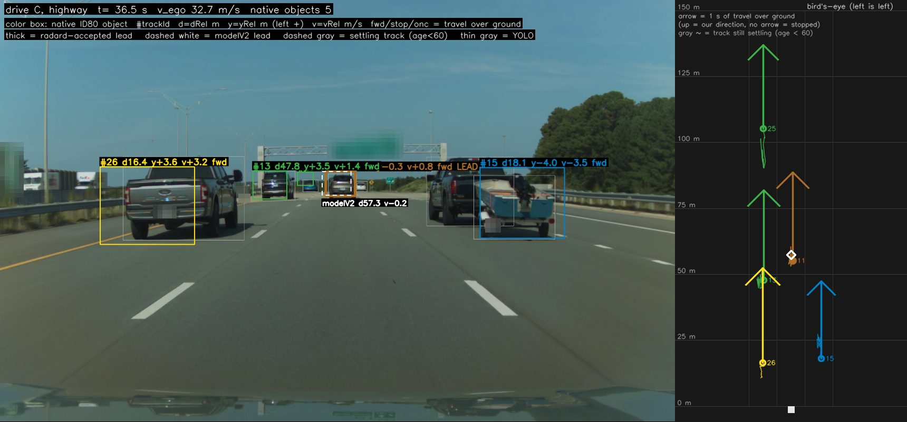
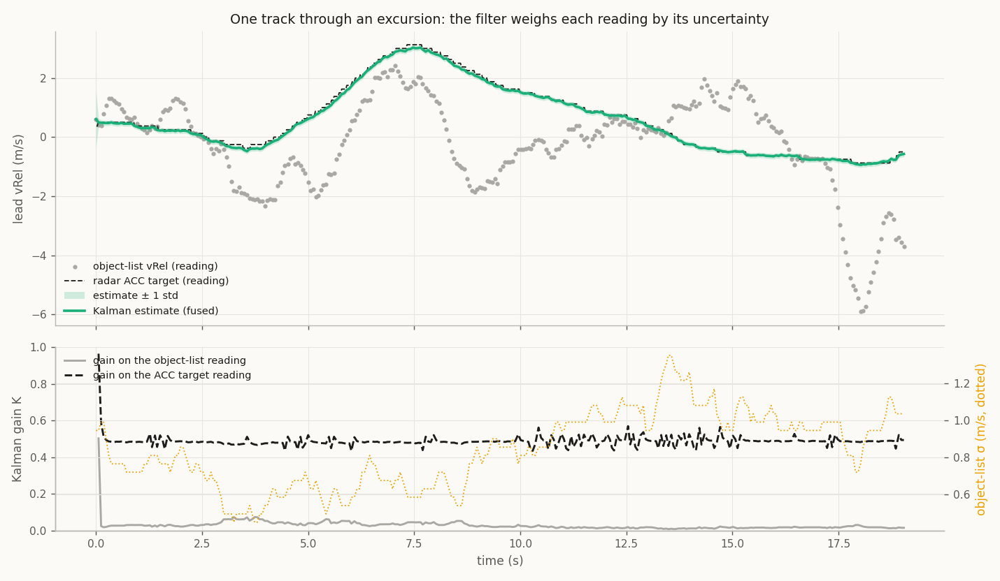
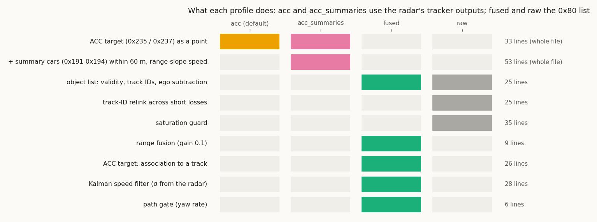
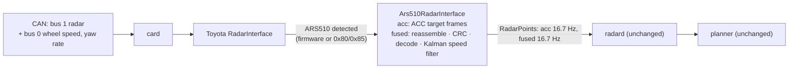

# ARS510 radar for openpilot

openpilot drives the **Toyota RAV4 TSS2 2022 / 2023** (`TOYOTA_RAV4_TSS2_2022` / `_2023`) on camera alone, because the
car's front radar, a **Continental ARS510** (firmware `8821F0R03100` at 0x750 / 0x0f), speaks its own
segmented object-list format, so stock openpilot takes its leads from the camera. This repo decodes that radar and plugs it into openpilot and its forks, so radard gets radar leads with
measured distance and speed. It contains the decoder, an installer, the evidence behind every decoded field, and
replay comparisons against vision only.



*Decoded radar objects projected onto the road camera: each box is one object at its decoded distance and lateral
position, with track ID, distance, lateral offset and relative speed.*

## Try it (testers)

You need a RAV4 2022 / 2023 with the ARS510 radar and a comma device running openpilot or a fork with openpilot's
`opendbc_repo` layout (sunnypilot, StarPilot, CarrotPilot, ...).

```bash
cd /data && git clone https://github.com/ds-sebastian/ars510-radar
python /data/ars510-radar/openpilot/install.py /data/openpilot     # installs the default `acc` profile
sudo reboot                                                          # required: the manager pre-imports the car code
```

1. **Check it took:** `python /data/ars510-radar/openpilot/install.py /data/openpilot --check` should report the hook as
   present and `profile: acc`. On the next drive, leads should be radar-backed (`radarUnavailable` false).
2. **Drive normally.** Press the bookmark (flag) button whenever braking feels wrong, a lead looks stuck, or the car
   brakes late.
3. **Tell us how it went** in a [drive report](https://github.com/ds-sebastian/ars510-radar/issues/new?template=drive_report.yml):
   fork and version, the `--check` output, and the time and description of each flagged moment. Keep route
   IDs, dongle IDs, VINs, GPS and identifying video private; say in the report if you can share logs privately.
4. **Undo or switch at any time:** `install.py /data/openpilot --uninstall` (then reboot) restores the fork exactly;
   `--profile fused` installs the all-tracks Kalman profile, `--profile raw` the unfiltered decode for comparison. Updating the fork resets `/data/openpilot`, so run
   the installer again after an update.

More on installing, the self-check and troubleshooting: [`openpilot/README.md`](openpilot/README.md).
For the routes and controlled captures that help most, see [16: Routes and tests](docs/16_routes_and_tests.md).

## What to expect on the road

From replaying recorded drives through openpilot's unchanged radard and planner, judged against what the driver did and
against a hindsight lead ([11](docs/11_profiles_compared.md)). `acc` (default) and `fused` side by side, vision only
(stock openpilot on this car) as the baseline:

| replay result | vision only | `acc` | `fused` |
|---|---|---|---|
| radar lead share of lead time, 20 held-out routes | 0 % | 84.8 % | 83.1 % |
| first braking request vs vision, mean (95 % CI) | — | −0.04 s (−0.09 … +0.00) | −0.01 s (−0.06 … +0.03) |
| brake presses already answered with ≤ −1 m/s² (167) | 40.1 % | 44.9 % | 44.9 % |
| braking only the radar asked for, per hour | 0 | 0 | 0 |
| unnecessary braking against the hindsight lead, all drives (16.9 moving h) | 89.2 s | 19.2 s | 21.0 s |
| missed braking against the hindsight lead, all drives | 30.8 s | 17.4 s | 16.4 s |
| lead flips between radar and vision, per hour | 0 | 302 | 332 |
| 26 owner routes held out from every replay (2.56 moving h): unnecessary / missed braking | 40.1 s / 9.9 s | 7.7 s / 5.3 s | 11.4 s / 3.6 s |

- **The radar's measured distance reaches radard** for about 83-85 % of the time a lead exists. Beyond 60 m both
  profiles publish only the car the radar's own ACC follows, as Toyota's ACC uses it; other far cars come from the camera.
- **`acc` and `fused` ask for the same braking** on 99.8 % of moving time. `acc` flips between a radar and a vision
  lead less often (−30 per hour, 95 % CI −44 … −16) and publishes a newly seen stationary vehicle at once, where `fused`
  waits 3.6 s ([11](docs/11_profiles_compared.md#why-acc-is-the-default)). `fused` keeps every radar car within 60 m and
  has road drives behind it; `acc` has replays.
- **On some real slowdowns the radar sees the closing first** (curves, far leads); on others vision does.
- **A car closing fast beyond 60 m** reaches the planner through the camera until the radar's ACC picks it, about 1 s
  later than with the object list ([12](docs/12_kalman_filter.md#far-cars-beyond-60-m)).
- **Second car.** Replayed on a second car held out of all tuning (6.19 moving h) both profiles start braking within 0.05 s of
  vision's onset with far less unnecessary braking (vision 56.5 s; `acc` 9.9 s, `fused` 15.5 s;
  [11](docs/11_profiles_compared.md#acc-and-fused-head-to-head)), and the radar's speed noise matches the owner's unit
  ([06](docs/06_accuracy.md#velocity)).
- **On the road** (`fused` 2.1.0: 7.4 h on the owner's car and a second driver's 2025 RAV4 Hybrid) the braking matched
  the replays ([08](docs/08_openpilot_integration.md#on-the-road)).

## `acc` and `fused`

The radar reports a speed-error code per object (`240|7`, ◐) and also sends its own, smoother tracker output for the
car its ACC function follows: the ACC target. The two profiles use these differently.

| | `acc` (default) | `fused` |
|---|---|---|
| publishes | the ACC target as one point | every radar car, one Kalman speed filter per track |
| speed source | the radar's own tracker | object list (σ = 0.045 m/s × `240\|7`) and ACC target (σ = 0.13 m/s) weighted by uncertainty |
| range of the followed car | ACC distance, 0.025 m per code | ACC distance (other tracks: object-list range) |
| gates | the radar's target-present flags | path gate beyond 15 m, 60 cycles of age, speed std ≤ 0.75 m/s, far rule beyond 60 m |
| code | 33 code lines + a three-message, 8-signal DBC | 187 code lines in one openpilot file |
| strength | smallest and closest to Toyota's own ACC; speed and range come from the ACC target alone | every radar car; the filter handles object-list speed excursions |

`fused` runs the filter as:

```text
predict  v⁻ = v,  P⁻ = P + (1.5 m/s² · Δt)²
update   K = P⁻ / (P⁻ + σ²),  v = v⁻ + K · clamp(z − v⁻, ±3√(P⁻ + σ²)),  P = (1 − K) P⁻
σ:       object list 0.045 m/s × 240|7 (× 1.8 for young tracks, tapering to × 1 by age 100) · ACC target 0.13 m/s
```



*During an object-list excursion the object list (grey) dives to −6 m/s; each of its readings moves the estimate by
about 2 %, each ACC target reading by about half, so the estimate (green) stays with the radar's tracker. radard then
runs its usual filter on top.* The object list's speed sometimes drifts into a false closing for 1-10 s at range while the
radar's own ACC distance and the camera hold steady ([07](docs/07_velocity_excursions.md)); `acc` takes its speed from
the ACC target, `fused` from the filter. The followed car is published at the radar's ACC distance, which agrees with the
vision lead and has a per-frame scatter of 0.002-0.035 m against 0.1-2.8 m for the object-list range. Model, constants,
matching and variants tested: [docs/12](docs/12_kalman_filter.md); the two profiles on the same drives:
[docs/11](docs/11_profiles_compared.md).

## Profiles

The code comes in two versions that drive identically:
- **Fork build:** the `ars510/` package, installed by default. It is configurable, has the profiles below, and fills
  the extra point fields sunnypilot still uses.
- **openpilot version:** [`upstream/ars510_radar.py`](upstream/ars510_radar.py), one file of 227 lines (187 code) in
  opendbc style, which is `fused` in one file (a test keeps it equal to `FUSED_CONFIG` point for point);
  [docs/17](docs/17_upstream.md#parts-of-the-openpilot-file) lists what each part costs and buys. The
  `acc` proposal is [`upstream/ars510_acc_target.py`](upstream/ars510_acc_target.py), 50 lines (33 code) with its
  [DBC](upstream/toyota_tss2_ars510.dbc). The fork build also keeps the radar's target summaries and the track-ID
  relink as options; `fused` drives the same with both switched off
  ([docs/12](docs/12_kalman_filter.md#what-the-summaries-do)).

| profile | install | what it does | use it for |
|---|---|---|---|
| **`acc`** (default) | `install.py /data/openpilot` | the radar's ACC target as one point (33 code lines and a DBC; the car Toyota's own ACC follows); every other car from the camera; the upstream proposal | everyday driving ([docs/11](docs/11_profiles_compared.md#why-acc-is-the-default)) |
| `fused` | `--profile fused` | one Kalman speed filter per track that weights the object list and the radar's ACC target by the radar's own uncertainty, and withholds most next-lane cars beyond 15 m | the all-tracks alternative: every radar car within 60 m |
| `raw` | `--profile raw` | the unfiltered radar decode, with the validity rules radard needs | research and comparison: speed excursions reach the planner |
| `openpilot` | `--profile openpilot` | `fused` from the single upstream file; points with `trackId` / `dRel` / `yRel` / `vRel` only | driving exactly what is proposed for openpilot in all-tracks form |



Also tried, set aside: a colored-noise variant of `fused` (`--profile colored`) and two gate-free Kalman models over every object (`shared_speed`, `shared_range`). In replay, `colored` asks for 10 s more unnecessary braking than `fused` over 16.9 moving hours, and the gate-free models brake hard 7-21 times as often ([docs/12](docs/12_kalman_filter.md#kalman-variants-tested), [docs/17](docs/17_upstream.md#the-acc-target-alone--candidate)); the installer keeps them for research.

`anchor` and `steady` (earlier tuned profiles) install `fused`. Each profile against vision only, pros and cons,
assumptions and a comparison with openpilot's other radar interfaces: [docs/11](docs/11_profiles_compared.md) and [docs/17](docs/17_upstream.md#compared-with-the-other-radar-interfaces-in-openpilot). The
filter with replay evidence for every part: [docs/12](docs/12_kalman_filter.md).

## Status

| | state |
|---|---|
| **Object list** (0x80): transport, CRC, 20 slots, track IDs | ● decoded |
| **Distance, lateral position, speed over ground** | ● field layout, range scale, lateral sign, speed over ground; ◐ range zero, lateral and speed scales ([06](docs/06_accuracy.md)) |
| **Object attributes**: lane assignment, class and its confidence, size, heading, lateral speed and acceleration, existence, uncertainties, camera association | ◐ decoded; some physical names and scales ○ ([03](docs/03_slot_fields.md)) |
| **Radar's ACC target** (0x235 / 0x237 / 0x239 / 0x23B, 50 Hz) | ● mapped bit for bit: closing speed 0.125 m/s, relative acceleration 0.125 m/s² and distance 0.025 m per code, class, cycle timestamp; ◐ lateral 0.01 m per code, lateral speed and acceleration, in-path state, width; ◐ sent by the radar itself ([05](docs/05_acc_target_and_support.md)) |
| **Target summaries** (0x190-0x194) | ● 0x192 / 0x194 = position of one internal track in the object list's encoding (range ●, lateral unit ◐); ● 0x190 counts them; ◐ 0x191 / 0x193 carry the class template (car / truck size) ([05](docs/05_acc_target_and_support.md)) |
| **Car-bus target report** (0x366, 5 Hz) | ◐ the ACC target while one exists, plus other states: relative speed 0.5 km/h, distance ≈ 0.8 m, lateral 0.34 m per code ([13](docs/13_car_bus_messages.md)) |
| **Single-object stream** (0x680, 2 Hz) | ● range at 1/32 m; ◐ one tracked object, mostly stationary roadside objects: lateral position and speed, stationary / oncoming / moving flags ([05](docs/05_acc_target_and_support.md)) |
| **Event pair** (0x195 / 0x196) | ● raw payloads; ◐ a short-time-to-collision state ([05](docs/05_acc_target_and_support.md#0x195--0x196-event-pair)) |
| **Metadata cells** (0x85) | ◐ ten lane / road-boundary curves; remaining cell fields raw ([04](docs/04_metadata_record_0x85.md)) |
| **openpilot integration** | installable on openpilot, sunnypilot, StarPilot and CarrotPilot; replayed end to end; driven by the owner on FrogPilot, StarPilot and sunnypilot ([08](docs/08_openpilot_integration.md)) |

● confirmed · ◐ likely · ○ candidate

## Scope and limits

- **One owner's car.** The decode and the 27-drive replays come from one RAV4 2022 with radar firmware `8821F0R03100`; a second
  driver's 2025 RAV4 Hybrid with the same firmware reported similar road numbers ([08](docs/08_openpilot_integration.md#on-the-road)).
  Firmware `8821F0R01100`, also in openpilot's fingerprints, is detected by its bus-1 messages when the radar is
  already running at fingerprinting (a warm restart); one capture from such a car adds it to the firmware list.
- **Far range.** The object list's speed sometimes reads a far car closing several m/s faster than it is, for 1-10 s
  ([07](docs/07_velocity_excursions.md)). The ACC target is present for 99 % of radar-lead time at 15-80 m and 66 %
  beyond 80 m ([08](docs/08_openpilot_integration.md#on-the-road)); beyond 60 m both profiles publish the car the ACC
  target follows, with the camera supplying other far cars.
- **Range and speed.** The object list's range rate and its speed differ by 10-20 %, so `fused` smooths range separately
  from the speed filter ([12](docs/12_kalman_filter.md#what-runs-before-and-around-the-filter)). At 50-100 m the object-list
  range reads 5-8 % short of the radar's own ACC distance, which both profiles publish for the followed car
  ([06](docs/06_accuracy.md#distance)).
- **openpilot longitudinal, checked on one firmware.** openpilot's radar-disable request silences the radar's
  car-bus messages; the object list, ACC target and summaries on bus 1 keep arriving at full rate (an unfiltered
  `8821F0R03100` car through 26 min of alpha long, [01](docs/01_radar_bus.md#openpilots-radar-disable)).
- **AEB under openpilot longitudinal** relies on a radar CAN filter: the radar disable takes the car's AEB with it, and
  stock ACC keeps AEB. A relay of the radar's own decision and the one recording it needs are in
  [15](docs/15_aeb_pcs.md#aeb-on-an-unfiltered-radar-line).
- **Community integration.** It installs on top of openpilot; `acc` is the candidate for an upstream PR
  ([17](docs/17_upstream.md#towards-an-upstream-comma-interface)).

## How it fits into openpilot



The installer adds the decoder package and appends one hook block to the end of Toyota's `interface.py`. The rest of
the fork (card, radard, the planner) runs as shipped.

## Decode in Python

```bash
pip install -e .[dev]    # the decoder itself is pure standard-library Python
pytest
python tools/decode_log.py data/sample/highway_following_30s.csv.gz -o points.csv
```

```python
from ars510 import FUSED_CONFIG, Ars510NativeRadarInterface

radar = Ars510NativeRadarInterface(FUSED_CONFIG)
for t, bus, addr, data in can_frames:            # all buses: bus 1 = radar (incl. 0x235 ACC target), bus 0 = car (0xB4 speed, 0x24 yaw rate)
    out = radar.update_frame(t, bus, addr, data)
    if out:                                       # one per radar cycle (60 ms)
        for p in out["radarData"]["points"]:
            print(p["trackId"], p["dRel"], p["yRel"], p["vRel"])
```

## The core decode

The object list arrives on **bus 1, 0x80** as a 742-byte record split over 106 CAN frames: a header, 20 slots of 36
bytes and a CRC32. Each slot is one little-endian bit field:

| field | bits | decode |
|---|---|---|
| dRel (forward) | `32\|12` | `(code − 160) / 16` m |
| yRel (left +) | `44\|12` | `(code − 2048) × 0.015` m |
| speed over ground | `64\|10` | `(code − 510.5) × 0.15` m/s; vRel = this − ego speed |
| age | `24\|7` | radar cycles; a restart is a new track |
| speed uncertainty | `240\|7` | about 0.043-0.045 m/s per count against the radar's ACC target |
| lane weights (right / left / ego) | `148\|4`, `152\|4`, `156\|4` | 0-15, summing to 15 or 16 |
| class | `163\|3` | 1 new, 2 car, 3 large vehicle, 4 pedestrian, 5 cyclist / person (○), 6 two-wheeler |

Scales and zero points are nominal ([06](docs/06_accuracy.md#encoding-constants-and-motion-geometry)). The driving
profiles multiply ground speed by `0.149 / 0.15` before subtracting Toyota 0xB4 ego speed. Every field:
[docs/03](docs/03_slot_fields.md).

## Documentation

New here? [00 Start here](docs/00_start_here.md) walks from CAN frames to openpilot's planner in pictures, with the key
numbers and a glossary.

| doc | contents |
|---|---|
| [00 Start here](docs/00_start_here.md) | the parser in pictures: nine steps, the numbers that matter, how to read the evidence, glossary |
| [01 Radar bus](docs/01_radar_bus.md) | every message on the radar bus, power-up timeline |
| [02 Object list](docs/02_object_list.md) | 0x80 transport, header, track IDs, an object's life, which objects the radar lists |
| [03 Slot fields](docs/03_slot_fields.md) | every bit of an object: kinematics, lifecycle, lane assignment, class and size, uncertainty |
| [04 Metadata record](docs/04_metadata_record_0x85.md) | 0x85: pairing with 0x80, prefix flags, lane / road-boundary curve cells |
| [05 ACC target and support messages](docs/05_acc_target_and_support.md) | 0x235 / 0x237, target summaries, timing, readiness |
| [06 Accuracy](docs/06_accuracy.md) | distance, lateral, speed and identity against camera and odometry |
| [07 Velocity excursions](docs/07_velocity_excursions.md) | the far-range false-closing issue: what it looks like, how often, what the radar reports about it |
| [08 openpilot integration](docs/08_openpilot_integration.md) | how it hooks in, profiles, what radard does, replay and road results, on-car checks |
| [09 Tools and data](docs/09_tools_and_data.md) | decoding logs, Cabana, replaying drives through openpilot, the dataset, testing on your car |
| [10 Research directions](docs/10_research_directions.md) | open problems and the data that would answer each, ordered by how directly the answer improves the radar in openpilot |
| [11 Profiles compared](docs/11_profiles_compared.md) | `acc` and `fused` head to head and against vision only, which profile for what, driving pros and cons, assumptions |
| [12 Kalman speed filter](docs/12_kalman_filter.md) | the `fused` profile's filter: model, gains, constants and their sources, what each part is worth, variants tested |
| [13 Car-bus messages](docs/13_car_bus_messages.md) | the radar's nine Toyota driving-support messages on bus 0 (ACC command, PCS / AEB, lead distance), CAN filter versus radar disable, what happens to AEB |
| [14 Forks](docs/14_forks.md) | what sunnypilot, FrogPilot and StarPilot do with the radar lead, and what that does with this radar (replays of their own radard and MPC lead code) |
| [15 AEB and PCS](docs/15_aeb_pcs.md) | the recorded stock PCS alarm, AEB on an unfiltered radar line, relaying the radar's decision, open questions, and the professional/passive recording specification |
| [16 Routes and tests](docs/16_routes_and_tests.md) | thirteen capture procedures: ordinary routes, parked diagnostics, physical references, lifecycle/class/lane tests and what to send back |
| [17 Upstream proposals](docs/17_upstream.md) | the `acc` and `fused` opendbc branches, the parts ledger of the openpilot file, the evidence for the ACC target alone, what review will ask, other radar interfaces |

## Repository layout

| path | contents |
|---|---|
| [`ars510/`](ars510) | pure-Python decoder: reassembly, CRC, slot decode, track IDs, the openpilot-shaped interface and its profiles (`FUSED_CONFIG`, `BASE_CONFIG` for `raw`) |
| [`openpilot/`](openpilot) | installer, the RadarInterface wrapper, the on-PC self-check, an optional radard patch |
| [`upstream/`](upstream) | the upstream proposal: `opendbc_ars510.patch` for opendbc master, with its DBC (`toyota_tss2_ars510.dbc`) and the ACC-target interface (`ars510_acc_target.py`); also `ars510_radar.py`, `fused` in one file, tested against the fork configuration on bundled CAN samples |
| [`dbc/`](dbc) | DBCs for inspecting the radar in Cabana (the decoder works from raw frames) |
| [`tools/`](tools) | log decoder, Cabana exporter, openpilot replay harness, figure and statistics scripts |
| [`data/`](data) | three CAN samples, an anonymised analysis dataset (3 drives, 88 min) and the summary JSONs behind every number in the docs |
| [`docs/`](docs) | the documentation above |
| [`tests/`](tests) | decoder, interface, profile and installer tests (`pytest`) |

## Where the evidence comes from

One owner's 2022 RAV4, logged with openpilot: three reference drives (A development, B city, C highway; 88 minutes)
with camera and odometry references; 399 one-minute segments from 24 drives for field statistics; 27 drives replayed
through openpilot against the driver (20 held-out routes with 4.6 h of driver-controlled speed, 4 further drives, 3
owner sunnypilot drives); 8 later drives held back for fresh checks; and closed-loop drives on FrogPilot,
StarPilot and sunnypilot. The repo carries anonymised drives (A/B/C, D1-D4, O#, U#, S#) and decoded values.

## Contributing

Drive reports, code, docs and research results are all welcome, through pull requests: see
[CONTRIBUTING.md](CONTRIBUTING.md) (and [AGENTS.md](AGENTS.md) for AI coding agents). Good first contributions: a drive
report from another car or radar firmware, a CAN excerpt of an interesting moment, or one of the open problems in
[docs/10](docs/10_research_directions.md).

## License

MIT (see [LICENSE](LICENSE)). The DBCs and docs are yours to reuse in opendbc or elsewhere.
