# 00. Start here: the parser in pictures

A guided tour from the radar's CAN frames to openpilot's planner, one figure per step, with the key numbers and a link to
the topic doc that has the detail. Read this first; docs 01-17 are the reference. Terms in **bold** are in the
[glossary](#glossary).

Two install profiles turn the radar into openpilot radar points. The tour shows both side by side:

| | `acc` (default) | `fused` (the all-tracks alternative) |
|---|---|---|
| publishes | the radar's ACC target (0x235 / 0x237) as one point | every settled object-list track, with one Kalman speed filter per track |
| code | 26 code lines (41 in the file) and a 7-signal DBC (plus two rolling counters) | 187 code lines (the single-file openpilot version) |
| other cars | from openpilot's camera match in radard | from the radar up to 60 m, from the camera beyond |
| install | `install.py` | `install.py --profile fused` |

Sections 1-3 describe the object list that `fused` decodes; section 4 describes the ACC target that `acc` publishes and
`fused` also uses; sections 5-8 compare the two.

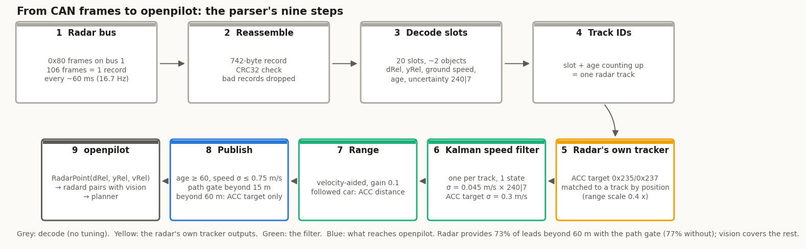

*Steps 1-4 decode the object list; steps 5-9 are the `fused` chain. `acc` reads the ACC target frames of step 5 directly.*

## 1. What the radar sends

The ARS510 sends its object list on the private radar bus (bus 1) as one 742-byte **record** every ~60 ms
(16.7 Hz), split over 106 CAN frames on 0x80 and closed by a CRC32; the parser reassembles it in code. Each record has 20 **slots**; on a highway about 2 hold objects on average (p95 4, up to 7).

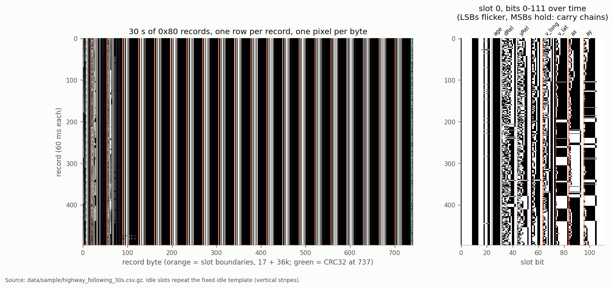

*30 s of records, one row per record, one pixel per byte: occupied slots change every row, idle slots repeat a template.*
More: [02 Object list](02_object_list.md), [01 Radar bus](01_radar_bus.md).

## 2. Objects and tracks

Each slot holds one object: distance (**dRel**), lateral position (**yRel**), speed over ground, an age counter and the
radar's own speed **uncertainty** code `240|7`. The radar keeps an object in its slot while the age counts up, so
slot + age gives a **track**. `fused` publishes a new track after 60 records (~3.6 s), when its range and speed have settled.

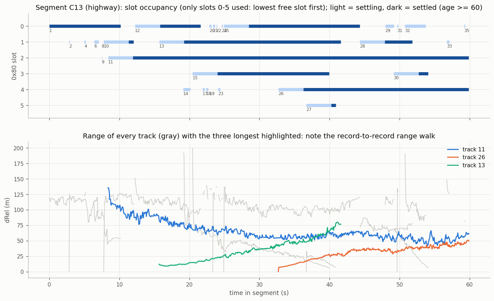

*One highway minute: which slots are occupied (light = settling, dark = settled at age ≥ 60, the tracks `fused` publishes) and every track's range.*
More: [02](02_object_list.md#an-objects-life), [03 Slot fields](03_slot_fields.md).

## 3. How good is each measurement?

Distance and lateral position are steady; speed at range has excursions. On the owner's 2.1 drives (300,000 radar-lead ticks
matched to the camera's lead) the radar lead radard received, which takes the ACC distance for the track matched to
the ACC target, reads 0.5-1.4 m shorter than the camera up to 90 m, with a spread that grows
from 0.6 m to 4-6 m at range (`road_v21.json`).

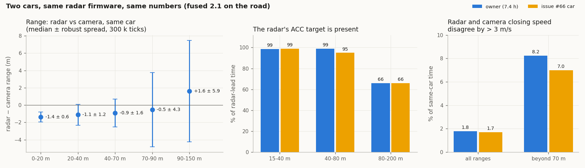

*Left: published radar lead minus camera range on the owner's car (median ± robust spread). Middle and right: ACC target presence
and radar-camera closing-speed disagreement (> 3 m/s) on the owner's car and a second driver's 2025 RAV4 Hybrid
([issue #66](https://github.com/ds-sebastian/ars510-radar/issues/66)), which give similar numbers.* More: [06 Accuracy](06_accuracy.md).

The object list's speed has **excursions**: for 1-10 s a far car seems to close fast while the radar's ACC distance and the camera hold steady.
80-87 % of them are false closings. They are rare close in and common far out: on the owner's first closed-loop drives
(0.31 h of radar lead) radar and vision differ by ≥ 2 m/s for 1 % of radar-lead time at 0-20 m and 49 % beyond 80 m
(`jitter_problem_figures.json`). The radar's uncertainty code grows with the width of the speed error at that range and age, and
`fused` weights the object-list speed by it.

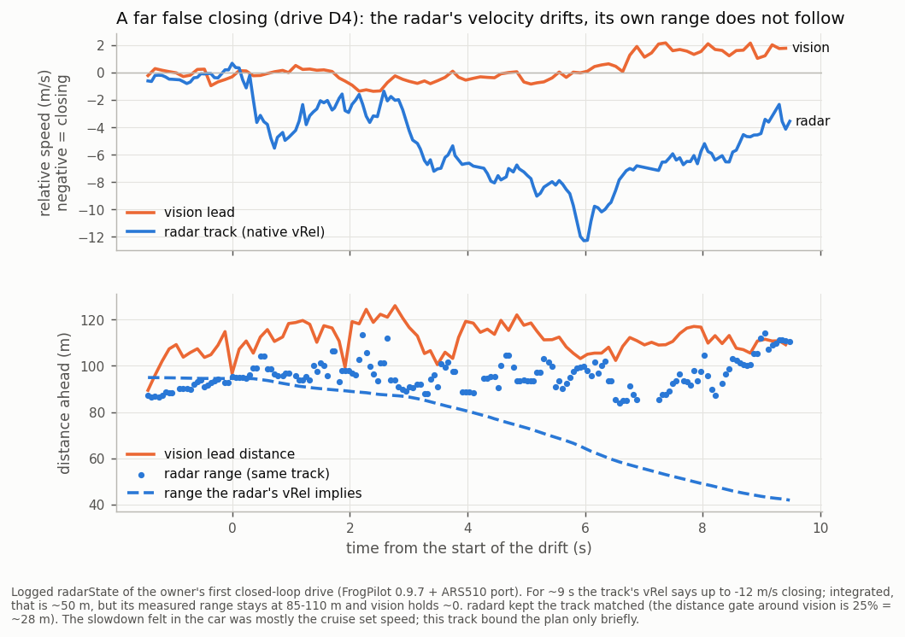

*vRel drifts to −12 m/s over ~9 s while the range stays at 84-114 m and vision holds steady (drive D4, `jitter_problem_figures.json`).* More:
[07 Velocity excursions](07_velocity_excursions.md).

## 4. The radar's own tracker: the ACC target

Besides the object list, the radar publishes the car its own ACC function follows, the **ACC target**
(0x235 / 0x237), with a smooth 0.025 m distance and a speed that stays steady through the object list's excursions. It is
present for 99 % of the radar-lead time at 15-80 m and 66 % beyond 80 m (`road_v21.json`, owner's car; second car 99 / 95 / 66 %
at 15-40 / 40-80 / 80-200 m).

- `acc` publishes this target as its one radar point; the radar's target ID is the track ID.
- `fused` matches the target to an object-list track by position. That track takes the ACC speed as an extra reading and
  the ACC distance as its range.

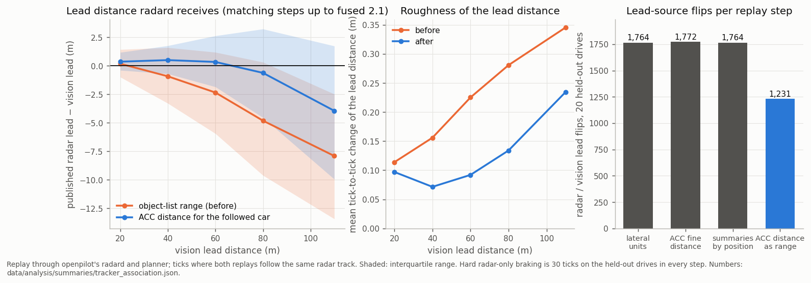

More: [05 ACC target](05_acc_target_and_support.md), [12](12_kalman_filter.md#matching-the-radars-trackers-to-tracks).

## 5. Two profiles: `acc` and the `fused` Kalman filter

**`acc`** publishes the radar's tracker output as sent: the tracker has already chosen, converged and filtered the one car Toyota's ACC follows.
Its speed follows the slope of its own distance (best lag −0.06 s, gain 1.00; `acc_target_parser.json`), so the point goes to
openpilot unfiltered. Every other car reaches the planner through the camera.

**`fused`** keeps the whole object list and estimates each car's speed over ground with one small Kalman filter per track.
Each reading is weighted by its own uncertainty: the object list by 0.045 m/s × `240|7`, the ACC target by 0.13 m/s. A reading the
radar itself calls uncertain moves the estimate only a little, so excursions are absorbed while real slowdowns, which the
ACC target confirms, come through.

*During an excursion the object list (grey) dives to −6 m/s; each object-list reading moves the estimate by about 2 %, each ACC target reading by about 49 % (bundled sample E, current `fused`).*
More: [12 Kalman speed filter](12_kalman_filter.md).

## 6. Choosing which tracks openpilot sees

openpilot's radard picks the radar track that best matches the camera's lead in distance, lateral position and speed,
each weighted by the camera's uncertainty, then checks only distance and speed. With `acc` the one ACC target point is
the only candidate, so the camera's lead decides every other car. With `fused` the gates below choose among all tracks:

- Beyond 15 m, a track more than 2.5 m from the path the car is driving (predicted from yaw rate and speed) is withheld; closer in,
  cars moving into the lane stay visible. Far out the camera's lateral uncertainty is wide, so this gate keeps a car in the next lane
  from becoming the lead.
- Within 15 m, stationary tracks (under 0.5 m/s) are gated to 1.5 m of the path.
- Beyond 60 m only the track matched to the ACC target is published.
- The track matched to the ACC target is exempt from all three gates.

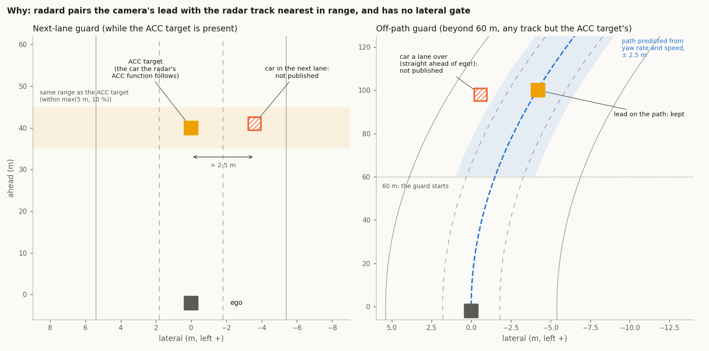

What that changes on the road, replayed through openpilot's planner:

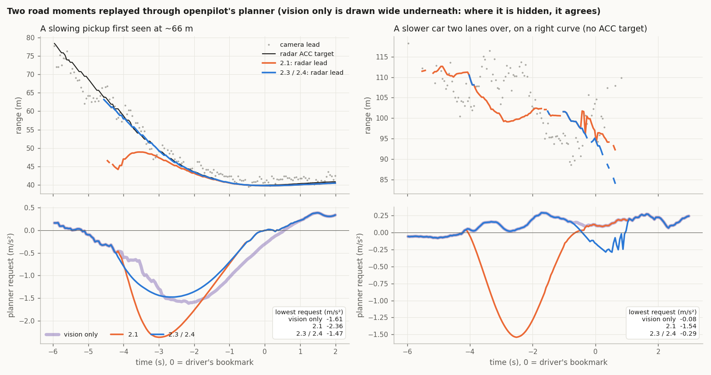

*Left: a pickup first detected at 66 m read 15-20 m short in the object list; `fused` 2.3 matches it to the ACC
target and asks for −1.47 m/s² instead of 2.1's −2.36 (vision −1.61). Right: on a curve, radard paired the camera's lead
with a car a lane over whose radar speed read a false −7 m/s, while the real lead, slowing to turn off, closed at about
−3 m/s; 2.1 asked for −1.54 m/s², 2.3 for −0.29 (vision −0.08). 2.4 asks the same as 2.3 in both
moments ([`lead_choice_guards.json`](../data/analysis/summaries/lead_choice_guards.json)); across 23 bookmarked road moments
2.5's requests stay within 0.06 m/s² of 2.4's ([`acc_weight.json`](../data/analysis/summaries/acc_weight.json)).* More:
[12](12_kalman_filter.md#path-gate).

## 7. What each part of `fused` is worth

Every part was removed on its own and in combination, then replayed on 27 drives. Every hard brake was judged
against the radar's raw range, the camera and the driver. Each part kept earns its place: removing it adds unjustified
braking or destabilises the lead; the ego-speed alignment is braking-neutral (onset +12 ms) and adds 0 code lines.

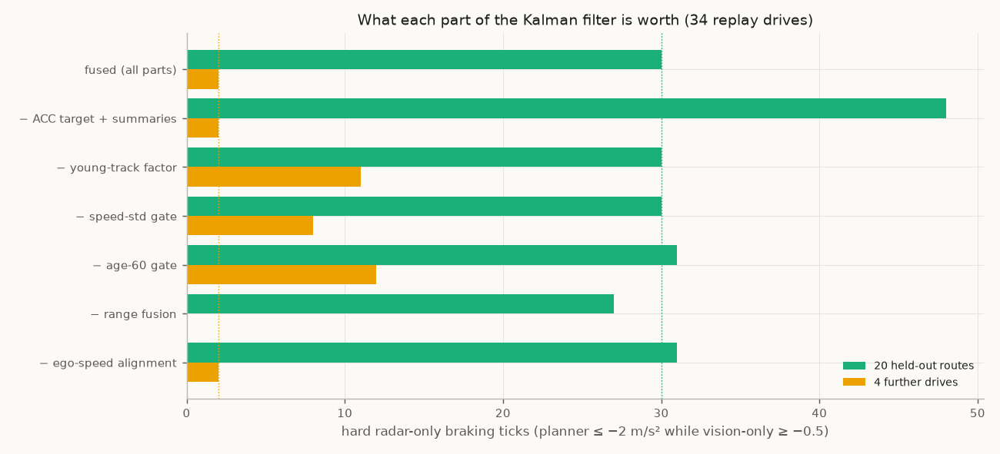

The single-file openpilot version carries the same parts; this is what each of its lines buys and which ones an
upstream PR could drop:

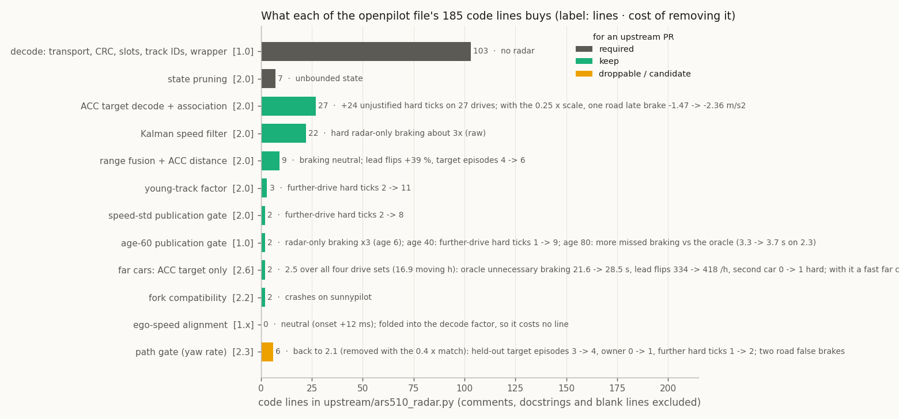

`acc` is the other end of the scale: 26 code lines, one constant, the radar's target-present flags as its only gate. Each of `fused`'s parts rebuilds a piece of the
decision the radar's tracker has already made ([17](17_upstream.md#the-acc-target-alone--candidate)).
More: [12](12_kalman_filter.md#what-each-part-is-worth), [17](17_upstream.md#parts-of-the-openpilot-file).

## 8. The result against vision only

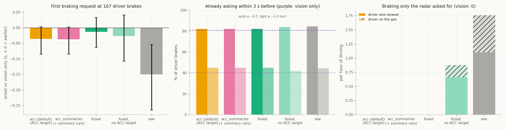

Against openpilot with vision only, both profiles start braking within 0.04 s of the camera's first request on average
(`fused` −0.01 s, `acc` −0.04 s), ask for ≤ −1 m/s² before the same 44.9 % of driver brakes (vision only 40.1 %), and ask
for ≤ −1 m/s² braking only where vision only asks for it too (0 radar-only braking per hour; `raw`: 1.75). Table
([`profiles_vs_vision.json`](../data/analysis/summaries/profiles_vs_vision.json), 20 held-out drives, 4.56 h with the driver
controlling speed):

| | vision only | `raw` | `fused` | `acc` |
|---|---|---|---|---|
| first request ≤ −0.5 m/s², mean vs vision (95 % CI) | — | −0.15 s (−0.26 … −0.05) | −0.01 s (−0.06 … +0.03) | −0.04 s (−0.09 … +0.00) |
| already asking ≤ −1 m/s² around the driver's brake | 40.1 % | 44.3 % | 44.9 % | 44.9 % |
| braking only the radar asked for, per hour | 0 | 1.75 | 0 | 0 |
| hard radar-only ticks (while moving) | 0 | 93 | 16 (16) | 66 (14) |
| share of lead time on a radar lead | 0 | 86.6 % | 83.1 % | 84.8 % |
| flips between a radar and a vision lead, per hour | 0 | 939 | 347 | 318 |

`acc`'s extra hard ticks are holds at standstill (52 of 66): a stopped car 0.7-4.8 m behind an object the radar sees
and the camera leaves out of its lead (a wall, a fence), where radard's low-speed rule holds it stopped.

Vision only has its own errors, so a second reference helps. openpilot's own planner fed a hindsight lead (the
radar's ACC target and smoothed range, checked with the camera) gives the seconds of unnecessary and missed braking
below. Its reference range comes mostly from the ACC target, which favours designs built on that target; hard ticks and onset are judged against the raw range, the camera and the driver.

| unnecessary / missed braking, seconds (set) | vision only | `fused` | `acc` | source |
|---|---|---|---|---|
| owner road drives and a second car's two drives (7.65 h) | 10.2 / 10.3 | 3.3 / 8.2 | 6.0 / 10.8 | `oracle_reference.json` |
| 27 replay drives (6.72 h) | 31.9 / 10.0 | 2.2 / 3.1 | 3.3 / 2.5 | `oracle_reference.json` |
| every drive set incl. the second car's 8.8 h (16.9 moving h) | 89.2 / 30.8 | 21.0 / 16.4 | 19.2 / 17.4 | `acc_target_parser.json` |

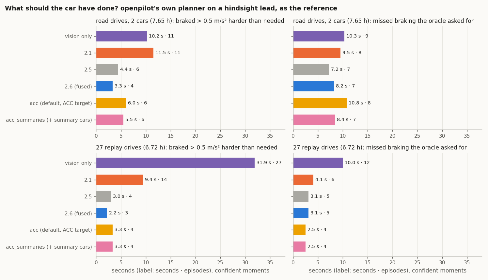

More: [11 Profiles compared](11_profiles_compared.md), [08](08_openpilot_integration.md#on-the-road), [12](12_kalman_filter.md#against-what-the-car-should-have-done).

## By the numbers

| | value | source |
|---|---|---|
| object list | 16.7 Hz, 20 slots, ~2 objects per record on a highway (p95 4) | `stats.json` |
| published radar lead − camera range, 20-70 m (`fused` 2.1, owner's car) | −1.1 / −0.9 m median, spread 1.2-1.6 m | `road_v21.json` |
| ACC target present (lead 15-40 / 40-80 / 80-200 m) | 99 / 99 / 66 % | `road_v21.json` |
| owner road drives with `fused` 2.1 (5.8 moving h, replayed) | 0 hard radar-only episodes; braking starts 0.4-1.2 s before vision (the recorded motion was driven under `fused`, which favours it) | `road_v21.json` |
| code size | `acc` 26 code lines + 7-signal DBC; `fused` 187 code lines | `acc_target_parser.json`, `openpilot_file_parts.json` |
| every drive set (16.9 moving h, 62 routes): requests differing by > 0.3 m/s² | `acc` vs `fused` on 0.21 % of moving time | `acc_target_parser.json` |
| lead flips per moving hour, every drive set | `fused` 332, `acc` 302 | `acc_target_parser.json` |

## How to read the evidence

- **Replay of recorded drives.** Recorded drives run through openpilot's own card → radard → planner, once with vision
  only and once with the radar ([09](09_tools_and_data.md)). The car's motion stays as recorded (open loop), so a
  replay shows what openpilot would have *asked for*.
- **The 27 drives.** 20 held-out drives, 4 further drives and 3 owner sunnypilot drives. Limits for a change are
  written down before it is replayed, and a change is tuned on other drives than the one that motivated it.
- **Judging a brake.** A radar-only brake is checked against references taken from outside the radar's speed: its raw
  range, the camera, and whether the driver slowed too ([12](12_kalman_filter.md#what-each-part-is-worth)).
- **Confidence marks.** ● confirmed, ◐ likely, ○ candidate, used throughout the topic docs.

## Glossary

| term | meaning |
|---|---|
| **record** | one complete object-list message: 742 bytes over 106 CAN frames on 0x80, ~16.7 per second |
| **slot** | one of the record's 20 fixed places for an object |
| **track** | one object followed over time (slot + age counting up); openpilot's `trackId` |
| **dRel / yRel / vRel** | distance ahead, lateral position (left positive), relative speed (negative = closing) |
| **uncertainty `240\|7`** | the radar's own speed-error code per object; `fused` weights the speed by it |
| **excursion** | a 1-10 s stretch where the object list's speed is wrong, mostly a false closing on a far car |
| **ACC target** | the car the radar's own ACC function follows (0x235 / 0x237): smooth distance and speed |
| **summaries** | the radar's selected-target ranges (0x192 / 0x194), a second tracker output; a fork option, off in `fused` and `acc` |
| **radard** | openpilot's process that turns radar points and the camera's lead into the lead the planner follows |
| **hard radar-only tick** | a 20 Hz tick where the radar planner asks for ≤ −2 m/s² while vision only asks for ≥ −0.5 |
| **target episode** | the radar planner asks for ≤ −1 m/s² while vision only asks for ≥ −0.3, for ≥ 0.3 s while moving |
| **onset** | when braking starts with the radar compared with vision only (negative = earlier) |
| **anticipation** | share of driver brake presses the planner was already braking for at ≤ −1 m/s² |
| **`acc` / `fused` / `openpilot` / `raw`** | the default profile (the radar's ACC target alone) / the all-tracks Kalman profile / its single-file version / the unfiltered decode |

Figures: `tools/make_guide_figures.py` (guide_*.png), `tools/make_fused_figures.py`, `tools/make_analysis_figures.py`,
`tools/make_jitter_figures.py` (jitter_*.png).
