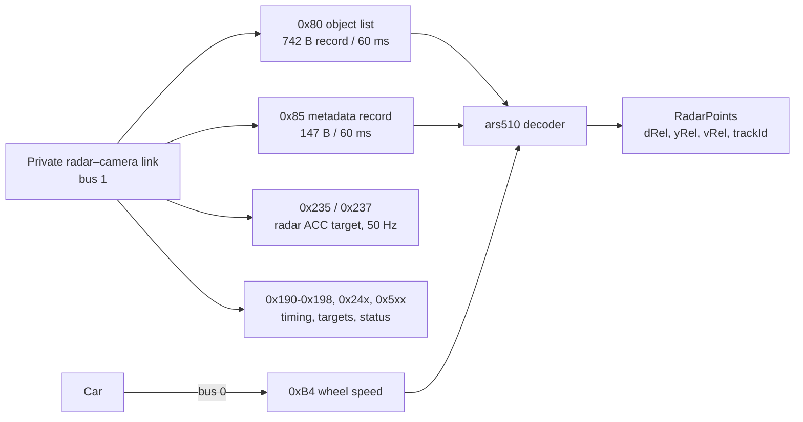

# 01. The radar bus

The ARS510 talks to the camera over a private CAN link, which the comma harness exposes as **bus 1** (`src == 1` in openpilot logs).
The radar runs a **60 ms cycle (16.7 Hz)**. The `raw` and `fused` decodes take ego speed from the car bus (bus 0, Toyota `SPEED` 0xB4);
the `acc` profile reads the radar's ACC target (0x235 / 0x237), which carries its own closing speed.

Other TSS2 Toyotas send fixed-layout radar tracks, described by opendbc's `toyota_tss2_adas.dbc`. The ARS510's object list is the
segmented record on 0x80, and 0x191-0x194 carry two target summaries from the radar's internal tracker
([05](05_acc_target_and_support.md#0x191-0x194-selected-target-summaries)).

## Message map

| addr | DLC | rate | content | doc |
|---|---|---|---|---|
| **0x80** | 8 | 106 frames / 60 ms | **object list**: 742-byte record, 20 object slots × 36 bytes + CRC32 | [02](02_object_list.md), [03](03_slot_fields.md) |
| 0x81 | 8 | 16.7 Hz | record-cycle marker `30 00 …` after each 0x80 record start | |
| **0x85** | 8 | 21 frames / 60 ms | metadata record: 147 bytes, ten 12-byte cells (lane / road-boundary curves: offset, heading, curvature) + CRC32 | [04](04_metadata_record_0x85.md) |
| 0x86 | 8 | 16.7 Hz | record-cycle marker for 0x85 | |
| 0x100-0x103 | 7/6/3/2 | 10 Hz | startup state: 0x101 goes 0x1D → 0x11 when the radar is running; 0x100 byte 0 = 0x02 during a PCS alarm ([13](15_aeb_pcs.md#a-recorded-stock-pcs-alarm-u3)) | [05](05_acc_target_and_support.md#startup-and-readiness) |
| 0x180 | 5 | 16.7 Hz | constant `CF C0 00 00 00` | |
| 0x190 | 7 | 16.7 Hz | cycle header: number of target summaries, µs timestamp and a mod-16 cycle counter | [05](05_acc_target_and_support.md#0x190-cycle-header) |
| 0x191 / 0x193 | 8 | 16.7 Hz | selected-target companions: score, age, track code, class template (width, height, length) | [05](05_acc_target_and_support.md#0x191-0x194-selected-target-summaries) |
| 0x192 / 0x194 | 4 | 16.7 Hz | target summaries: distance and lateral position of one internal-tracker target each | [05](05_acc_target_and_support.md#0x191-0x194-selected-target-summaries) |
| 0x195 / 0x196 | 8 | 16.7 Hz | paired event frames; exact idle payloads in 99.67% of recorded frames | [05](05_acc_target_and_support.md#0x195--0x196-event-pair) |
| 0x197 / 0x198 | 2 / 1 | 16.7 Hz | 0x197 bit 8 = radar running; 0x198 constant `10` | |
| 0x202 | 5 | 16.7 Hz | counter + check byte | |
| 0x210 | 7 | 5 Hz | copy of Toyota road-sign-assist data | |
| **0x235 / 0x237** | 8 | 50 Hz | **radar ACC target** (fields ●, sender the radar ◐): closing speed, relative acceleration, distance, lateral position and speed, target ID, in-path state | [05](05_acc_target_and_support.md#the-radars-acc-target-0x235--0x237) |
| 0x239 / 0x23B / 0x23D | 8/3/8 | 50 Hz | ACC target companions: 0x239 = class, object-list flag, µs timestamp; 0x23B = width in cm + counter + CRC-8; 0x23D all zero | [05](05_acc_target_and_support.md#class-width-and-timestamp-0x239--0x23b) |
| 0x240 / 0x241 / 0x244 / 0x245 / 0x248 | 8 | 16.7 Hz | camera-sent context frames with a rolling phase 1-7; 0x240/0x244 carry light-source records at night | [05](05_acc_target_and_support.md#0x240-0x248-context-frames) |
| 0x24D / 0x24F | 7 / 1 | 1 Hz / 33 Hz | state frame; 0x24F bit 6 = radar running | |
| 0x500 / 0x501 / 0x502 | 6/7/8 | slow | unit-specific constants (redacted in the DBC), status nibble, two slowly drifting codes | |
| 0x680 | 8 | 2 Hz | one tracked object: distance, lateral position, over-ground speed; mostly a stationary roadside object | [05](05_acc_target_and_support.md#0x680-single-object-stream) |

Two clocks run on the link (◐, [`acc_sender_clock.json`](../data/analysis/summaries/acc_sender_clock.json), four drives): the **radar's**
carries 0x100, 0x103, 0x190-0x196, 0x198, 0x202, 0x24F, 0x680 and the ACC target 0x235 / 0x237; the **camera's** carries 0x101, 0x102, 0x180,
0x197, 0x210, 0x240-0x248, 0x24D, 0x500 and 0x501.

Every frame above is in [`dbc/ars510_radar_bus.dbc`](../dbc/ars510_radar_bus.dbc) with a one-line comment per signal.

## Power-up

| time after the first CAN frame | event |
|---|---|
| 0.2 s (median 0.23 s, 0.15-0.46 s on 26 of 27 cold starts) | 0x235 / 0x237 (ACC target frames), 0x191 target summaries and 0x680 frames start |
| 0.8 s (median; 0.65-1.3 s on 24 of 27) | 0x680 reports its first tracked object |
| 3.3-4.2 s (14 cold starts, current openpilot) | openpilot's fingerprinting is done and it starts transmitting |
| **5.83-6.12 s** | **0x80 / 0x85 object records start** (27 cold starts, [`object_stream_0x680.json`](../data/analysis/summaries/object_stream_0x680.json)) |

Start-up times: `object_stream_0x680.json` (object records, 0x101 / 0x197) and `decode_claim_sources.json` (0x235 / 0x680 / sendcan, recomputed from the research captures).

- The object list starts after openpilot's fingerprinting has finished, so the openpilot integration selects the
  radar by the car model, the radar-ACC RAV4 2022 and 2023-25 platforms ([08](08_openpilot_integration.md),
  [radar firmware](#radar-firmware)).
- 0x101 switches 0x1D → 0x11 0.14 s after the first 0x80 record (spread 7 ms) and 0x197 bit 8 sets 60 ms later (0.20 s, spread 14 ms) on
  27 of 27 cold starts: both behave as the camera's acknowledgement of the object list (◐) and serve as "radar running" signals.
- 0x680 reports tracked objects 5 s before the object list starts.
- 0x100 sends `FFFF…` in its first frame ([DBC](../dbc/ars510_radar_bus.dbc)).
- Age-1 placeholder objects at 0 m (the initialization template, [03](03_slot_fields.md#class-and-size)) are marked `geometry_valid = False`, and the decoder withholds them.

## openpilot's radar disable

On the RAV4 2022 / 2023 the radar itself sends the car's ACC command: opendbc marks the platform `RADAR_ACC`, so openpilot
longitudinal (alpha long) switches the radar's car-bus output off with UDS CommunicationControl `28 01 01` (receive
on, transmit off) to 0x750 / 0x0F, then keeps it off with tester-present `3E 00` every ~0.2 s. That request switches off bus 0
only; **bus 1 keeps running unchanged** (●, one drive with the radar line unfiltered, firmware `8821F0R03100`;
[`radar_disable_unfiltered.json`](../data/analysis/summaries/radar_disable_unfiltered.json)):

| | before the request | after (26 min, openpilot longitudinal engaged 8 min) |
|---|---|---|
| radar's response | | `68 01` (positive) 20 ms later |
| bus 0 from the radar: 0x283, 0x343 (33 Hz), 0x344 (20 Hz), 0x33E, 0x365, 0x366 (5 Hz), 0x411, 0x494, 0x4FF (~1 Hz) | sent | silent |
| bus 1: all 36 addresses, 0x80 / 0x85 records, ACC target 0x235 / 0x237 | sent | sent at full rate; 25,849 records, 0 CRC failures |
| 0x101 / 0x197 / 0x24F running flags | running | running |

So on this firmware the decoder works with the radar line unfiltered: the object list, the ACC target and the target summaries all
continue through openpilot's radar disable, which makes it compatible with both the `acc` and the `fused` profile. The car-bus messages it switches
off, including the radar's PCS / AEB brake request, are described in [13](13_car_bus_messages.md).

## Ego speed

The object-list velocities are **over ground**, so the `raw` and `fused` profiles subtract ego speed. Toyota 0xB4 reads about 1-1.5% below
GPS and wheel speed; those profiles read the radar speed at 0.149 m/s per code (`vground_scale = 0.149 / 0.15` on the nominal 0.15)
and subtract 0xB4 speed ([06](06_accuracy.md#velocity)). The `acc` profile publishes the ACC target's closing speed (0.125 m/s per code,
[05](05_acc_target_and_support.md#units-of-the-acc-target)), which is already relative to the car.

## Radar firmware

openpilot's fingerprints list two radar firmwares for the radar-ACC RAV4 (fwdRadar at 0x750 / 0x0f): `8821F0R01100`
(the original 2022 ports, RAV4 Hybrid 2022 and RAV4 2022) and `8821F0R03100` (the 2023-25 platform; also the owner's car,
which fingerprints as 2022). Both are the ARS510 and send the same bus (●, [`rav4_radar_firmware.json`](../data/analysis/summaries/rav4_radar_firmware.json)):

| | `8821F0R01100` (opendbc's 2022 test routes, Hybrid / ICE, 1 min each) | `8821F0R03100` (owner's car) |
|---|---|---|
| bus-1 addresses | 36 / 36 | the same set |
| 0x80 / 0x85 records | 995 CRC-valid records per minute (16.6 / s), 0x85 with each | 16.7 / s |
| 0x235 / 0x237 / 0x239 | 3,000 frames per minute each (50 Hz), counter steps of 1 on every frame | 50 Hz, counter steps of 1 |
| radar cycle clock (0x239) | 15.4 / 15.8 changes per s | 16.5 per s |
| ACC target state | 5 (target) on 68 % of the Hybrid minute; 1 (no target) on the whole ICE minute | 5 / 1 / 15 (start-up) |
| `acc` interface | 15.5 / 15.8 reports per s; all 627 points equal the reference decoder | 17.0 reports per s; all 1,018 points equal |
| `fused` object list | 783 points published on the Hybrid minute | the replay drives |

The integration therefore selects the parser by the car model: both firmwares carry the same messages, and the cycle
clock stays inside radard's 8-24 Hz window on both.
