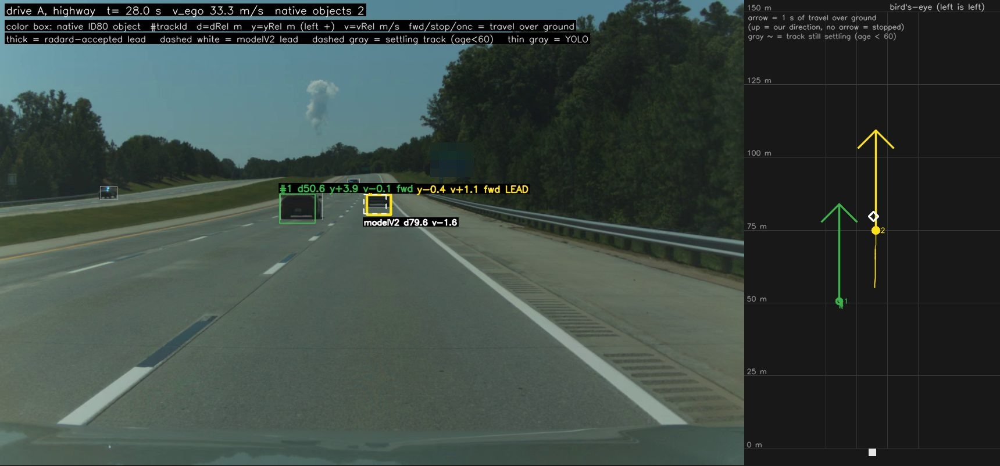
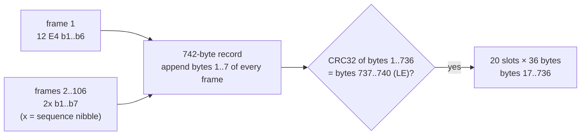
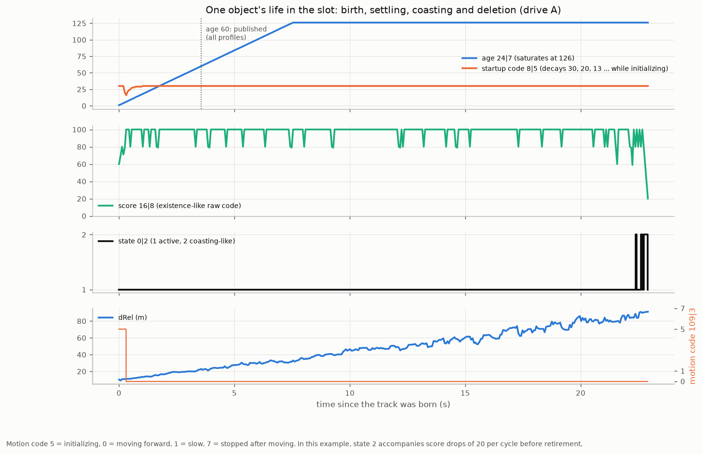
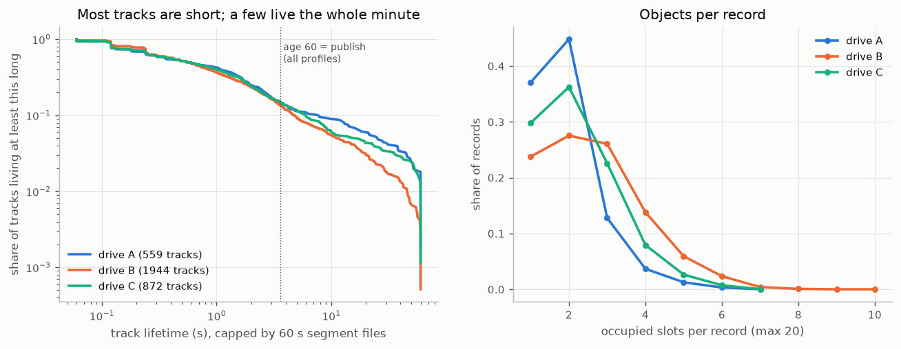
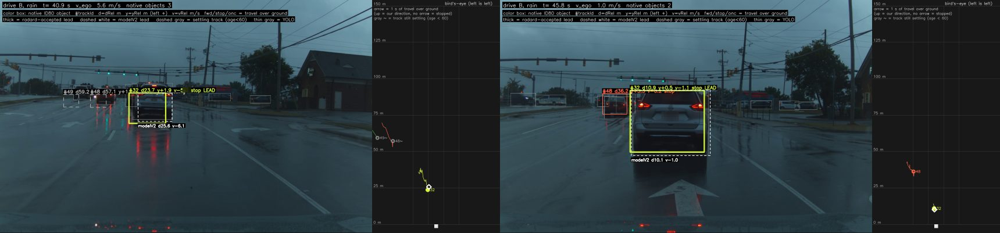
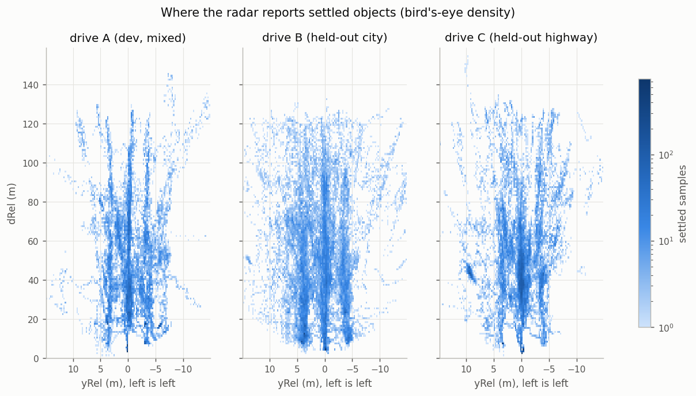
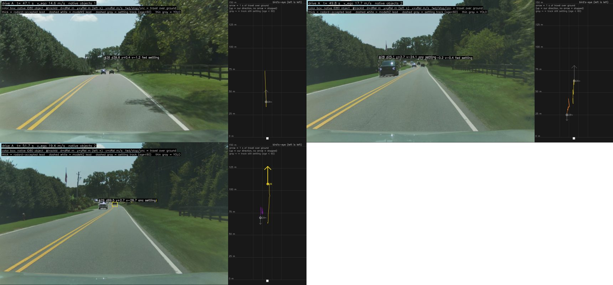
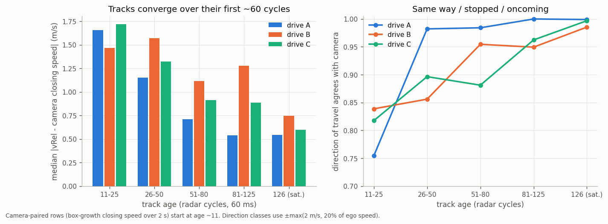

# 02. The object list (0x80)

The radar sends its object list once per 60 ms cycle as one **742-byte record** split over **106 frames** on
bus 1, address 0x80. It holds a 16-byte header, **20 object slots** of 36 bytes, and a CRC32.

## Reading the camera overlays



The route shots in these docs project decoded objects onto the road camera using only the log's own calibration and
openpilot's camera intrinsics. Coloured box = one 0x80 object (1.8 × 1.5 m at its dRel / yRel); label = `#trackId`,
dRel, yRel, vRel and direction over ground (`fwd` / `stop` / `onc`); **thick** outline = the lead radard accepts;
dashed white = the vision lead; dashed gray = a track still settling (age < 60). Right: bird's-eye view, each arrow
1 s of travel over ground.

## Transport



- **First frame:** bytes 0-1 are `12 E4`, an ISO-TP first frame of length 0x2E4.
- **Following frames:** byte 0 is `2x`, where x is a sequence nibble that wraps every 16 frames.
- **Reassembly:** append bytes 1..7 of every frame, the first included, until 106 frames have arrived. Record byte 0 is `E4`.
- **CRC (●):** `zlib.crc32(record[1:737])`, stored little-endian at `record[737:741]`. The CRC passes on all 1,309 bundled records
  ([`header_allocation_count.json`](../data/analysis/summaries/header_allocation_count.json), `python tools/check_structure.py`) and on all 25,849 records of the
  26-minute unfiltered drive ([`radar_disable_unfiltered.json`](../data/analysis/summaries/radar_disable_unfiltered.json)).
- `ars510/transport.py` reassembles records in 78 lines. The sequence nibble wraps every 16 frames, so a frame's place in
  the record comes from counting frames since the first.


*Left: 30 s of the bundled highway drive, one row per record, one pixel per byte (orange = slot boundaries, green = CRC32). Unused slots
repeat the idle template (vertical stripes). Right: one slot's bits 0-111 over time: low bits flicker, high bits hold. Carry
chains mark the field boundaries.*

| record bytes | content |
|---|---|
| 0 | `E4` (length low byte) |
| 1-16 | header |
| 17-736 | 20 object slots × 36 bytes |
| 737-740 | CRC32, little-endian |
| 741 | trailing byte |

An unoccupied slot holds exactly this idle template:

```
FCE00000A0F07F00FFFDF71FFFA100F807000F0008000000000000000000000000000000
```

## Header

| field | read as | meaning | conf. |
|---|---|---|---|
| clock code | record bytes 1-4, little-endian | equals the 0x85 fine clock `// 100` in the same cycle | ● |
| record counter | `int.from_bytes(record[5:7], "little") >> 1` | equals the 0x85 counter in the same cycle | ● |
| timing offset | record bits 104-114 (bytes 13-14) | follows the record's arrival-time offset at 0.9-1.0 ms per count (record-to-record change r 0.98-0.99 on the three bundled drives, [`header_timing_offset.json`](../data/analysis/summaries/header_timing_offset.json)) | ◐ |
| allocation count | `record[14] >> 3` | number of allocated slots: those whose index field equals their position, which are the slots with age ≥ 1; exact on all 1,309 bundled records ([`header_allocation_count.json`](../data/analysis/summaries/header_allocation_count.json)) | ● |
| sequence counter | `record[8] >> 4` (low nibble 0) | a second 4-bit counter, +1 per record; its offset to the record counter is fixed within a drive segment (three cars) | ● |
| constants | byte 0 = 0xE4; bytes 9-11 = 0xFF; bytes 7, 12, 15, 16 = 0x00 | unchanged on every record of 100 segments and of 49 logs from a third car | ● |

Pairing 0x80 and 0x85 by clock and counter gives one 0x85 record per 0x80 record (99.97% of 0x80 records paired, each pair unique,
[`prefix_alignment.json`](../data/analysis/summaries/prefix_alignment.json)); pairing by arrival time picks the neighbouring cycle 31-37% of the
time. Pair by counter.

## Slots and track IDs

Each slot is one object. The radar fills the **lowest free slot first**: on the three bundled drives (A-C) it used at most
10 of the 20 slots, and 94-99% of each drive's samples sit in slots 0-4. An object keeps its slot for its whole life, and the slot's
**age** field (`24|7`) counts its radar cycles.

The decoder builds `trackId` from **slot + continuous age run** (`ars510/tracks.py`):
- age restarts (usually through 0) → new ID;
- a slot quiet for more than 0.3 s → new ID;
- a new occupant of a reused slot gets a new ID, and each ID lives in one slot.

The `raw` profile (`BASE_CONFIG`) also re-links an ID when the radar re-initialises a car it lost for up to 3.5 s near
its predicted position, so radard keeps its per-track filter. `fused` leaves the relink off: on 27 drives its replays give the same braking
counts, with 1,770 lead switches with the relink off and 1,772 with it on ([12](12_kalman_filter.md#what-runs-before-and-around-the-filter)).
The `acc` profile uses the radar's own target ID.


*One highway minute: slot occupancy (light = settling, dark = published) and every track's range.*

## An object's life



A slot's life, as the fields show it ([03](03_slot_fields.md) has every field):

1. **Birth.** Age 1, motion code 5 (initializing), class 1 (new). The startup code `8|5` counts down
   30, 30, 30, 30, 20, 13, 9, 6, 4, 2, 1, 1, 0 while the motion code stays 5.
2. **Settling.** Range and velocity converge over the first ~60 cycles (3.6 s). `raw` and `fused` publish from age 60; `acc` publishes
   the target the radar's tracker selects.
3. **Tracked.** Age saturates at 126. State `0|2` is commonly 1 (update-like); the score `16|8` commonly sits at
   100 and can decline.
4. **Coasting candidate.** State 2 is prediction-like: the score drops by exactly 20 or 1 per cycle (20 on about three quarters).
5. **Deletion.** The allocation can return to state 1, with score recovery in some cases, or be freed near score 20:
   age can go to 0 for one cycle with the previous geometry, or the slot returns directly to the idle template.



## What the radar lists

The object list behaves like an ACC list (◐): it lists **moving objects** and objects it saw moving.

- Every new object is decided at about **age 5 (0.3 s)**. A slow new object is deleted then more often the
  faster ego drives: below 0.2 m/s over ground, 44 % survive with ego at most 2 m/s and 7 % above 10 m/s.
- **Objects first seen moving keep their track after they stop** (motion code 7, [03](03_slot_fields.md#lifecycle-and-confidence)), so stopped leads in a
  queue are tracked through the stop.
- Objects moving faster than 0.8 m/s over ground are kept 78-85 % at every ego speed.
- Objects seen only at rest hold a long-lived track on 9 % of the cases with ego below 1 m/s, 6 % at 1-3 m/s and 0 % above 3 m/s
  (653 tracks of objects seen only at rest, [summary](../data/analysis/summaries/stationary_listing_rule.json)).

| ego speed | new object < 0.2 m/s kept | 0.2-0.4 m/s | 0.4-0.8 m/s | > 0.8 m/s |
|---|---|---|---|---|
| ≤ 2 m/s | 44% (296) | 65% (117) | 60% (52) | 85% (296) |
| 2-5 m/s | 34% (32) | 67% (21) | 88% (8) | 80% (101) |
| 5-10 m/s | 12% (51) | 46% (46) | 48% (31) | 78% (417) |
| > 10 m/s | 7% (86) | 29% (51) | 52% (31) | 83% (1,335) |

*Share of new objects surviving the age-5 decision (object count in brackets; 122 one-minute segments from drives A-C and 21 further drives; 2,971 of 4,051
tracks fall in these bins; [summary](../data/analysis/summaries/stationary_listing_rule.json)).*



*A stopped queue in the rain: the lead at 10.9 m was seen moving and is tracked through the stop, reading `stop`
with vRel ≈ −v_ego.*

**For openpilot:** the radar backs up vision on leads it watched slow down and stop. A vehicle that was already stopped
when it came into view (a stalled car, the tail of a queue that stopped out of range) is seen by vision.



## Young tracks

Tracks younger than about 50-60 cycles carry range and velocity that are still converging:
- median |vRel − camera closing speed| (2 s box growth, 3-80 m, drives A-C) by age: 1.6 / 1.4 / 1.0 / 1.0 m/s for ages 11-25 / 26-50 / 51-80 / 81-125, and
  0.6 m/s at the saturated age 126 (camera pairs start at age 11; figure below, recomputed from `camera_pairs.parquet`);
- about a quarter of age-1 samples (26% over 700 segments) are an initialization template with a placeholder
  position at 0 m; the decoder withholds them ([03](03_slot_fields.md#class-and-size));
- a newborn track can start tens of metres off: one read about 39 m for a car about 100 m ahead and reached 105 m within 5 s of its birth (drive A, bundled `slots.parquet`).



*A newborn track (gray, dashed) reads about 39 m for a car about 100 m ahead and walks out to about 105 m within 5 s.*



Hence `raw` and `fused` publish from age 60 (`min_publish_age = 60`), and radard uses vision for a new car's first ~3.6 s. The `acc` profile
publishes the radar's ACC target, a converged track the radar's tracker has selected
([05](05_acc_target_and_support.md#the-radars-acc-target-0x235--0x237)).

## Worked example

```python
from ars510.objects import decode_native_slot

o = decode_native_slot(3, record[17 + 36 * 3 : 17 + 36 * 4])   # slot 3
o.d_rel, o.y_rel, o.v_long_ground, o.age, o.movement_code, o.raw_weights148
vrel_native = o.v_long_ground - v_ego                         # nominal velocity; matched ego reference
vrel_b4 = o.v_long_ground * (0.149 / 0.15) - v_ego_b4          # raw and fused profiles; Toyota 0xB4
```

The profile factor multiplies the radar's ground velocity before the Toyota 0xB4 ego speed is subtracted as read
(the openpilot file folds it into the decode as 0.149 m/s per code). The nominal decode and the alignment are in
[06](06_accuracy.md#velocity).
