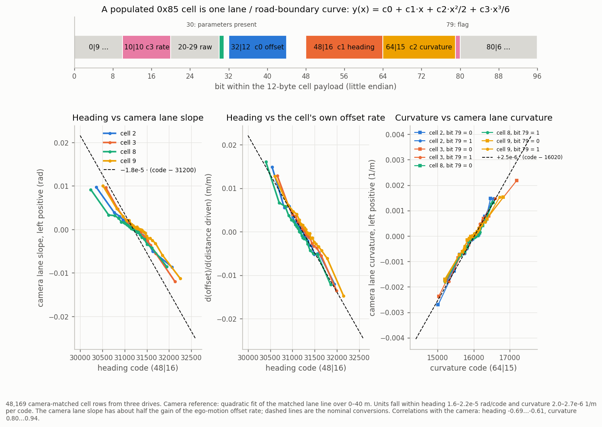
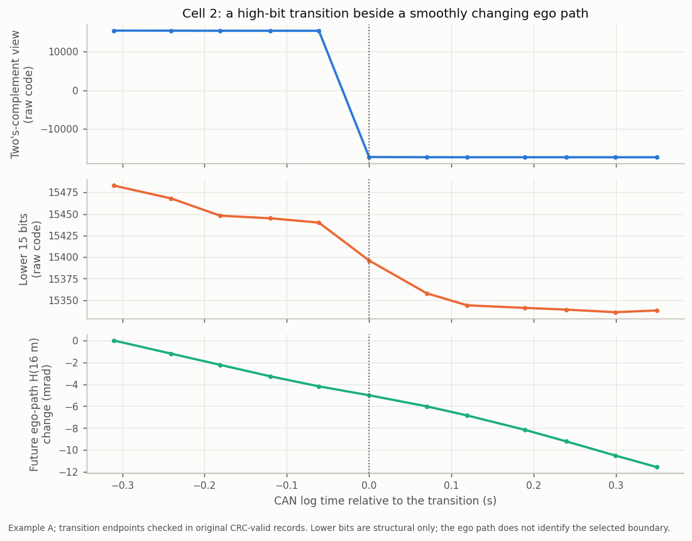

# 04. The metadata record (0x85)

0x85 carries a second segmented record at the radar cycle rate. The first frame starts `10 90`; keeping bytes 1..7 of
each of 21 frames gives **147 bytes**. A fixed marker follows on 0x86. It comes with every 0x80 record on both RAV4 radar firmwares
([01](01_radar_bus.md#radar-firmware)); the lane cells below serve analysis and in-path research
([10](10_research_directions.md#for-the-decode)).

## Layout

| bytes (Python slice) | content | conf. |
|---|---|---|
| `[0:1]` | `90`, transport length-low byte | ● |
| `[1:21]` | prefix: fine clock (bytes 1-4, LE), counter (bytes 5-6 >> 1), other raw bytes | ● clock and counter |
| `[21:141]` | **ten 12-byte cells**: lane / road-boundary curves (offset, heading, curvature) | ◐ |
| `[141:145]` | CRC-32/ISO-HDLC, little-endian, over `[1:141]` | ● |
| `[145:147]` | trailer, zero | ● |

```python
crc_ok = int.from_bytes(record[141:145], "little") == zlib.crc32(record[1:141])
```

The CRC passes on 1,309 / 1,309 bundled records, 6,967 / 6,967 records of seven original logs and 25,862 / 25,862 records of the 26-minute
unfiltered drive ([`radar_disable_unfiltered.json`](../data/analysis/summaries/radar_disable_unfiltered.json)); the trailer is zero on all 1,309 bundled records.
`python tools/check_structure.py` reproduces the check on the bundled samples. `ars510/shell85.py` returns the prefix and the ten raw cells.

## Pairing with the object list

The 0x85 prefix and the 0x80 header share a clock and a record counter:

```python
counter80 = int.from_bytes(record80[5:7], "little") >> 1
counter85 = int.from_bytes(record85[5:7], "little") >> 1
same_cycle = counter80 == counter85 and int.from_bytes(record80[1:5], "little") == int.from_bytes(record85[1:5], "little") // 100
```

On the 700-segment set this pairs 677,115 of the 677,754 CRC-valid 0x85 records with their 0x80 record; every pair is unique ([`prefix_alignment.json`](../data/analysis/summaries/prefix_alignment.json)). Nearest arrival time picks the
neighbouring cycle 31-37 % of the time, so the counters give the pairing.

## Prefix bytes

Bytes `[1:21]` of the record hold more than the clock and counter. Counts are over 677,754 CRC-valid records (677,115 of them paired with 0x80 by counter and clock).

| record byte(s) | content | conf. |
|---|---|---|
| 1-4, 5-6 | fine clock and counter (above) | ● |
| 7 (low 4 bits) | counter, +1 per record on 99.997 % of steps | ◐ |
| 15 (bits 6-7) | evenly spread 2-bit value that holds for 1-4 records | ○ |
| 15 (bits 3, 0) | rare event flags for cells 8 and 9: around a record with bit 3 (bit 0) set, cell 8 (cell 9) is dropped or re-added within ±5 records 6-12 × as often as elsewhere, on both cars; bits 1, 2, 4, 5 are never set | ◐ |
| 16 (low 5 bits) | count-like quantity, 2-20 above a fixed `0x20`: correlates with ego speed (non-monotone: mean 3.5 at standstill, 10.4 at 14-22 m/s, 7.5 above 30 m/s), with the number of populated cells (ρ .58) and with 0x80 header byte 13 | ○ |
| 17.2-3; 17.4-5, 17.7; 18.1, 18.3; 18.4, 18.6-7; 19.1-3; 19.4-7 | **inverted copies of the cell "parameters present" flag** of cells 3, 4, 5, 2, 1, 0: the bit is 1 exactly when bit 30 of that cell is 0, 2-4 bits per cell. The copies cover cells 0-5; the other bits of bytes 17-19 are constant 1. `shell85.prefix_flags_consistent` checks it, and it holds on all 1,309 bundled records | ● |
| 9, 11, 13, 14 | count-down timers: zero on 99.5 % of records; after an onset bytes 9 / 11 count down by 6-7 per record and bytes 13 / 14 by 1-2. Bytes 9 and 13 start with cell 9 being dropped or re-added (5-10 × its usual rate on both cars), byte 14 with cell 8 (10-17 ×); byte 11 goes with cell 8 on one car only | ◐ |
| 0, 8, 10, 12, 20 | constant: byte 0 = 0x90, byte 8 = 3 (rarely 0-2), bytes 10, 12, 20 = 0 | ● |

Bits agree on all 677,754 records for cells 0, 2, 3, 4 and 5 and on all but 238 for cell 1 (a default block with a nonzero `32|12`);
a fresh 114-segment set agrees the same way (cell 1 on 99.996 %), and 13,934 records decoded independently from 14 original-log segments agree on all but 12 of 236,878 tested bits
([`id85_lane_curve_cells.json`](../data/analysis/summaries/id85_lane_curve_cells.json)).

## Cells

Each cell holds a default block `84 03 F4 01` at payload bytes 6-9 when empty. **Cell bit 30** says whether the
cell holds parameters:

```python
parameters_present = bool(cell.payload[3] & 0x40)   # also ShellCell.parameters_present
```

It equals `payload[6:10] != b"\x84\x03\xf4\x01"` in all 4,466,850 tested cells
([`id85_parameter_presence.json`](../data/analysis/summaries/id85_parameter_presence.json)) and in all 13,090 bundled cells (1,309 records × 10 cells). Populated cells change at
every record while ego moves (1,984 of 1,984 consecutive pairs of cells 2, 3, 8 and 9 in the bundled highway sample).

### Lane / road-boundary curves



A populated cell is one boundary curve, `y(x) = c0 + c1·x + c2·x²/2 + c3·x³/6` in the radar frame, left positive. Bit numbers are little endian inside the
12-byte payload (`ShellCell.offset_code`, `.heading_code`, `.curvature_code`, `.rate_code`, `.curve_flag`):

| bits | field | nominal conversion | conf. |
|---|---|---|---|
| `32\|12` | **c0 offset** at the radar | `(code − 2000) × 0.01` m | ◐ (0.0098 m per code against the camera's lane width; a centimetre field; object yRel is 0.015 m per code) |
| `48\|16` | **c1 heading**, left-positive tangent | `−1.8e-5 × (code − 31200)` rad per code, zero 31.1-31.3 k per cell | ◐ sign, zero; unit bounded 1.6-2.2e-5 |
| `64\|15` | **c2 curvature**, left positive | `+2.5e-6 × (code − 16020)` 1/m per code | ◐ sign, zero; unit bounded 2.0-2.7e-6 |
| `10\|10` | **c3 curvature rate** d(κ)/ds, offset binary | `+4e-6 × (code − 500)` 1/m² per code | ◐ sign, zero; unit order of magnitude |
| `79\|1` | flag; the same in cells 2 and 3 on 99 % of rows | set on 79-80 % of cells 2/3 and 43-44 % of 8/9, rarely elsewhere; goes with higher speed, half the curvature and a longer `0\|9`. Not a model-order flag: the curvature rate `10\|10` sits at its zero equally often with it set or clear | ○ |
| `30\|1` | parameters present | above | ● |

Idle cells hold the defaults 900 at `48|16` and 500 at `64|15`; the conversions describe populated cells, and `ShellCell.heading_rad`,
`.curvature_per_m` and `.lane_offset_m` return `None` for idle cells.

**Heading.** Three references agree on sign and zero:
* the ego-motion offset rate, `d(c0)/d(distance driven)` from consecutive records and carState speed, falls linearly with the code: binned correlation −0.985…−0.993 and slope −1.63…−1.80e-5 rad/code in cells 2, 3, 8 and 9;
* the camera lane line's fitted slope correlates −0.61…−0.69 with the code and crosses zero at 31,167-31,322; its gain is about half the ego-motion one (consistent with shrinkage in the model's lane lines, ○), so the unit rests on the ego-motion reference;
* the radar's own ego-lane assignment (slot `128|3` = 3) for objects at 45-90 m is predicted from the cell-2 / cell-3 curves with AUC .9967 on the offsets alone and .9992 once the heading term is added; the AUC is a plateau at 1.3-2.0e-5 rad/code and falls to .9937 at 4e-5.

**Curvature.** The curvature is the 15 bits `64|15`; bit 79 is a separate flag. The correlation with the camera lane curvature is +0.94 (cell 2/3, bit 79 clear) and +0.80…+0.91 otherwise, with a zero at 15,987-16,037; the best-correlated cells give 2.1-2.3e-6 (regressing the reference on the code) up to 2.4-2.6e-6 (inverting the regression of the code on the reference) 1/m per code.
Against the gyro curvature (yaw rate / speed, cell 2) the 15-bit field reaches ρ 0.70 and the whole 16-bit word 0.44 ([`decode_claim_sources.json`](../data/analysis/summaries/decode_claim_sources.json)). The ego-lane AUC is .9992 from offset and heading alone and .9991-.9981 with an added `x²/2` term, so the radar's lane state follows offset and heading (◐).



*A cell-2 high-bit transition checked against original CRC-valid records: the signed-view jump is bit 79 toggling while the lower 15 bits change by tens of codes. Counts, limits and the relative-time example:
[`id85_direction_code_structure.json`](../data/analysis/summaries/id85_direction_code_structure.json).*

Replication: 114 further segments (binned heading correlation −0.93…−0.99 in every cell with enough samples, slopes −1.25…−1.85e-5; curvature +0.98…+0.99, slopes +1.9…+2.3e-6 on cells 2/3/8/9) and an independent decode of 14 original-log segments with this package
([`id85_lane_curve_cells.json`](../data/analysis/summaries/id85_lane_curve_cells.json), table [`lane_cells.parquet`](../data/analysis/lane_cells.parquet)).

**Curvature rate.** `10|10` (the field near 500 on straight roads) tracks the rate of change of the cell's own curvature per metre driven: binned correlation +0.96…+0.98 in cells 2, 3, 8 and 9 (+0.92…+0.97 elsewhere), zero 497-501, 3.5-5.7e-6 1/m² per code in the lane cells; replicated on the fresh drives.

**Which curve is which.** Against the camera's four lane lines (rows where all four have probability above 0.5), cells 0 and 1 follow the **left outer** line (median error 0.17 / 0.14 m), cells 2 and 8 the **left ego** line (0.04 m), cells 3 and 9 the **right ego** line (0.10 m) and cell 4 the **right outer** line (0.41 m); cells 6 and 7 take either side (1-8 m) and follow the left outer line 61-76 % of the time. Cells 8 / 9 hold a second estimate of the ego pair
(offset correlation 0.98 / 0.99 with 2 / 3) and share `24|4`, `28|1` and `44|4` on every row and `20|4` on every row where both are populated; cells 2 and 3 share bit 79 on 99 % of rows. The camera-quality-like fields (`24|4` low bits = 1 and bit 27 set, `20|4` ≈ 5, `28|1` = 0, `44|4` = 2) go with a camera lane probability ≥ 0.99.
Against openpilot's lane model the median offset error is 3-10 cm (left-lane cells 3-4 cm, right-lane cells 6-10 cm, the right-lane cells carrying a signed bias of the same size, −0.06…−0.10 m):

| drive group | cell 2 | cell 3 | cell 8 | cell 9 |
|---|---|---|---|---|
| A | 0.036 m | 0.096 m | 0.036 m | 0.095 m |
| B | 0.033 m | 0.070 m | 0.030 m | 0.067 m |
| C | 0.031 m | 0.065 m | 0.030 m | 0.063 m |

*24,878 CRC-valid records from 25 segments, speed ≥ 5 m/s, lane probability ≥ 0.8, cells with parameters present
([summary](../data/analysis/summaries/id85_lane_lateral_candidates.json)). The within-segment correlation with the lane model is 0.82-0.96 in ten of the twelve
group and cell scores (0.35 and 0.41 for the right-lane cells 3 and 9 on drive C). Four further drives (16 segments,
[`id85_parameter_presence.json`](../data/analysis/summaries/id85_parameter_presence.json)) give median errors of 2.3-8.2 cm in 14 of 16 cell scores and 22 cm in the left-lane cells 2 and 8 of one drive; 5 of the 16 scores meet all gates (median, p90 and centred correlation).*

Each cell describes a nearby boundary whose identity can change: during a lane change or at a turn pocket a cell
keeps describing the old or a different boundary for a while, and single-cycle spikes of a few metres occur.

The remaining cell fields (`0|9`, `20|4`, `24|4`, `44|4`, `80|6`) are raw. `0|9` reads as the curve's **view range** (◐): on the ego cells it falls 5.6 codes per metre driven, is extended in steps of 10-11 codes, never wraps (so it is not a dash phase), is longer at speed (r 0.50) and on straight roads (r −0.31 with curvature), and stays put at standstill. Its unit is not known: the drop per metre driven is not constant (1.9-7.1 codes per metre depending on the cell and on whether held values are counted), so driven distance does not calibrate it; `80|6` on the ego cells 2 / 3 is the lane line's confidence, written as 5·q + s: s = 2 is the confirmed sub-state (the camera's own line probability 0.96-0.99 at every q on three cars), s = 3 / 4 are weaker (0.59-0.92); 47-49 mark a line being lost (0.63-0.83 on the other two cars, down to 0.17 on the owner's) and 0 a poor line; q itself does not order the probability (◐; [`decode_round3.json`](../data/analysis/summaries/decode_round3.json), block `cell_80_6`). On the outer cells 1 and 4 it is 50 when the camera sees that outer line (its probability 0.79) and 0 when it does not (0.002). On the other cells it is confidence-like (0-50; cell 1 holds 0, 15 or 50 on every row; cell 4 holds the same three values on 99.98 % of populated rows). The middle value 15 marks a weak outer line: the camera's probability for that line is 0.30 there (median, below 0.5 on 85 % of rows) against 0.78 at 50, and the curve jumps more, as if the line is being re-associated; it is often a single-record dip or the step before the line is dropped.

**For in-path decisions, the yaw-rate path is the working predictor.** To decide whether an object 30-100 m ahead is in the ego lane (within 1.6 m of the path
the car later drove), the car's own curvature, y(x) = (yaw rate / v) · x² / 2 with the yaw rate from Toyota 0x24, is scored on three drive sets
(confirmation 5,692 objects, discovery 14,067, other drives 32,761):
- it classifies 92.6 / 93.6 / 98.8 % of objects correctly, against 84.5 / 85.9 / 95.1 % for a straight |yRel| window;
- on the confirmation set missed in-lane objects drop from 26% to 11%, and at 60-100 m accuracy rises from 82% to 88%;
- lane-cell terms added to the yaw path as a robust fit give 88.6 / 89.8 / 97.0 %; added as a residual correction they give 92.5 / 93.6 / 98.8 %.

Numbers: `in_path_prediction` in [`decode_references.json`](../data/analysis/summaries/decode_references.json).
