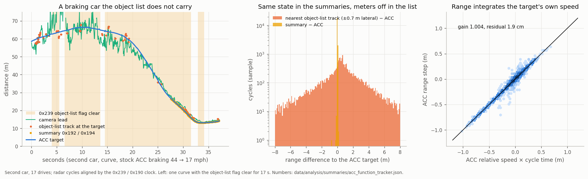
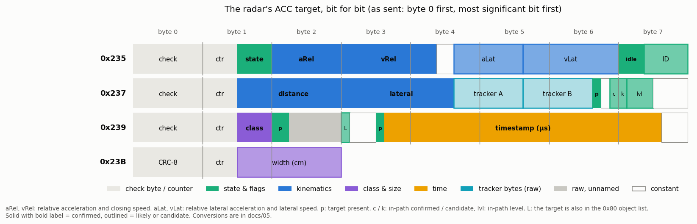
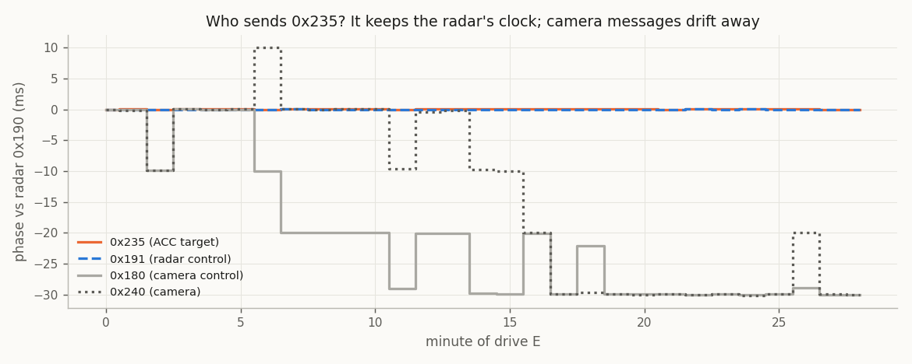
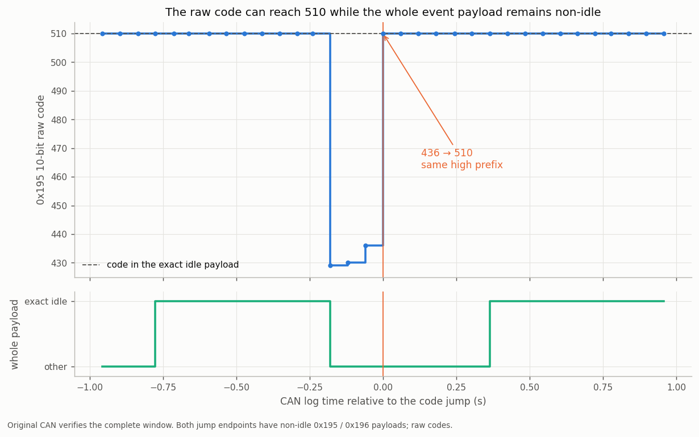

# 05. The radar's ACC target and support messages

Besides the object list, the radar sends its own ACC target, target summaries, timing and status on the private radar–camera link.
Bit numbers for the big-endian frames below treat the 8-byte frame as one big-endian integer (bit 0 = LSB of byte 7),
matching [`dbc/ars510_radar_bus.dbc`](../dbc/ars510_radar_bus.dbc) and `ars510.support`.

| stream | read by | role |
|---|---|---|
| ACC target (0x235 / 0x237, companions 0x239 / 0x23B) | `acc` and `acc_summaries`; `fused` as a speed reading (σ 0.13 m/s) and as the followed car's range | the one car the radar's ACC logic follows: 0.025 m distance, 0.125 m/s closing speed |
| object list (0x80) | `raw` and `fused` | every tracked car, 0.0625 m range, 0.15 m/s over-ground speed ([03](03_slot_fields.md)) |
| target summaries (0x191-0x194), 0x680 | `acc_summaries` (extra points); analysis | positions of the radar's internal tracker targets: the ACC car and the two nearest other moving cars (not a far-lead source) |

## The radar's ACC target (0x235 / 0x237)

At **50 Hz** (content updated every 60 ms radar cycle), this stream reports the one target the radar's own ACC logic follows.
The two frames are mapped bit for bit: field boundaries come from the carry structure of 2 M frames, and while idle
every numeric field sits at its zero code (100, 1024, 100, 1024, 2000, 0). Both DBCs name them `ACC_TARGET_1` (0x235) and `ACC_TARGET_2` (0x237), with the companion 0x239 as `ACC_TARGET_3`
(the radar cycle clock `TIMESTAMP`, which advances once per 60 ms cycle with or without a target):
[`dbc/ars510_radar_bus.dbc`](../dbc/ars510_radar_bus.dbc) carries every field for Cabana,
[`upstream/toyota_tss2_ars510.dbc`](../upstream/toyota_tss2_ars510.dbc) carries the same fields of 0x235 / 0x237 / 0x239 and the width on 0x23B (`ACC_TARGET_4`); the `acc` interface reads seven of them.
The stream is a distinct output of the radar's tracker: it reports on 58,553 of 484,061 active cycles in which the object
list is empty (mostly stopped within 6.4 m; 1,443 of them above 3 m/s ego speed; 13 drives,
[`acc_target_availability.json`](../data/analysis/summaries/acc_target_availability.json)).

**Where the target comes from (◐, exploratory, two cars).** The ACC target is not a smoothed object from the 0x80 list. It is
the output of the radar's own internal tracker. When one of the 0x192 / 0x194 summaries below is on the ACC car (70-74 % of
moving ACC-target cycles; the first pair only on 39-53 %), it shows the same track state:
- **Same state as the summaries.** Aligned by the radar cycle clock (33,695 cycles on a second car), summary range minus ACC
  range always lies between 0 and −0.0625 m, one summary step: the summary code is `160 + floor(0.4 × ACC code)` on 90 % of
  cycles and one code lower on the rest. Lateral differs by a constant 2.75 cm (within 2 cm on 99.8 %).
- **No range flows from the list.** The list object at the target's position is 3.1 m RMS away in range, and the fast
  frame-to-frame changes of the two ranges are uncorrelated (|r| ≤ 0.01 at lags −3 to +3 cycles). A filter fed by the list
  would need a gain below 5 × 10⁻⁵ per cycle. Only lateral shares fast content with the list, about 3 cycles later.
- **Runs without the list.** When a wiring fault stopped the object-list group on bus 1 (14 min of driving), the ACC target
  kept sending: present for 96 % of camera leads within 60 m (99 % normally), with the same agreement with the camera.
- **One kinematic filter.** From one radar cycle to the next, the range step equals `vRel × dt` (gain 1.004, 1.9 cm RMS
  residual, at the 2.5 cm code) and the speed step equals `aRel × dt` (gain 0.96, at the 0.125 m/s code); the owner's car gives
  1.002 / 0.97. The tracker propagates range from speed and speed from acceleration, and corrections reach range through those
  states. This is why its range is smooth and why no filter over the object list reproduces it
  ([`acc_function_tracker.json`](../data/analysis/summaries/acc_function_tracker.json)).





| field | conversion | conf. | DBC signal |
|---|---|---|---|
| closing speed | 0x235 bits 29-39: `(code − 1024) × 0.125` m/s, negative = closing | ● | `REL_SPEED` |
| relative acceleration | 0x235 byte 2: `(code − 100) × 0.125` m/s², positive = opening | ● | `REL_ACCEL` |
| distance | 0x237 bits 39-51: `code × 0.025` m | ● | `LONG_DIST` |
| lateral position | 0x237 bits 27-38 (12 bits): `(code − 2000) × 0.01` m, left positive; 1.5 codes = one 0.015 m object-list code. Above +20.95 m the field wraps (the check byte says when); on the right it stops at −20.00 m. Wraps occur about 8 cycles per hour, on targets 25-80 m out and 21-43 m to the left while ego turns or waits at a junction; the radar marks some of them in-path, but the camera has no lead there, so radard never used them in the logs; `acc` and `acc_summaries` add the 40.96 m back ([check bytes](#check-bytes)) | ● layout and ratio, ◐ absolute unit | `LAT_DIST` |
| lateral speed | 0x235 bits 8-18: `(code − 1024) × 0.0125` m/s, left positive, **relative in the rotating ego frame**: stationary targets read about −1.1 to −1.2 × yaw rate × distance, and the lateral position changes by 0.98-1.00 × this speed. Crossing traffic beyond 12.8 m/s wraps the field | ● unit consistency, ◐ frame | `LAT_SPEED` |
| target identity | 0x235 bits 0-4: the radar tracker's own track number. It stays the same while the radar follows one target and also when the target is dropped and picked up again (56 of 56 returns to the same track; a different track gets a different number in 23 of 23). 31 is an ordinary number (2-3 % of active cycles); read idle from `STATE` | ◐ | `TARGET_ID` |
| in-path state | 0x237 bit 8 confirmed, bit 7 candidate, bits 4-6 level 5 / 4 / 3 / 2 | ◐ | `IN_PATH`, `IN_PATH_CANDIDATE`, `IN_PATH_LEVEL` |
| relative lateral acceleration | 0x235 bits 19-26: `(code − 100) × 0.125` m/s² (nominal unit), left positive | ◐ | `LAT_ACCEL` |
| tracker bytes | 0x237 bits 19-26 and 11-18: one maneuver quantity in two encodings; both rise while the target accelerates or brakes. `TRACKER_A` sits at about 35 while the target's over-ground acceleration stays within ±1 m/s², steps to about 46 between 1 and 2 m/s² in either direction, and does not depend on range (three cars). For a stopped target `TRACKER_B` = 2.5 × `TRACKER_A` within one code (94-95 % on three cars); for a moving target the factor is larger (3.7-4.3, growing with range) and `TRACKER_B` wraps past 255 | ◐ | `TRACKER_A`, `TRACKER_B` |
| check byte | byte 0 of 0x235 / 0x237 / 0x239: CRC-8 (polynomial 0x1D) over the frame's signals serialized as zero-padded integers; `support.acc_check` | ● | `CHECK_BYTE` |
| target present | 0x235 byte-1 low nibble = 5 (1 = idle, bytes 2-7 `64 80 0B 24 00 FF`) and bits 5-7 = 0 (7 idle); 0x237 bit 10; 0x239 bit 35 and bits 46-47 = 1 (2 idle) | ● | `STATE` (0x235), `PRESENT` (0x237) |

`support.parse_acc_target(data235, data237)` returns all of them as one `AccTarget`; the single-field helpers
(`parse_acc_target_vrel`, `_arel`, `_position`, `_range_code`) read the same bits.

- **Lateral position.** The twelfth bit is the real least-significant bit: it flips more often than the eleventh, its
  carries stay inside the field, and against the 0x192 lateral of the same target the residual is half a code with it and a
  full code with it inverted. One summary (or object-list) lateral code is 1.500 of these codes (1.499-1.502 on five sets; 344 k rows,
  correlation 0.9999), which ties the two lateral units together ([06](06_accuracy.md#lateral-position)).
- **Lateral speed.** Over two-second windows the lateral position changes by 1.21 codes per code-second of this field
  (correlation 0.97 on a 114-segment set; 1.03-1.24 on the larger, noisier 700-segment set), so one code is about
  1.2 cm/s; 0.0125 m/s is the nominal value.
- **Relative lateral acceleration.** Same width and zero code as the longitudinal field. It mirrors ego's own lateral
  acceleration (−8.2 codes per m/s² of yaw rate × speed: about −1.0 at 0.125 m/s² per code) and adds 3.8 codes per m/s of
  the target's lateral speed. The two terms explain 76 % of its variance and 89 % in curves; it lags the gyro.
- **In-path state.** Confirmed on 94 % of target frames (level 5). The remaining frames carry candidate levels 4, 3 and 2,
  with median lateral offsets of 0.7, 1.6 and 2.2 m against 0.3 m at level 5.
- **Tracker bytes.** The first sits at 35-36 on a steady target, 44-50 while the target accelerates harder than about
  1.2 m/s² and a median of 48-74 while it brakes (harder braking, higher value); the second is about 86 for a stopped
  target, 128-135 for a steady mover, and climbs
  toward 240 within half a second of a maneuver. They follow the target's own acceleration (also when the relative speed
  is still zero because ego brakes with it) and are explained to 78-88 % by the target's kinematics: the tracker's
  maneuver terms. They carry no information on how long the target has been tracked (rank correlation with target age
  about 0), so they cannot say when the relative acceleration has converged; it rarely needs to: at a hand-over it already
  carries about 0.8 of the maneuver and about 0.97 after a second.

### Check bytes

Byte 0 of 0x235, 0x237 and 0x239 is a CRC-8 with polynomial 0x1D (MSB first, the polynomial of 0x23B), computed over
the frame's signals serialized as zero-padded integers (each signal in an 8-, 16- or 32-bit container, in payload
order), not over the raw bytes; that is why CRC searches over bytes 1-7 find nothing. The padding shows as gaps in the
register positions: 3 zero bits before the 13-bit distance, 4 before the 12-bit lateral position, 5 before each 11-bit
speed. Being linear, it is stored as one column per payload bit plus a constant (`support.acc_check`). It holds on
every frame: 1.69 M distinct payloads of two cars and 1.19 M frames of other drives, with no failure.

Lateral speed (0x235) and lateral position (0x237) are one bit wider inside the radar than on the bus. When that bit
is set the CAN field wraps, and the check byte differs by that bit's CRC term (0x9C and 0x14): `acc_check` returns
`"wrapped"`, and the lateral speed is continuous with its neighbours only when 2048 codes are added
([`acc_check_bytes.json`](../data/analysis/summaries/acc_check_bytes.json)). The `acc` and `acc_summaries` profiles
read the 0x237 check byte this way and publish a wrapped lateral position with the 40.96 m added back.

### Units of the ACC target

| check | result |
|---|---|
| stopped lead vehicles (true closing speed = ego speed), 97 tracks on 26 drives | closing speed = 1.004 × ego at 0.125 m/s per code once the radar's 0.15 s output age is taken into account (1.03 against the current ego speed while braking; [06](06_accuracy.md#velocity)); same on 16 held-out tracks |
| fine distance against the 0x680 object range on the same car, 1,872 frames | 0.02500 m per code, +0.01 m, median residual 0.02 m |
| closure inside the frames, 2,905 two-second windows | 5.03 distance codes per speed-code-second |
| closing speed against the slope of the fine distance, 1,862 windows | 0.99 (IQR 0.97-1.00); 0.99 on held-out drives |
| relative acceleration against the change of the closing speed, 222 k two-second windows | 0.997 speed codes per code-second (1.002 on other drives): 0.125 m/s² per code |
| lateral code against the 0x192 lateral code of the same target, 344 k rows | 1.500 (other drives 1.499-1.502) |

- **Relative acceleration** follows the derivative of the closing speed about 0.1-0.2 s behind it.
- The **object-list** relative speed (`64|10` minus ego) is 0.87 of the same distance slope (IQR 0.77-0.96, every
  drive 0.78-0.94; 1,862 windows on 27 drives): on a moving car it reads about 13% smaller in magnitude than the ACC target (0.99).
  It is a smaller gain, not a delay: the ratio stays 0.82-0.87 for every time shift from −0.5 s to +1 s, and when a lead
  starts braking the object list follows within 0.02 s but by only about 0.84 of the change; the list's own range rate
  reads 0.90-0.94 ([`field_readings.json`](../data/analysis/summaries/field_readings.json), block `list_speed_gain`).

Numbers: [`acc_summary_units.json`](../data/analysis/summaries/acc_summary_units.json), [`acc_target_frames.json`](../data/analysis/summaries/acc_target_frames.json).

### A second velocity estimate from the radar itself

The ACC target is matched to an object by position (its 0.025 m distance and 0.01 m lateral against the track's `dRel`
and `yRel`). When the object list's vRel and the ACC target's closing speed
differ by more than 3 m/s, **the vision lead sides with the ACC target 76-81% of the time** (discovery 81%, n = 738;
confirmation 76%, n = 484, route-bootstrap 68-93%; [`acc_unit_recompute.json`](../data/analysis/summaries/acc_unit_recompute.json)). In the bundled drive-E sample the object's vRel falls to −5.9 m/s
while the ACC target holds −0.75 to −0.9 m/s until about 18.7 s (`highway_acc_anchor_24s.csv.gz`, 18 s; [12](12_kalman_filter.md#the-model)).

**Who sends it: the radar** (◐) ([summary](../data/analysis/summaries/acc_sender_clock.json)):

- It starts 0.2 s after power-up, while openpilot first transmits at about 4 s ([01](01_radar_bus.md#power-up)), and
  runs at 50 Hz with cruise disengaged and with the radar's car-bus output disabled (U2, 26 min,
  [`radar_disable_unfiltered.json`](../data/analysis/summaries/radar_disable_unfiltered.json)).
- Every ECU's periodic messages carry its own crystal error. On four drives the radar link splits into two clocks:
  - **radar:** 0x100/0x103, 0x190-0x196, 0x198, 0x202, 0x24F, 0x680, and **0x235/0x237**, which keep a fixed phase to
    the radar's 0x190 like its own 0x191 and change content every 60 ms radar cycle;
  - **camera:** 0x101/0x102, 0x180, 0x197, 0x210, 0x240-0x248, 0x24D, 0x500/0x501, drifting 16-57 ms per 30 min against
    the radar.
- **Its distance and closing speed are filtered estimates sent on the radar clock** (◐, [summary](../data/analysis/summaries/acc_target_camera.json)).
  The slot's camera-association state `112|3` ([03](03_slot_fields.md#camera-association)) ends between 40 and 60 m by
  day, so the same cars are followed at association states 0 and non-zero. At 40-60 m both have the same ACC
  distance and speed jitter and the same agreement with openpilot's vision lead, and at 216 association onsets and
  losses the ACC distance and speed hold steady (+0.06 / +0.03 m, −0.01 / −0.05 m/s) while the object-list range of the
  same track moves by 0.8-1.7 m. An association-linked pull toward the camera is therefore at most about 4 % of distance
  and 6 % of speed (measured against openpilot's vision lead). The observations are identical for any constant camera
  share (exact mixture identities, [summary](../data/analysis/summaries/acc_camera_identifiability.json)), so the camera's
  total weight in the target is a research question ([10](10_research_directions.md)).
- **Target choice follows the radar's listed objects:** all 539 daytime acquisitions beyond 60 m happen at camera-association state 0, and the radar follows the nearest moving in-lane object as often at 60-70 m as at 20-40 m (0.93 / 0.92).
  At the camera's daytime range limit (40-50 m), 66 of 357 acquisitions (18.5 %) come within 0.25 s after the camera
  associates the object, against about 27 expected by chance: the camera helps pick the target there, or both
  react to the same scene ([summary](../data/analysis/summaries/acc_camera_identifiability.json)). The camera
  also feeds the radar its lane curves (0x85); a drive with the camera covered tests the rest
  ([10](10_research_directions.md)). The interface uses the target as the radar's own ACC target: `acc` publishes it
  alone, `fused` associates it with an object-list track by position.
- **The radar acquires a moving target only within max(80 m, about 4 s × ego speed) (◐, owner car):** of 430 moving acquisitions the
  farthest are 78-80 m below 20 m/s, 100 m at 20-25, 111 m at 25-30 and 129 m at 30-40 m/s; 0.2 % lie beyond max(80 m, 4 s × vEgo).
  The limit is on acquisition, not on keeping a target: in-lane camera leads beyond 80 m are covered 78-90 % inside it and 32-53 %
  outside it (targets taken nearer and kept as they pull away). Below 20 m/s a lead beyond 80 m is the ACC target only if it was
  acquired nearer; otherwise only vision supplies it (`acc_summaries` publishes summaries within 60 m). With cruise off the same limit
  holds (1 of 277 acquisitions beyond it, 0 of 153 with cruise engaged) ([summary](../data/analysis/summaries/acc_horizon_and_flips.json)).



*Phase of each message against the radar's 0x190, per minute of one drive. Logger timestamps come in ~10 ms USB batches, so camera drift appears as 10 ms steps.*

**How good it is** (ACC target against the object list, same cars; `acc` publishes the first, `fused` weights both):

| measure | ACC target | object list | source |
|---|---|---|---|
| speed noise, fast component (owner car / second car) | 0.025 / 0.027 m/s | 0.12 / 0.11 m/s | [`second_unit_noise.json`](../data/analysis/summaries/second_unit_noise.json) |
| distance jitter per cycle | 0.04 m | 0.94 m | [`acc_fields.json`](../data/analysis/summaries/acc_fields.json) |
| closer to the range slope in 62 tail episodes | 76 % (median error 1.2 m/s) | 24 % (2.5 m/s) | [`acc_unit_recompute.json`](../data/analysis/summaries/acc_unit_recompute.json) |
| error scale against the [optical reference](07_velocity_excursions.md#compared-with-an-optical-reference), 10-40 m / 40-70 m | at most about 0.4 m/s (0.01-0.37 by reference triple) / 0.54 m/s | 0.55 / 1.07 m/s | [`acc_unit_recompute.json`](../data/analysis/summaries/acc_unit_recompute.json), [`video_truth.json`](../data/analysis/summaries/video_truth.json) |
| present while a radar lead exists, owner road drives, 15-80 m / 80-200 m | 99 % / 66 % | every tracked car | [`road_v21.json`](../data/analysis/summaries/road_v21.json), [08](08_openpilot_integration.md#on-the-road) |

- It is not a filtered copy of the object list (◐): it is the state of the radar's own tracker, which keeps running when
  no list is sent and takes no measurable range from the list ([above](#the-radars-acc-target-0x235--0x237)). The object
  list's own fields and their recent history explain only 37-43 % of its disagreement with the ACC target
  ([07](07_velocity_excursions.md#far-range-excursions-match-the-reported-velocity-error-scale)). Neither result
  identifies the tracker's inputs, and the second bounds only the tested models, not every estimator. The `fused`
  profile therefore feeds the ACC target in as a speed measurement ([12](12_kalman_filter.md#the-model)).

### Class, width and timestamp (0x239 / 0x23B)

Two companion frames at the same 50 Hz describe the same target (`support.parse_0x239`, `parse_0x23b`):

| frame | bits | field | conf. |
|---|---|---|---|
| 0x239 | byte 1 low nibble | **target class**: 1 car, 2 truck; 0 narrow and 6 wide stationary object; 4 unclassified object (vehicles and stationary obstacles); 5 crossing object; 7 idle; 3 never seen | ● 1 / 2, ◐ 0 / 4 / 5 / 6 |
| 0x239 | bit 39 | the target also has an object in the 0x80 list | ◐ |
| 0x239 | bit 35 | target present | ● |
| 0x239 | bits 3-34 | **microsecond timestamp** of the radar cycle the target data belong to (the 0x190 clock) | ● |
| 0x23B | byte 1 low nibble + byte 2 (12 bits) | **target width in cm** | ◐ |

- **Class.** Class 1 goes with the car template of the target summaries below and class 2 with the truck template in every
  matched frame (329,612 of 329,612; 18,974 of 18,974 on other drives). Classes 0 and 6 are **stationary objects** (◐): close in, the radar
  saw them move in 3-10 % of target runs against 61-67 % for class 1. Class 0 is narrow (median 33 cm), class 6 car-sized
  (105-155 cm); they appear mostly while ego is stopped behind something within a few metres. All eight standstill holds
  of `acc` on the replay drives face such an obstacle: a fence (class 0 at 33 cm, or class 1), a garage wall, a kerb
  island across a T-junction and a car crossing it; seven of the eight have no object in the 0x80 list. Class 4 is mostly a moving target (2,992 of 3,687 samples, median 50 m and 27 m/s) with a fixed width of 120 or 50 cm: the
  object list calls it a car on 79-95 % of matched cycles (never a two-wheeler), 89-90 % of its moving time is on targets
  that are class 1 at other times, and on camera the checked cases are cars, one in heavy rain, so it reads as an object whose
  class is not settled (◐), not the motorcycle of the ARS408 enum: on seven more owner scenes it is also a low wall at 2-3 m,
  a kerb island across a T-junction and crossing traffic at an intersection, besides vehicles ahead. Class 5 moves sideways (median 4.4 m/s) while ego is
  mostly stopped; on camera these are cars crossing an intersection (◐, four scenes), not bicycles. Class 3 does not occur in about
  860 k cycles of two cars ([`field_readings.json`](../data/analysis/summaries/field_readings.json), block `acc_class`;
  [`round2_readings.json`](../data/analysis/summaries/round2_readings.json)).
- **Small targets while driving.** Over every stored log (three cars), class 0 also appears with ego above 3 m/s. That
  includes stationary objects as narrow as 23 cm (median 50 cm, at a median 31 m, on 22 routes)
  ([`object_size_provenance.json`](../data/analysis/summaries/object_size_provenance.json)). The radar's target choice
  includes objects far narrower than a vehicle.
- **Width.** Zero exactly while the ACC target is idle. The car class reads 140-220 cm (median 171, clipped at 140), the truck
  class 200-280 cm (exactly 200 on 97 % of its frames); cars read about 175 cm inside 30 m and 165 cm at 90 m.
- **Object-list flag.** Set on 88-95 % of target frames when the object list holds one to four objects and on 0.2 % when
  it is empty; 99 % when an object-list track sits at the target's position. While moving it is clear on 5 % of target
  cycles (second car). Those are not a full list (at most 9 of 20 slots are ever valid): they go with trucks (41 % vs 4 %), curves,
  lateral offsets beyond 4 m, young tracks and lower in-path levels. The target then stays as close to the camera's lead as with
  the flag set; one 17 s stretch held a braking car from 64 m to 16 m with an object-list track at its position on only 13 % of
  cycles, and Toyota's ACC braked for it ([`acc_function_tracker.json`](../data/analysis/summaries/acc_function_tracker.json)).
- **Timestamp.** Equal to the 0x190 timestamp in 73 % of frames and within one cycle in 99.8 % (the 50 Hz frames can
  arrive before or after the cycle header). It says which radar cycle a 0x235 / 0x237 update belongs to.

## 0x191-0x194: selected-target summaries

Two target-summary pairs: 0x191 with 0x192, and 0x193 with 0x194. Each pair describes one target of the radar's
internal tracker, the same tracker that produces the ACC target: 0x191 / 0x193 its lifecycle and class, 0x192 / 0x194 its position.
When a summary and the ACC target describe the same car, the summary range is the ACC range rounded down to 1/16 m
([above](#the-radars-acc-target-0x235--0x237)).

**0x191 / 0x193** (8 bytes, sentinel `FE FE FE FC FC FF FE FF`):

| bits (LE) | field |
|---|---|
| `1\|7` | score: 91-99 on a young target, then 100; 127 idle |
| `9\|7` | target age in cycles, saturates at 126 |
| `26\|6` | pair-local target code; can move between pairs; every value 0-63 occurs in active frames. Not the ACC `TARGET_ID` (equal on 1-9 % of frames where both describe the same car), but kept when the car becomes the ACC target |
| `17\|7` | 100 while a target is present |
| `34\|6`, `49\|7`, `56\|8` | **class template** in 0.1 m: width, a height-like size and length. 18:15:45 for cars, 22:23:120 for trucks |
| `43\|5` | track-maturity counter: median 14 at age 5-10 cycles, 20 at 10-15, 27-28 at 25-40, then 30 (on 85-89 % of frames); not higher for in-lane cars |

The template is the target's class: when the ACC target is this summary target, 0x239 reports class 1 with 18:15:45 and
class 2 with 22:23:120 in every frame, and the object list's own class for a class-2 target is "large vehicle" on 92 % of
20,394 matched frames ([`decode_claim_sources.json`](../data/analysis/summaries/decode_claim_sources.json)). Most active frames use 18:15:45 or 22:23:120 (607,999 of 608,186); the remaining 187 frames contain
28 further tuples such as 25:15:20.
`support.parse_0x191` returns score, age, code, the template in metres and the counter. Byte 2 (`17|7` = 100 with bit 16 clear) is 200 on all but one active frame of both cars.
Score, counter and age do not say which car the radar will pick next: for "this summary car becomes the ACC target within 3 s" they score
AUC 0.37-0.49 on both cars (young targets are picked slightly more often, consistent with cut-ins); of the fields tested only the lateral
position separates (0.68-0.75)
([summary](../data/analysis/summaries/acc_horizon_and_flips.json)).
[Aggregate evidence](../data/analysis/summaries/selected_target_descriptors.json),
[`acc_target_frames.json`](../data/analysis/summaries/acc_target_frames.json).

**0x192 / 0x194** (4 bytes, sentinel `00 FF 00 FF`; the radar also sends `FF FF FF FF` for a single cycle inside a live track, 7 of about 756 k summary frames on two cars; the top three bits of each 16-bit word are 0 on every valid frame, so `parse_0x192` and `acc_summaries` skip any word with one of them set, which catches that glitch):

| bytes | field |
|---|---|
| 0-1 | big-endian 13-bit **distance**: `(code − 160) / 16` m, the object list's encoding (●; 0.0625 m per code, −10 m against the 0x680 object range, median residual 0.05-0.07 m over 9-148 m) |
| 2-3 | big-endian 13-bit **lateral position**: `(code − 2048) × 0.015` m, left positive, the object list's encoding (● layout, ◐ unit; median residual 0.01 m) |

Each summary is therefore the position of one target of the radar's internal tracker. Keep all 13 bits of the second
word (it crosses 4096 continuously). The lateral word cannot go below code 0: targets more than 30.72 m to the right read
exactly −30.72 m (clipped), while the left side runs on smoothly past +25 m.

**They likely come from the radar's smooth internal tracker (◐).** The speed from a 1 s slope of the 0x192 range matches the radar's
ACC speed when both describe the same car (correlation 0.98, median difference 0.18 m/s). During object-list velocity
excursions it stays with the ACC speed in every tested cycle (490 of 490 for 0x192, 98 of 98 for 0x194), and against
a camera optical reference it is closer than the object list out to about 80 m (false closings > 2.5 m/s at 60-80 m:
14.9 % → about 10 %; closer in 97 % of object-list false closings). The summaries also describe far cars while the ACC target is idle,
at a median 60 m (0x194: 79 m)
([`summary_tracks.json`](../data/analysis/summaries/summary_tracks.json), block `current_units_recompute`). They carry position only, so a speed comes
from the range slope and lags by about half a second. Take that slope per track, not per message: a pair can switch to another car, so
8-11 % of moving 1 s windows span two tracks, and a per-message slope has 0.59-0.84 m/s RMS against the ACC speed (99th
percentile 2.3-4.2 m/s) where a per-track slope has 0.25 m/s (0.95). Restart it when the pair's code or age breaks
([`function_tracker_outputs.json`](../data/analysis/summaries/function_tracker_outputs.json), block
`summary_slot_identity_and_slope`).

**Summaries that are not the ACC target are further tracker-quality cars (◐, two cars, exploratory).** Each slot that does not hold the ACC
target holds another track of the same internal tracker: up to two cars besides the lead, one on 32 % and two on 23 % of
moving cycles (second car), at least one on 57-65 % (19-25 % with no ACC target at all). It carries only
moving vehicles going the same way (99.9 %; never stationary or oncoming), mostly in the next lanes (median lateral 3.8 m), at
a median 34-50 m. Its range is as smooth as the ACC target's (0.022-0.024 m residual against 0.018 m quantization; the object
list's moving tracks 1.2-1.4 m). A causal slope over 5-8 radar cycles gives a speed within 0.16-0.19 m/s RMS of the ACC speed on
the same car, and a median 0.14 m/s from 0x680's own speed on other cars. The 6-bit pair code stays with a track, including
when it swaps slots. Limits: it covers about a third of the moving cars the object list shows within 120 m (80 % within
20 m, 10-22 % beyond 40 m), and many runs are short (median 0.6 s). 62-67 % of new ACC targets were already a summary track,
a median 0.7-1.3 s before ([`function_tracker_outputs.json`](../data/analysis/summaries/function_tracker_outputs.json)).

`parse_0x192()` returns the raw codes plus `Target192.d_rel` and `Target192.y_rel` in metres (0x194 has the same
layout). It returns `None` for a short payload or the exact whole-frame sentinel. `acc_summaries` publishes the non-ACC
summaries within 60 m as radar points of their own, with a speed from the slope of their last 8 ranges
([11](11_profiles_compared.md#acc_summaries-acc-plus-the-summary-cars)); `fused` and `acc` do not read them
(`fused` 2.0-2.3 used them inside its filter: [12](12_kalman_filter.md#what-the-summaries-do)).

## 0x190: cycle header

- Byte 0 = count << 2 | 2: the **number of target summaries** in this cycle (0, 1 or 2). It equals the number of
  non-sentinel 0x191 / 0x193 frames in 681,864 of 681,879 cycles (the rest are startup frames); with one summary it is always the 0x191 / 0x192 pair.
- Bytes 2-5: big-endian **microsecond timestamp** (`support.parse_0x190`).
- Byte 6 high nibble: **cycle counter** mod 16, +3 per cycle on 99.996% of cycles
  ([`decode_claim_sources.json`](../data/analysis/summaries/decode_claim_sources.json)). Use it to detect dropped
  cycles.

## 0x195 / 0x196: event pair

Exact idle payloads account for **99.67% of recorded frames** in a 700-segment census (1,365,236 frames; 169 groups
of non-idle paired frames, including initialization). 0x195 bits 18-27 (MSB-first) form one 10-bit code:

```python
q10 = ((payload[2] & 0x3f) << 4) | (payload[3] >> 4)   # 510 when idle
```

In 59 of 60 changes where the low seven bits move by more than 64 codes, the high bits move by one in the opposite
direction: a carry, so the ten bits are one field. Non-idle codes span 391–558. Code 510 also occurs in 1,202 of 2,215
non-idle samples, so recognise idle frames by the whole payload. `q10` is the low 10 bits of the object acceleration below.

**While active, 0x195 describes one object of the radar's tracker and the ego's path (◐ unless marked; two cars, raw-checked):**

| 0x195 bits (DBC start\|length, big-endian) | DBC | decode |
|---|---|---|
| 50\|11 | `A195_OBJECT_RANGE` | object range, 0.05 m per code (●): `floor(ACC distance code / 2)` on the ACC car; on 16-25 % of active cycles another, mostly stationary object |
| 27\|12 | `A195_OBJECT_SPEED` | its longitudinal over-ground speed, 1/16 m/s per code, zero code 0 (the same quantity as 0x680's speed, including the ego-rotation term) |
| 23\|12 | `A195_OBJECT_ACCEL` | its over-ground acceleration, about 1/32 m/s² per code around 512 (29-32 codes per m/s² measured) |
| 46\|11 | `A195_EGO_TRAVEL_TO_TTC` | the ego's predicted travel up to the time to collision, `v·T + a·T²/2` with `T = range / closing speed`, clamped at 0; 0.05 m per code (residual 0.20 m against a 0.17 m rounding floor) |
| 7\|16 | `A195_PATH_CURVATURE` | ego path curvature, left positive, about 1/133,000 per m per code around 32768 (R² 0.997 against yaw rate / speed) |

0x196 byte 0 (signed) is a required deceleration of about 0.1 m/s² per code, close to the usual lead-moving / lead-stops
formula with a 1-2 m margin (within one code on 92-98 % of active cycles, not exact; it relaxes while the driver brakes
hard). **Bytes 4-7 are two lateral pairs, not time thresholds (◐ on the owner car, ○ beyond it):** byte 6 − byte 4 and byte 7 − byte 5
behave like lateral distances from the object to the left and right edges of a corridor around the predicted ego path, about
0.1 m per code, with the edges about 1.0-1.15 m either side of the path (R² 0.83 / 0.87 on the owner car). The fit does not
transfer to the second car, and lateral-speed or time-to-collision alternatives fit comparably, so the edge values are not settled. Bytes
4 and 5 clip at 50 and bytes 6 / 7 reach 74-80, so the "62" seen before was byte 4's clip plus a gap; what bytes 4 / 5
themselves measure is open. Bytes 1-3 stay 0 while active, except one bit:
**0x196 byte 1 bit 0 is a radar fault flag (◐).** It sets 0.3-0.4 s after the object list stops (two outages on a second
car, together with 0x198 byte 0 changing 0x10 → 0x90), about 1.5 s before the car-bus 0x411 fault code, and clears with it.
It marks the onset of an outage (5.6 and 22.6 s here), not a list that is missing from power-up, and it is also set for the
first cycle after every power-up, so a reader should require two or more consecutive cycles. No false alarm in 14.4 h of
normal driving ([`timing_launch_health.json`](../data/analysis/summaries/timing_launch_health.json)). 0x195 is active on only
0.5-0.6 % of moving cycles ([`event_pair_fields.json`](../data/analysis/summaries/event_pair_fields.json)).
The DBC keeps the remaining sub-fields as raw codes.

**The event pair behaves like a short-time-to-collision state (◐).** Across 700 segments, compared with matched moving moments:

| | non-idle 0x195 frames | matched moving moments |
|---|---|---|
| closing in-path lead with time-to-collision < 4 s | **41%** | 0.8% |
| in-path lead distance, median | 18 m | 36 m |
| brake pedal pressed | 67% | 18% |
| accelerator pressed | 12% | 51% |

85% of event frames occur with both the stock cruise and openpilot longitudinal control off. `q10` (the object's
acceleration) leads the car's own deceleration by 0.5-1 s, as a braking lead would. The reading: the radar's
pre-collision view of one object, with its range, speed, acceleration and the deceleration needed (◐). Counts and relative-time example:
[`event_pair_carries.json`](../data/analysis/summaries/event_pair_carries.json); context table and lead lags:
[`decode_references.json`](../data/analysis/summaries/decode_references.json).

On U3, the one recorded stock PCS alarm, the pair left idle 1.06 s before the alarm and returned 0.26 s after it. The
alarm itself is marked on the radar bus by **0x100 byte 0 = 0x02**, in the same CAN tick as the car-bus alarm. The object acceleration stayed
at 510 (the parked pickup), the required deceleration fell to about −2 m/s² at the alarm, and the 0x196 bytes ramped from the pair's onset
([15](15_aeb_pcs.md#a-recorded-stock-pcs-alarm-u3)).



## 0x240-0x248: context frames

0x240, 0x241, 0x244 and 0x245 are sent by the camera and share a **rolling phase 1-7** in byte 0 bits 5-7 (0 at startup).
By day their bodies hold a default payload (`00 10 01 00 10 01 00`). **At night 0x240 and 0x244 carry light-source
records**: every drive that starts after dark carries them and drives that end before dusk keep the default (71 of 698
one-minute segments; 35 of 114 on a second set, ramping in over three minutes at dusk;
[`decode_claim_sources.json`](../data/analysis/summaries/decode_claim_sources.json), [`context_24x.json`](../data/analysis/summaries/context_24x.json)). Each frame holds two records of
{type nibble, 3 flag bits, 13-bit signed value, 8-bit value}; the two records of 0x244 share the 8-bit value. One record
kind sweeps from small to large values while its byte falls from 255, as an approaching light does. In 0x240 the two
13-bit values are the left and right edges of a horizontal angle range (◐ reading, ○ about 0.01° per code, left
positive): the ACC car's bearing lies inside it on 98 % of night cycles, against 85 % with bearings shuffled, and the range
is a median 11.5° wide, so it brackets the car only coarsely. By day these frames carry nothing that changes: no lane
lines, lane assignment or object list reach the radar on bus 1. The radar's own lane estimate is the 0x85 cells
([04](04_metadata_record_0x85.md)), whose ego-lane left edge matches openpilot's lane line to 2-9 cm. 0x248 byte 2 is 1 by day and 0, 2 or 3 at night and carries startup and event bits with the same phase.

The night mode matters for the object list: two slot fields change with it ([03](03_slot_fields.md#camera-association)).

## Startup and readiness

| signal | booting | running |
|---|---|---|
| 0x101 byte 0 | `0x1D` | `0x11` |
| 0x197 bit 8 | 0 | 1 (60 ms after 0x101 switches) |
| 0x24F bit 6 | 0 | 1 |

All three switch once and stay, so they are a direct "radar running" signal and a radar-reboot detector. 0x101 and
0x197 are sent by the camera and follow the first 0x80 record by 0.14 s and 0.20 s on 27 of 27 cold starts (spread
7 and 14 ms): they behave as the camera's acknowledgement of the object list (◐).

## 0x680: single-object stream

Every 0.5 s the radar reports **one object from its function-level tracker: the track with number 0** (◐). It is the same car as
the ACC target whenever the ACC target's `TARGET_ID` is 0 (range within 0.3 m on 98 % of frames; 173 of 173 on the owner car in a
re-check from the original logs, 6 of 6 on a third car; with any other ID it is a different object), so it does not rotate
through the tracks. Track 0 is reused quickly, mostly by roadside objects, so few frames cover moving vehicles. On the ACC target
its speed equals the ACC speed (median difference 0.09 m/s), and its range is a close copy of the ACC distance, not a rounding of
it: pairing each original 0x680 transmission with the preceding ACC frames gives 0.052 m RMS on 2,065 moving-object reports of the
owner's car (0.091 m with the coarser per-cycle pairing; receipt alignment accounts for part of the difference;
[`register_structure_and_reference_scope.json`](../data/analysis/summaries/register_structure_and_reference_scope.json)). `support.parse_0x680` decodes it (big-endian fields, MSB-first start | length):

| field | reading | conf. |
|---|---|---|
| `0\|8` | selector: 0 / 1 mostly stationary objects, 3 mostly same-direction vehicles | ◐ |
| `8\|13` | longitudinal distance, 1/32 m per code (0-256 m) | ● |
| `21\|11` signed | lateral position, 0.015 m per code (the object list's unit), left positive | ◐ |
| `32\|10` − 512 | speed over ground, 0.15 m/s per code | ◐ |
| `42\|6` | **motion flags**: bit 0 stationary, bit 1 oncoming, bit 2 crossing (moving sideways), bit 3 seen moving (1 = stationary object, 8 = moving vehicle, 9 = stopped vehicle); bits 4 and 5 not named | ◐; bit 2 ○ |
| `48\|8` − 128 | lateral speed over ground, about 0.13-0.18 m/s per code (0.15 nominal) | ◐ |
| `56\|8` | low nibble: 0xA for selector 0, 0xF for selectors 1 and 3 (exact on three cars); high nibble: four flags, 0xE on 98 % of selector-1 / 3 frames and varied on selector 0 (mostly three of four set), not related to position or speed | ● low nibble; ○ high nibble |

- **Distance scale:** stationary objects close at ego speed with 31.9 codes per metre (672 segments; 32.0 on 84
  held-out segments).
- **Speed:** on 1,872 frames of the 672-segment corpus where 0x680 and the ACC target are on the same vehicle, the two
  speeds differ by 0.09 m/s (median absolute). When the object list is more than 2 m/s away from the ACC target, 0x680 stays within 1 m/s of
  the ACC target in 64 of 64 frames ([`acc_unit_recompute.json`](../data/analysis/summaries/acc_unit_recompute.json)).
- **Motion flags:** bit 0 is set on 99 % of objects slower than 0.5 m/s over ground and on 1 % of moving ones; bit 1 on
  98 % of objects approaching faster than 3 m/s and on 1 % of the others; bit 3 on 86 % of same-direction movers and on
  10 % of stationary objects, the stopped vehicles (on other drives the three shares are 98 %, 97 % and 72 %).
  `Object680.stationary`, `.oncoming` and `.seen_moving` expose them. Bit 2 (0.4 % of frames) goes with sideways motion:
  its objects have a lateral speed (median 16 codes against 0 for every other flag) and sit in ego's path on 39 % of frames, a
  crossing object. Bits 4 and 5 together (word 49) mark near, wide stationary objects (median 15 m at 28°); alone, bit 4 sits
  on far same-direction movers and bit 5 on slower in-path or oncoming movers, so neither bit is named yet. The selector
  values 0 and 1 interleave from frame to frame on stationary objects; 3 is a steady vehicle stream
  ([`decode_round3.json`](../data/analysis/summaries/decode_round3.json)).
- **Lateral speed:** the code is 0 on stationary objects even while ego turns, so it is over ground like `74|10` of the
  object list.
- **Which vehicles it reports:** of its moving-vehicle frames (13 % of frames while driving), 30 % are the ACC target,
  28 % a summary target and 42 % another vehicle of the radar's internal tracker (median range 105 m, mostly outside the
  ego lane). On the ACC target its speed equals the ACC speed (median difference 0.09 m/s on the 2,004 frames of the
  vehicle-witness set).
- **A witness for far tracks:** against it, the object-list track at the same position reads more than 2.5 m/s too closing
  on 1 % of frames below 40 m, 5 % at 40-60 m, 17-19 % at 60-110 m and 44 % at 110-170 m, and its range is a median 3 m
  short at 60-110 m and 14 m short at 110-170 m ([06](06_accuracy.md#distance), [07](07_velocity_excursions.md)). The
  fixes are sparse (about one a minute on tracks that only the object list reports).
- **Content while driving:** a stationary roadside object in 83% of frames (typically 8 m to the side), a
  same-direction vehicle in 13%, an oncoming one in 3%. While driving, the 0x80 object list holds the moving objects
  ([02](02_object_list.md#what-the-radar-lists)); 0x680 reports the stationary ones, one at a time.
- **Idle** payload `00 00 08 00 80 00 80 0A` appears in 0.12% of frames above 5 m/s and at most 1.0 s at a time
  in 7.8 h, so a long idle run while driving is a candidate "empty radar" indicator
  ([10](10_research_directions.md)).

Numbers: [`object_stream_0x680.json`](../data/analysis/summaries/object_stream_0x680.json).

## Other frames

- **0x202:** counter in byte 1 high nibble (+1 per frame); byte 0 is a fixed function of the counter (map in the DBC): a CRC-8 with
  polynomial 0x1D and the counter nibble processed first fits all 16 payloads (the fit identifies the counter dependence; the other
  bytes are constant).
- **0x23B (50 Hz, 3 bytes, in received order):** byte 0 = **CRC-8 SAE J1850** (polynomial 0x1D, init 0xFF, final xor 0xFF,
  the AUTOSAR CRC8) over `[0x00][counter][width as 16 bits]`, the same serialization as the other ACC frames; byte 1 = rolling counter in the high nibble; the low nibble and
  byte 2 are the ACC target width ([above](#class-width-and-timestamp-0x239--0x23b)). 3,615 of 3,616 distinct payloads over
  2.05 M frames pass, and 30,056 of 30,058 frames on fresh drives (the exceptions are the startup frame `00 0f ff`).
- **0x240 / 0x244 / 0x248:** camera-sent context frames ([above](#0x240-0x248-context-frames)).
- **0x210:** copy of Toyota road-sign-assist data (speed-sign presence, `RSA1.SPDVAL1`, `RSA3.TSRMSW`).
- **0x500 (● observed regular payload):** a shared regular payload across the three recorded cars.
- **0x502 (● layout, ○ interpretation):** byte 0 is a shared constant; bytes 4-7 are constant within each recorded car
  and differ between cars. Byte 1 and the big-endian word in bytes 2-3 are slowly varying numerical codes, updated
  during motion and held during settled standstill. Both behave like online alignment estimators: stored across power cycles, frozen
  at standstill and paused in turns. **The word in bytes 2-3 follows vehicle pitch (◐, inferred):** it moves opposite to openpilot's
  camera calibration pitch (per drive r −0.92 on the owner car, −0.39 on the second; every large step, 8 of 8, opposite a
  0.2-0.6° pitch step; about 0.005-0.006° per code if both see the same body pitch), so it reads as the radar's elevation
  alignment estimate. Byte 1 shows no link to the azimuth of stationary objects (○) ([`latches_and_pitch_codes.json`](../data/analysis/summaries/latches_and_pitch_codes.json)).
- **0x501 (● layout, ○ interpretation):** byte 5 bits 3-7 form one five-bit numerical code (`43|5@1+` in the DBC),
  including the carry from 15 to 16. Its low three bits are `100b` during active output and `000b` in the startup payload.
  The code is a learned value kept across drives: after power-up the camera sends 31, then 16 for about 7 s, then a value within one
  code of the previous drive's last (95-100 % of drives; equal on 66-71 %); it changes only while driving, in single steps. It is not a reach, rain, light, temperature or speed-mode signal;
  between drives it follows openpilot's calibration pitch weakly (○).
  Counts and scope for these register readings are in
  [`register_structure_and_reference_scope.json`](../data/analysis/summaries/register_structure_and_reference_scope.json).
- **0x180, 0x198, 0x23D:** constants.
