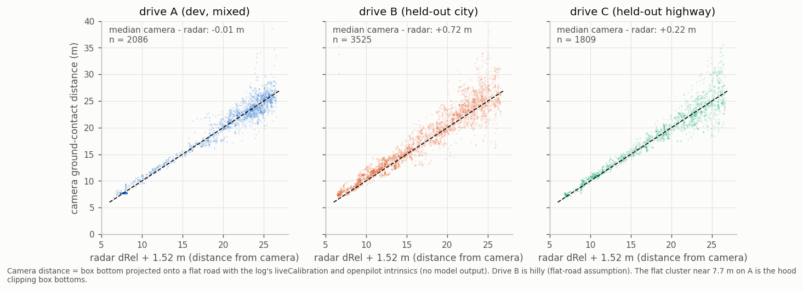
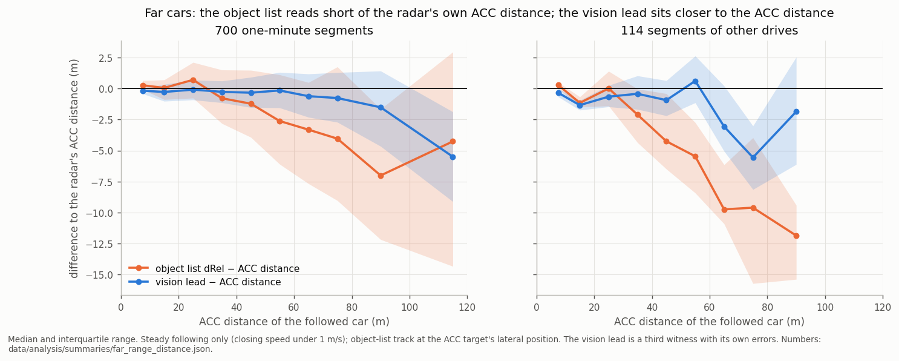
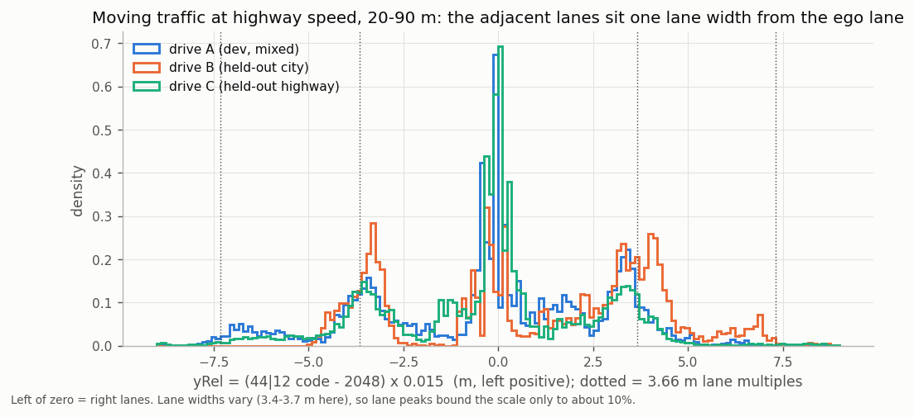
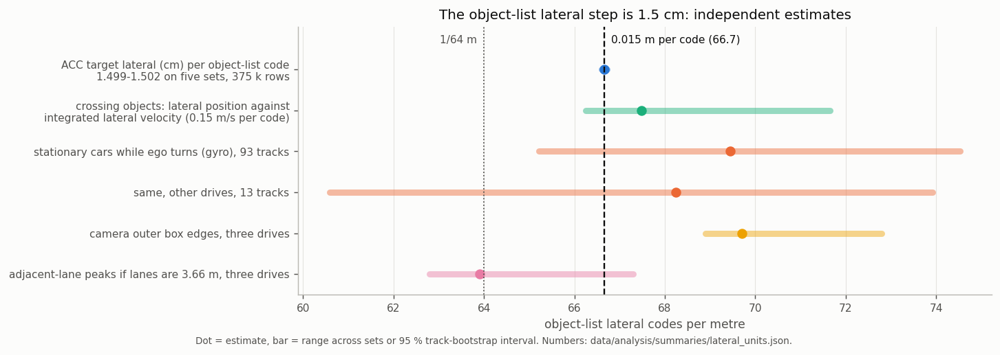
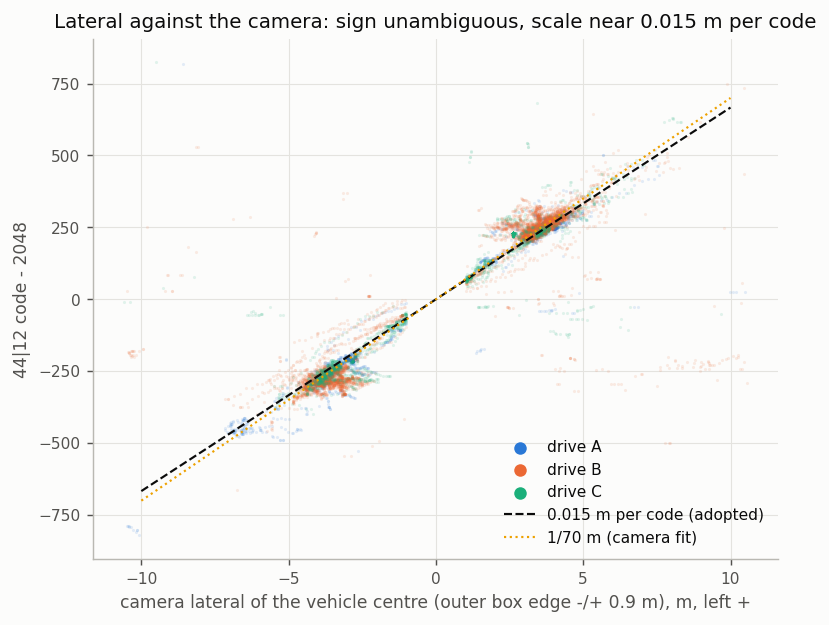
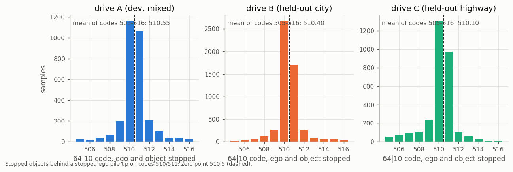
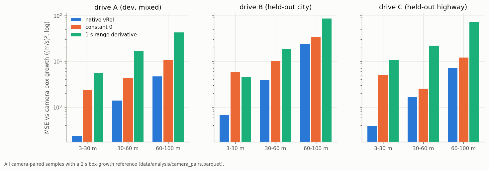
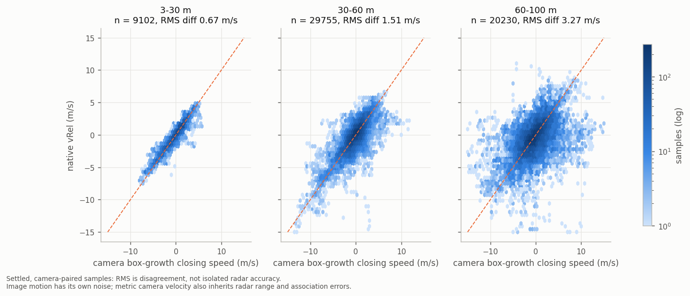
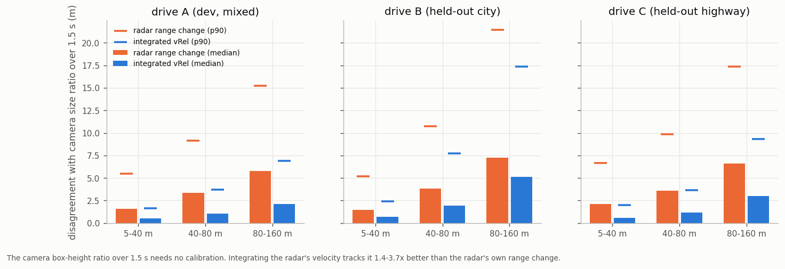
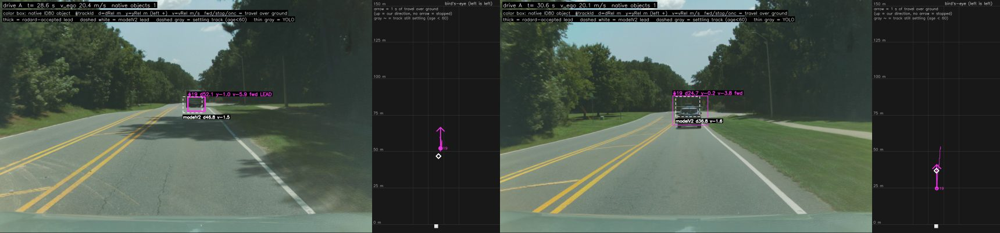

# 06. Accuracy: how well the object fields match the world

The radar publishes two streams of numbers: the **object list** (0x80; `raw` and `fused` read it) and the **ACC target**
(0x235 / 0x237; `acc` reads it alone, `fused` weights it into its speed filter). Sections below say which stream a number
belongs to; the [side-by-side table](#object-list-and-acc-target-side-by-side) puts them next to each other.

Three drives carry the object-list measurements: **A** (development, 24 min decoded, mixed), **B** (held out, 40 min city,
often wet or at night, hilly) and **C** (held out, 24 min highway). The references each measure something different:

| reference | what it gives |
|---|---|
| camera ground contact | absolute distance at 5-25 m: YOLO box bottom projected on a flat road with the log's calibration |
| camera box growth | closing speed from image expansion over 2 s, `−(dRel + 1.52) · d ln(h)/dt` (metric scale from radar range) |
| camera size ratio | scale-free range change: the box-height ratio over 1.5 s equals the inverse range ratio |
| ego odometry | wheel speed, GPS, gyro: velocity scale, and exact vRel of stopped targets (−v_ego) |
| openpilot's vision model | lateral side, far-range distance, lead speed |

## At a glance

| stream | quantity | result |
|---|---|---|
| object list | **dRel** scale and zero, 5-25 m | slope 1.001 / 0.993 / 0.995 against camera ground contact; median camera minus radar −0.01 m (A), +0.22 m (C), +0.72 m (B, hilly) |
| object list | **dRel** far range | median residual 3.7 m at 60-100 m and 5.1 m at 100-150 m against camera/model consensus; 5-8 % short of the radar's own ACC distance at 50-100 m |
| object list | **dRel** record to record | walks by about 3% of range (see range walks below) |
| object list | **yRel** side | correct on 97.9-99.3% of off-centre targets against the camera |
| both | **lateral** scale | object list 0.015 m per code (66.7 codes/m); ACC target 0.01 m per code, 1.5 of its codes per object-list code (1.499-1.502 on five sets); gyro 69 [65, 74.5], lane peaks 62.8-67.3, camera 69-73 |
| object list | **velocity** zero and scale | nominal zero 510.5; fitted scales 0.150 / 0.149 / 0.153 m/s per code from native range slope with GPS ego speed |
| object list | **vRel** vs camera | the lowest error of native vRel, a constant zero and range differencing at every range (table below) |
| object list | **vRel**, stopped targets 5-30 m | RMS 0.54 m/s on settled tracks |
| both | **speed noise**, second radar unit | object-list and ACC-target noise match the owner unit (fast noise 0.11 / 0.027 against 0.12 / 0.025 m/s) |
| object list | **trackId** | each ID lives in one slot; 77 of 87 camera-checked tracks within 60 m keep one camera identity ≥ 95% of their life |
| ACC target | distance, closing speed, lateral | 0.025 m, 0.125 m/s, 0.01 m per code ([05](05_acc_target_and_support.md#units-of-the-acc-target)); fast speed noise 0.025 m/s; distance jitter 0.04 m per cycle |

## Distance

- **Scale 1/16 m.** Closing rate over relative speed gives 15.93 / 16.01 codes per metre on two calibration routes;
  camera ground contact gives slope 0.99-1.00 on all three drives.
- **Nominal zero at code 160.** The formula is `code / 16 − 10 m`: code 160 decodes to zero. The offset was
  fitted against a vision reference. Camera ground contact minus radar is −0.01 m on A and +0.22 m on C; hilly drive B
  reads +0.72 m, the size of a 0.19° camera-pitch error at B's median 17.5 m
  ([`decode_claim_sources.json`](../data/analysis/summaries/decode_claim_sources.json), `data/analysis/ground_contact.parquet`).
  The comparison uses openpilot's `RADAR_TO_CAMERA = 1.52 m`, which sets the physical origin of the camera reference.
- **Far range** (drive A, camera box scale averaged with the vision model where they agree; the camera scale is anchored
  to the radar's own range at 20-45 m): median absolute residual 3.7 m at 60-100 m (distance ratio 1.017) and 5.1 m at
  100-150 m (ratio 0.979; [`far_range_camera_correction.json`](../data/analysis/summaries/far_range_camera_correction.json)).
- **Against the radar's own ACC distance** (◐). For the car the radar's ACC function follows, `dRel` agrees with the ACC
  distance ([05](05_acc_target_and_support.md#the-radars-acc-target-0x235--0x237)) below 30 m and reads progressively
  short beyond it: median −1 m at 30-50 m, −3 m at 50-70 m, −4 m at 70-80 m and −7 m at 80-100 m (2-3 %, 5 %, 5-6 % and 8 %; cars
  more than large vehicles), and about twice that on a second set of drives, with an interquartile spread of 8-11 m at
  60-100 m. openpilot's vision lead, a camera estimate, reads within 1 % of the ACC distance from 20 to 80 m on the
  700-segment set (5-7 % short at 60-80 m on the second set) and is nearer to it than to `dRel` on 71-79 % of samples
  at 30-100 m. The ACC distance is therefore the better far range for that car: `acc` publishes it, `fused` publishes it
  as the followed car's range (object-list range for the other tracks), and any position gate between the object list and
  the radar's own trackers needs room for this difference
  ([`far_range_distance.json`](../data/analysis/summaries/far_range_distance.json)). The 2 Hz object stream 0x680, likely a
  second output of the same tracker (◐) that also covers other vehicles, shows the same: the object list is a median 2.5 m
  short at 40-60 m, 3 m at 60-110 m and 14 m at 110-170 m
  ([`object_stream_0x680.json`](../data/analysis/summaries/object_stream_0x680.json)).

## Lateral position

- **Left positive, Cartesian.** Codes per metre stay constant across range, and ego-lane objects stay within 0.1-0.3 m of
  centre from 15 to 130 m on straight road (two calibration routes).
- **Scale 0.015 m per code** (66.7 codes per metre, ◐). The object list, the target summaries (0x192 / 0x194) and 0x680
  share this unit; the ACC target's lateral and the lane-curve offsets of 0x85 are in centimetres.

| evidence | result |
|---|---|
| ACC target lateral code (cm, zero 2000) against the summary's object-list code, same target, 344 k rows | 1.4998 / 1.5002 (other drives 1.499 / 1.502, original logs 1.5015), correlation 0.9999 |
| crossing objects on straight road: lateral position change against the integrated lateral velocity (`74\|10`, 0.15 m/s per code) | 9.9-10.5 position codes per velocity code-second (1/64 m would give 9.6) |
| stationary cars while ego turns at a steady yaw rate, against the gyro, 93 tracks | 69.4 codes per metre, interval 65.2-74.5 (other drives 68.3) |
| 0x85 lane-cell offsets against the camera's lane width, 10,262 records | 0.0098 m per centimetre code |
| adjacent-lane peaks at highway speed | 63.9 / 67.3 / 62.8 codes per metre if lanes are 3.66 m: lanes of 3.4-3.7 m at this scale |
| camera outer box edges | 68.9 / 69.7 / 72.8 codes per metre |

  The first two rows tie the unit to the radar's own centimetre and velocity fields; the gyro, camera and lane rows come from
  outside the radar and have wider intervals. Replaying `fused` 2.1 with these lateral units on 27 drives gives the same braking counts
  (held-out hard radar-only ticks 30 → 30, target episodes 4 → 4; anticipation 0.449 → 0.443, one of 167 driver
  brakes; lead-source switches +0.7 %).
  Numbers: [`lateral_units.json`](../data/analysis/summaries/lateral_units.json).

## Velocity

- **Over ground.** See [03](03_slot_fields.md#kinematics).
- **Nominal zero 510.5.** While ego is stopped (below 0.05 m/s, objects of age 10 or more), the dominant object-code
  peak is at 510 and 511; weighted means of the four most frequent codes are 510.486 / 510.400 / 510.198 on A / B / C (full
  drives; the figure shows the bundled sample's mean over codes 505-516).

  

- **Nominal scale 0.15 m/s per code.** Fitting velocity against native 8 s forward-range slope plus GPS ego speed,
  with a free intercept and a track bootstrap, gives:

  | drive | scale, m/s per code | 90% interval |
  |---|---:|---|
  | A | .15037 | [.1484, .1518] |
  | B | .14869 | [.1463, .1514] |
  | C | .15304 | [.1508, .1550] |

  A and B contain .15. These fits rest on the 1/16 m range scale and the GPS ego speed, so an error in either moves
  them too. Against the ACC target's distance slope, the object-list relative speed is 0.87 (IQR 0.77-0.96;
  [05](05_acc_target_and_support.md#units-of-the-acc-target)).
- **Ego reference.** Toyota 0xB4 reads about 1-1.5% below GPS and wheel speed in the measured comparisons. Steady
  following against 0xB4 fits .149 m/s per code. The `raw` and `fused` object-list profiles use
  `vground_scale = .149 / .15`, a **0.667%** reduction of decoded ground velocity, then subtract 0xB4 ego speed (the
  openpilot file, `fused`, decodes at 0.149 directly). This is an empirical profile setting on top of the nominal
  0.15 decoder unit. Against the ACC target's speed it moves the pooled RMS 1.302 → 1.297 m/s (below 40 m 0.758 → 0.760;
  [comparison](../data/analysis/summaries/native_speed_alignment.json)); the ACC target is a correlated radar witness.
  The `acc` profile reads the ACC target's own 0.125 m/s unit, which is already relative to the car.

- **Object list against the camera** (closing speed from box growth over 2 s, all camera-paired samples):

  | drive | band | native vRel | constant 0 | 1 s range derivative |
  |---|---|---|---|---|
  | A | 3-30 / 30-60 / 60-100 m | **0.23** / **1.38** / **4.65** | 2.34 / 4.40 / 10.6 | 5.6 / 16.5 / 42.6 |
  | B | same | **0.66** / **3.90** / **24.3** | 5.79 / 10.2 / 34.2 | 4.6 / 18.2 / 85.7 |
  | C | same | **0.38** / **1.63** / **7.13** | 5.09 / 2.51 / 12.0 | 10.5 / 22.1 / 72.9 |

  *Mean squared difference, (m/s)².*

  

  

- **Random error, by range.** The object list's mean squared difference to the camera grows 18-36-fold from 3-30 m to
  60-100 m (table above). The error lasts seconds and has heavy tails (kurtosis 1.3-8): these are the velocity
  excursions of [07](07_velocity_excursions.md), which belong to the object list; the ACC target's speed stays smooth
  through them ([05](05_acc_target_and_support.md#a-second-velocity-estimate-from-the-radar-itself)).
- **Stopped targets.** Against targets that video and odometry show stopped at 5-30 m, settled tracks read vRel with
  RMS 0.54 m/s (B and C; [`review_followup.json`](../data/analysis/summaries/review_followup.json)).
- **Timing.** On decelerating leads the radar's speed leads the camera's by 0.2-0.4 s (owner's StarPilot closed-loop drives, object list).
  Against openpilot's own ego speed (carState), the radar's outputs (ACC target, 0x195) match the car's state about 0.20 s
  earlier (wheel odometry on 16 braking stops, IQR 0.185-0.215 s; ◐, braking only): the radar's data are about 0.2 s old
  when they arrive. A speed comparison that uses the current ego speed reads about −0.25 × ego acceleration too high. The
  profiles publish the radar's values as sent; predicting them 0.2 s ahead brakes 0.03 s earlier but turns some moderate
  requests into firmer ones ([`event_pair_fields.json`](../data/analysis/summaries/event_pair_fields.json)).
- **A second radar unit behaves the same (◐).** On a second car with the same firmware (153 min of ACC-target runs),
  the noise numbers that set `fused`'s σ values match the owner car's:

  | | second unit | owner car |
  |---|---|---|
  | ACC-target speed, fast noise | 0.027 m/s | 0.025 m/s |
  | object-list speed, fast noise | 0.11 m/s | 0.12 m/s |
  | object-list minus ACC speed, mean / RMS | −0.33 / 0.90 m/s | −0.30 / 0.98 m/s |
  | share of time the two differ by > 1 m/s (1 s median) | 18 % | 23 % |

  The growth with range is the same: object-list fast noise is 0.09 / 0.16 / 0.21 m/s at 20-50 / 50-80 / ≥ 80 m on the
  second unit. At 50-80 m the second unit's object list reads more closing than the owner's (−0.55 against −0.26 m/s).
  The object-list minus ACC difference grows with ego speed (−0.11 m/s at 8-15 m/s, −0.24 m/s at 30-40 m/s), consistent
  with the 0.149/0.15 ego alignment above. These data fit a scale and an offset equally well. One set of constants
  serves both units ([`second_unit_noise.json`](../data/analysis/summaries/second_unit_noise.json)).

### Encoding constants and motion geometry

- **Wire steps:** `16 = 2⁴` gives 0.0625 m (range). The lateral step is 1.5 cm and the velocity step 0.15 m/s
  (0.54 km/h): ten lateral steps per velocity step-second. `2048 = 2¹¹` centres the lateral code and the 160-code range
  bias gives a span of −10 to 245.9 m. These steps set the resolution; the accuracy is in the sections above.
- **Frame:** velocity is over ground in the radar's rotating Cartesian axes ([03](03_slot_fields.md#kinematics)), a
  processed tracker output. Lateral: `vy = dy/dt + ω·x`; in an ideal planar frame `vx = dx/dt + v_ego − ω·y`.
- **Optical consistency** ([07](07_velocity_excursions.md#compared-with-an-optical-reference), 791 near windows,
  nominal 0.15 and carState ego speed): relative scale +0.3% (Theil-Sen) to −2.1% (OLS), interval −5.2% to +2.0%
  ([summary](../data/analysis/summaries/video_truth.json)).
- **Size of the constants' effect:** zero 510.5 → 512 shifts every speed by −0.225 m/s; 0.15 → 0.149 changes 30 m/s
  by −0.2 m/s; a 3.4% road slope changes 30 m/s by ~0.017 m/s, all far below the multi-m/s excursions
  ([`encoding_calibration.json`](../data/analysis/summaries/encoding_calibration.json)).

## Range walks

Settled-track range jumps by metres from record to record at 40 m and beyond: about 3% of range, decorrelating within
about 5 cycles. Over 1.5 s, integrating the radar's own velocity tracks the camera's scale-free size ratio **1.4-3.7×
better** than the radar's range change does:

| drive | 5-40 m | 40-80 m | 80-160 m |
|---|---|---|---|
| A | 1.6 vs **0.5** m | 3.3 vs **1.0** m | 5.8 vs **2.1** m |
| B | 1.5 vs **0.7** m | 3.8 vs **1.9** m | 7.3 vs **5.1** m |
| C | 2.1 vs **0.6** m | 3.6 vs **1.2** m | 6.6 vs **3.0** m |

*Median disagreement, range change vs integrated vRel.*

*A real closing: the radar lead reads 24.7 m against the vision model's 36.8 m while the camera box grows only 27 % over the 2 s.
The radar's velocity was right; its range walked. radard's 25% distance gate rejects the radar lead here.*

So from record to record velocity is the object list's steady channel and range the jittery one; over seconds at range,
velocity has the excursions of [07](07_velocity_excursions.md). Velocity-aided range (`range_fusion_gain = 0.1`, `fused`)
cuts the walks by about a third ([08](08_openpilot_integration.md#profiles)). Differentiating range to get velocity gives 3.5-27× the mean squared error
of the native velocity field. The ACC target's 0.025 m distance (`acc`) has a cycle-to-cycle jitter of 0.04 m against 0.94 m
for the object-list range of the same car ([`acc_fields.json`](../data/analysis/summaries/acc_fields.json), 46,251 cycles).

## Track identity

- **Within the radar:** each track ID lives in one slot.
- **Against the camera** (within 60 m, tracks with a long camera chain): the radar track keeps one camera identity for
  at least 95% of its life on A 21 / 21, B 28 / 36 and C 28 / 30 tracks.
- **Re-link:** `raw` re-links a track the radar re-initialises within 3.5 s near its predicted position, so radard keeps
  its filter state across short losses; with `fused`'s speed filter the replays brake the same with the re-link on or off (lead-source switches 1,770 vs 1,772,
  [`fused_filter.json`](../data/analysis/summaries/fused_filter.json)), so `fused` runs with it off. `acc` takes the radar's target ID as the track ID.

## Object list and ACC target side by side

`raw` and `fused` start from the object list; `acc` publishes the ACC target; `fused` also feeds the ACC target into its filter.

| measure | object list | ACC target | source |
|---|---|---|---|
| distance unit | 0.0625 m per code | 0.025 m per code | [05](05_acc_target_and_support.md#units-of-the-acc-target) |
| distance jitter per cycle, same car | 0.94 m | 0.04 m | [`acc_fields.json`](../data/analysis/summaries/acc_fields.json) |
| distance against the ACC distance, 30-50 / 50-70 / 70-80 / 80-100 m | median −1 / −3 / −4 / −7 m | 0 (reference); openpilot's vision lead within 1 % | [`far_range_distance.json`](../data/analysis/summaries/far_range_distance.json) |
| speed unit | 0.15 m/s per code (0.149 in the profiles) | 0.125 m/s per code | [05](05_acc_target_and_support.md#units-of-the-acc-target) |
| fast speed noise, owner / second car | 0.12 / 0.11 m/s | 0.025 / 0.027 m/s | [`second_unit_noise.json`](../data/analysis/summaries/second_unit_noise.json) |
| speed against the range slope of the same car, 1,862 windows | 0.87 (IQR 0.77-0.96) | 0.99 (IQR 0.97-1.00) | [`acc_summary_units.json`](../data/analysis/summaries/acc_summary_units.json) |
| closer to the range slope in 62 tail episodes | 24 % (median error 2.5 m/s) | 76 % (1.2 m/s) | [`acc_unit_recompute.json`](../data/analysis/summaries/acc_unit_recompute.json) |
| error scale against the optical reference, 10-40 / 40-70 m | 0.55 / 1.07 m/s | ≤ 0.4 / 0.54 m/s | [`acc_unit_recompute.json`](../data/analysis/summaries/acc_unit_recompute.json) |
| cars covered | every tracked car, from age 60 in `raw` / `fused` | the one car the radar's ACC follows; present 99 % of radar-lead time at 15-80 m, 66 % at 80-200 m | [`road_v21.json`](../data/analysis/summaries/road_v21.json) |
