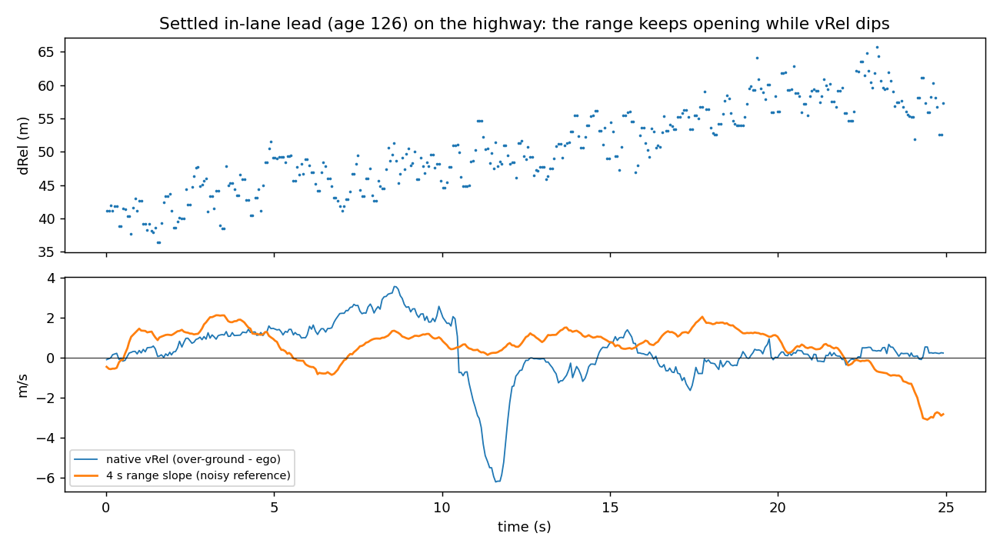
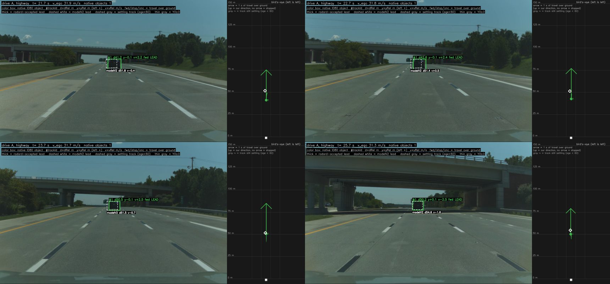
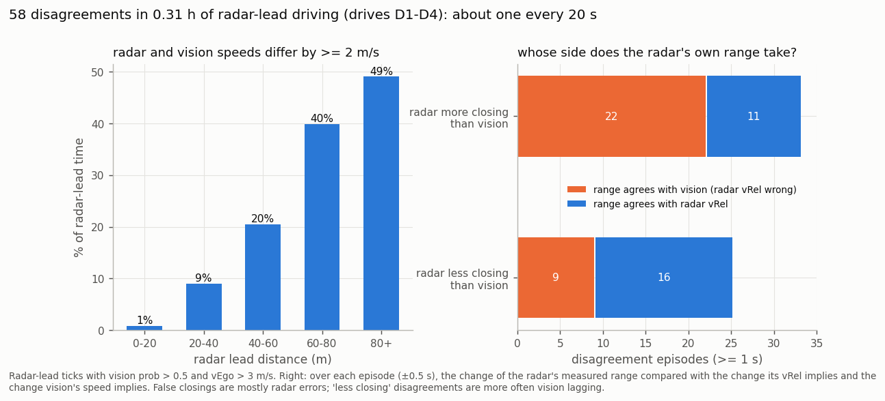
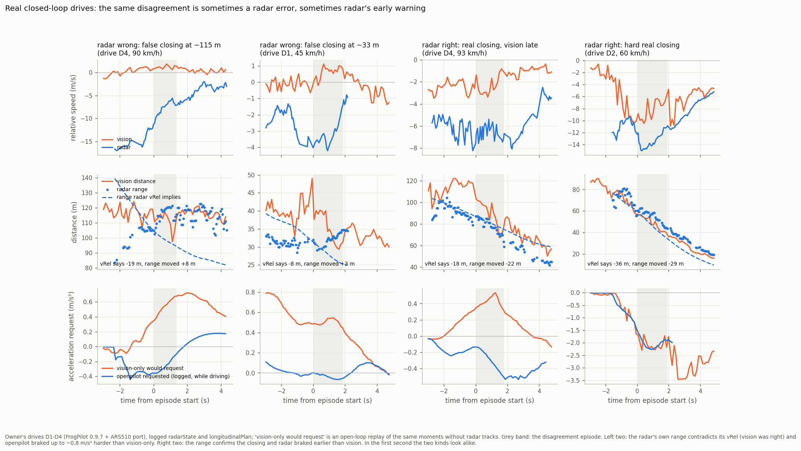
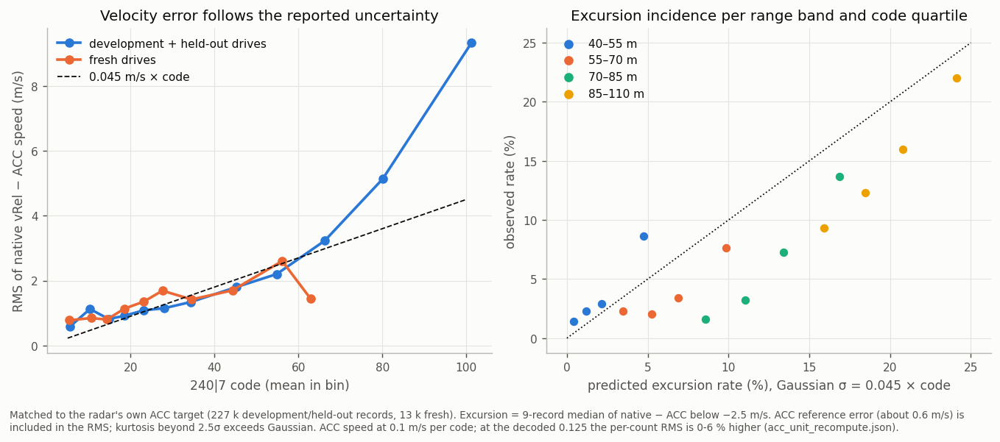
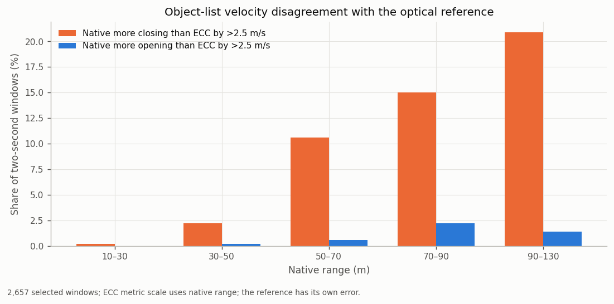
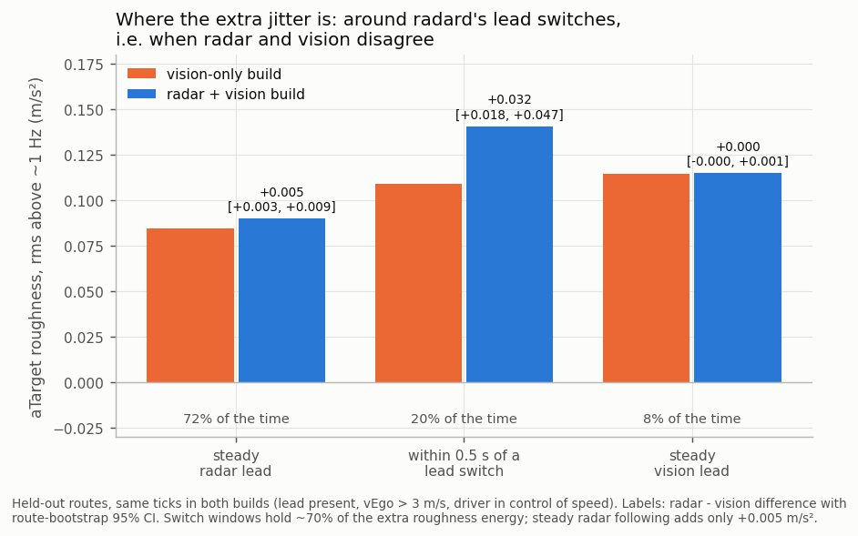

# 07. Velocity excursions (the false-closing issue)

The object list's velocity is its steadiest channel from record to record ([06](06_accuracy.md)), with one systematic flaw: on a settled track the
velocity sometimes **drifts for 1-10 s while the radar's ACC distance and the camera hold steady**, mostly as a **false closing beyond 40 m**.
Through `raw` that shows up in openpilot as extra jitter in the plan and as braking requests only the radar makes
(1.75 per hour). `acc` (the default) publishes the radar's ACC target, whose speed stays smooth through the same
moments; `fused` runs one Kalman filter per track on the object list and the ACC target ([12](12_kalman_filter.md);
[11](11_profiles_compared.md#why-acc-is-the-default)).

| profile | what reaches radard | hard radar-only braking ticks, 20 held-out routes | radar-only braking per hour |
|---|---|---|---|
| `raw` | object-list speed | 93 | 1.75 |
| `fused` (2.0, object-list filter alone) | Kalman-filtered object-list speed | 48 | 0.88 |
| `fused` | filtered object list weighted with the ACC target | 16 | 0 |
| `acc` | the ACC target's speed | 66 (14 while moving; 52 are holds at standstill) | 0 |

[`profiles_vs_vision.json`](../data/analysis/summaries/profiles_vs_vision.json); ticks as defined in
[11](11_profiles_compared.md#at-a-glance).

**In short**

- 80-87% of object-list excursions are false closings ([`acc_unit_recompute.json`](../data/analysis/summaries/acc_unit_recompute.json)); they ramp up over about 1 s.
- Rare close in, common far out: radar and vision disagree by ≥ 2 m/s for 1% of radar-lead time at 0-20 m and 49%
  beyond 80 m ([below](#how-often-on-real-drives); object-list radar through radard, owner's early closed-loop drives).
- Pooled over range, their size follows the speed-error code the radar reports (`240|7`, ◐): codes and errors both grow
  with range. Within a range band the grade varies between drive sets, and against stopped cars as ground truth one
  count is not the same speed error near and far ([below](#far-range-excursions-match-the-reported-velocity-error-scale)).
  The radar's own ACC tracker follows the same car smoothly.
- `fused` weights every reading by that uncertainty and leans on the radar's own ACC target.

## What an excursion looks like

*Bundled sample `highway_vrel_excursion_25s.csv.gz` (object list): a lead at 45-54 m whose range keeps opening; its
over-ground speed falls 33.3 → 24.8 m/s over 1.7 s (vRel to −6.4 m/s) and is back at about 30 m/s 0.5 s after the minimum.*

*Four frames of the same event over 4 s: the lead sits at 41-51 m and its box keeps its size, while the radar lead's
vRel reads +2.2 to +2.5 m/s and then −2.5 m/s; its −6 m/s low falls between the frames (plot above).*

*A long one at ~85 km/h: vRel drifts to −12 m/s over ~9 s while the range stays at 85-110 m and vision holds steady.*

- **Smooth drift:** the gap to the ACC target builds up over about 1 s in small record-to-record steps.
- **The object-list range walks** by metres at 60-100 m and can drift with the speed (the drive-E sample slides 46 → 33 m
  while the ACC distance stays at 46 m), so the ACC distance and the camera are the steady references.
- **The motion state moves with it:** the acceleration field `84|10` follows the drift.

What the radar's waveform allows

### What the radar's waveform allows

A published handbook table for the ARS510 (Winner and Waldschmidt, *Automotive Radar*, 2026, Table 15.3) gives 256
ramps (104 µs repetition), a 19 m/s single-cycle unambiguous radial-velocity span resolved over two cycles, 0.074 m/s resolution, 0.15 m/s
separability (the step of `64|10`) and three bandwidths by ego speed (range resolution 0.4 / 0.7 / 0.98 m); generic
product values (○ for this firmware). Excursion offsets sit well inside that span (median −4.0 m/s against vision,
−3.1 below 40 m to −4.8 at 80-100 m); unwrapping by ±19 m/s changes 57 of 900 labelled samples. Excursions therefore
sit inside the unambiguous span (◐) and build up over about 1 s, which fits low-SNR measurements at range
([`waveform_source.json`](../data/analysis/summaries/waveform_source.json)).

## How often, on real drives

Four closed-loop drives with the object-list radar feeding radard (owner's early FrogPilot port, 1.05 h, 0.31 h following a radar lead):

- radar and vision lead disagree by ≥ 2 m/s for ≥ 1 s **58 times** (about every 20 s of radar-lead driving): 1% of
  radar-lead time at 0-20 m, 20% at 40-60 m, 49% beyond 80 m;
- "radar closing faster": the track's own range sides with vision in 22 of 33;
- "radar closing slower": range sides with the radar in 16 of 25 (vision lagging);
  [`jitter_problem_figures.json`](../data/analysis/summaries/jitter_problem_figures.json).

*Two false closings and two real closings the radar saw first. In the first second they look the same.*

### Far-range excursions match the reported velocity error scale

- Against the radar's own ACC target, the object-list speed error grows with the reported uncertainty `240|7`
  ([03](03_slot_fields.md#kinematics)): RMS ≈ 0.04-0.06 m/s per count (≈ 0.8 m/s at code 15, 1.2-1.3 m/s at code 30;
  [`acc_unit_recompute.json`](../data/analysis/summaries/acc_unit_recompute.json)).
  Codes grow with range, so far tracks carry a 1-3 m/s error scale.
- A Gaussian with σ = 0.045 × code predicts the share of far records inside an excursion (5.3% observed vs 6.5%
  predicted; 7.7% vs 5.5% on fresh drives; [`acc_unit_recompute.json`](../data/analysis/summaries/acc_unit_recompute.json)). A 1-3σ deviation lasts seconds.
- `240|7` (◐) scales with the width of far errors when pooled over range, which is why `fused` uses it to weight readings.
  Within a range band its grade depends on the drive set (rising on some, flat at 20-40 m on others), and against
  stopped cars as ground truth its per-count step is larger near than far, so it is a range-wide weight, not one
  calibrated σ.

Caveats and the residual error

- 0.045 is a fitted Gaussian-equivalent: the robust (MAD) core is about 0.025-0.04 m/s per count over codes 12-70, and heavy
  tails (kurtosis 1.3-8) lift the RMS. Above code ~60 the main set's error grows faster than proportionally (figure).
- Within a range band, `240|7` separates excursion records below 40 m (AUC 0.95) and sits near chance beyond (0.53-0.59,
  [`continental_field_map.json`](../data/analysis/summaries/continental_field_map.json)).
- Across 13.6k candidate signals, the object's own state explains part of the object-list error: `84|10` acceleration (R² 0.11), the uncertainty code `264|8`, width `216|6`. Together the object's state
  and 3 s history predict ~37-43% of the error variance on 40 fresh one-minute segments ([`acc_unit_recompute.json`](../data/analysis/summaries/acc_unit_recompute.json)), spread over many fields
  ([`excursion_sigma_scale.json`](../data/analysis/summaries/excursion_sigma_scale.json)).

Compared with an optical reference (camera scale change)

### Compared with an optical reference

- Reference: `−(native range + 1.52 m) × d ln(scale)/dt` from ECC registration of the lead's rear over 0.5-1 s. It
  derives speed from the image scale change and takes its metric scale and association from the radar's range.
- 2,657 two-second windows of the object list in five bins (10-30 / 30-50 / 50-70 / 70-90 / 90-130 m): native more closing than the reference by > 2.5 m/s in
  0.2 / 2.2 / 10.6 / 15.0 / 20.9% of windows; the opposite in 0 / 0.2 / 0.6 / 2.2 / 1.4%
  ([`video_truth.json`](../data/analysis/summaries/video_truth.json)).

## What openpilot does with it

- radard's per-track Kalman filter smooths **the lead speed (vRel + ego speed) only** and passes a drift into `vLeadK` and `aLeadK`.
- radard's distance gate, max(25 % of the vision lead's distance, 5 m) (`selfdrive/controls/radard.py`, `dist_sane`), keeps the drifting track matched to the vision lead (±28 m at 110 m).
- The planner projects `aLeadK` forward as a·exp(−τ·t²/2), with τ = 1.5 while |aLeadK| stays below 0.5 m/s² and τ
  falling toward 0 while it is larger, so a large drift-driven `aLeadK` is held over the plan.

*20 held-out routes, `raw` object-list radar plus vision against vision only: in steady following the plan is +0.005 m/s² RMS
rougher than vision; around radar/vision disagreements (20% of the time) +0.032, about 70% of the extra roughness energy
([`jitter_problem_figures.json`](../data/analysis/summaries/jitter_problem_figures.json)).*

## How it is filtered

`fused` handles excursions with one Kalman filter per track that weights the object list and the radar's
ACC target by their own uncertainty. The model, every constant, what each part contributes and
the variants tested are in [12 Kalman speed filter](12_kalman_filter.md). `acc` (the default) reads the ACC target
alone: the ACC target's speed is the speed radard sees ([11](11_profiles_compared.md#why-acc-is-the-default)).

## Radar-internal signals that move with an excursion

| signal | behaviour during an excursion |
|---|---|
| `240\|7` velocity-error scale | higher (≈ 0.045 m/s per count against the ACC target) |
| 0x235 ACC target | holds its speed while the object's vRel drifts (when present) |

Together they give a soft prior ([10](10_research_directions.md#for-the-drift-discriminator)): a classifier on every
slot field and its 1 s changes separates false-closing frames from real closings with a cross-validated AUC of 0.78
(0.75 within one range and speed band), and catching half of the false-closing frames flags 15 % of real closings and
10 % of the frames where the lead really brakes. The radar's clean speeds come from its other tracker outputs: the ACC
target, the two summaries and the sparse 0x680 reports ([`frame_trust_classifier.json`](../data/analysis/summaries/frame_trust_classifier.json)).
