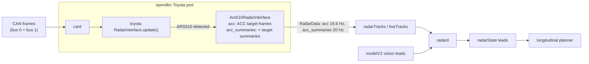
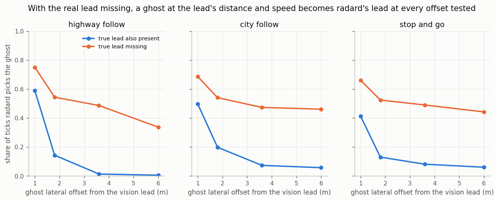
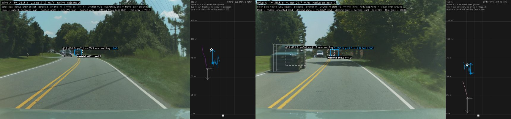
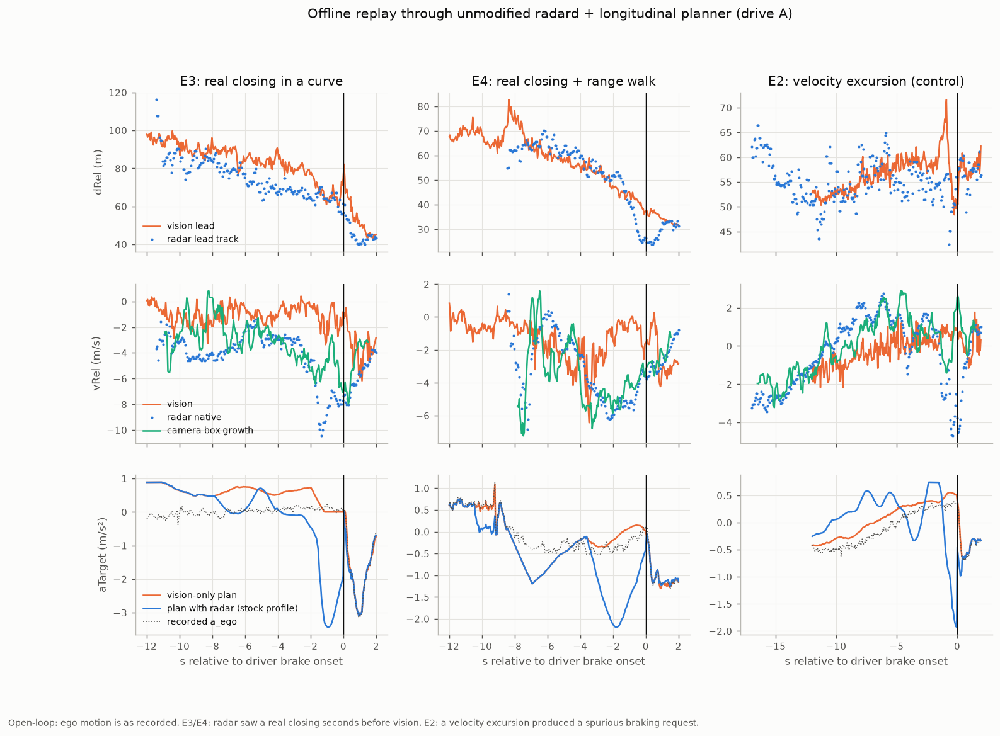

# 08. openpilot integration

The integration turns the radar's output into openpilot radar tracks with openpilot itself running as shipped: a decoder plus
one appended hook block in opendbc's Toyota port (detection and hand-over). radard, the planner and card run unchanged.
The default `acc` profile publishes the radar's ACC target; `acc_summaries` adds up to two other moving cars from the radar's summaries
(target summaries) within 40 m ([profiles](#profiles)). Neither publishes the raw object list: its speeds have
excursions that reach the planner ([07](07_velocity_excursions.md)).

Install instructions for each fork are in [`openpilot/README.md`](../openpilot/README.md).

One installer serves every fork: it copies the decoder and appends an 8-line hook block to the end of
`opendbc/car/toyota/interface.py`, append-only, with the fork's own flags as they are.

| fork | status |
|---|---|
| current openpilot (opendbc master) | self-check passes; replayed end to end through card → radard → plannerd ([`openpilot_integration_replay.json`](../data/analysis/summaries/openpilot_integration_replay.json)) |
| sunnypilot v2026.002.002 | self-check passes; replayed through sunnypilot's own radard and planner; carries `aRel` / `yvRel`; installed and driven on the owner's device |
| StarPilot | same hook; driven by the owner with the earlier patch-based install |
| CarrotPilot (`carrot-wip` 2ec25da) | installer and self-check pass on a checkout of the branch; Carrot's `radarcan` process builds the same RadarInterface (through `update_carrot`), and a car picked in Carrot's car selection (no firmware query, `carFw` empty) is detected from the car model; road drives pending |
| any fork | optional `openpilot/radard_vision_fusion.patch` ([openpilot/README](../openpilot/README.md#optional-radard-patch)) |

What sunnypilot, FrogPilot and StarPilot each do with a radar lead, and how the radar's speed errors reach their planners: [14](14_forks.md).

## How it hooks in

1. **Detection** (hook around Toyota's `CarInterface._get_params`). A radar-ACC RAV4 2022 or 2023-25
   (`ARS510_PLATFORMS`) gets `radarUnavailable = False` from the car model: both radar firmwares in openpilot's
   fingerprints (`8821F0R01100`, `8821F0R03100`) are the ARS510 ([01](01_radar_bus.md#radar-firmware)). The hook also
   requires the radar's early bus-1 frames in the fingerprint (cycle header 0x190, target summaries 0x191 / 0x193, ACC target
   0x235 / 0x237 / 0x239). They start 0.14-1.0 s after the first CAN frame and were in the fingerprint window on all 74
   recorded cold starts ([`radar_health.json`](../data/analysis/summaries/radar_health.json)), while the object list starts only ~5.9 s after power-up. Without them, the car gets a
   radarless setup with vision leads, also on an opendbc that declares the ARS510 itself ([commaai/opendbc#3860](https://github.com/commaai/opendbc/pull/3860)): a radar that is declared but never reports would leave radarState invalid, and
   openpilot would refuse to engage at all (`commIssue`). A fork whose hook passes no fingerprint gets the car model alone. The C-HR
   (`TOYOTA_CHR_TSS2`) and Yaris (`TOYOTA_YARIS`) are in `ARS510_PLATFORMS` for testing: their radars send the same
   frames ([01](01_radar_bus.md#c-hr-and-yaris)). The Yaris sends no 0xB4 wheel speed, so it runs `acc` whatever the
   profile.
2. **Hand-over** (hook on `CarInterface.RadarInterface`, which card instantiates). An `ARS510_PLATFORMS` car with radar
   available is built as `Ars510RadarInterface`; every other car gets the fork's own RadarInterface. card runs as
   shipped.
3. **Fail-safe.** The appended block catches any error from the hook (a fork or opendbc change it no longer fits), logs
   it and leaves Toyota as shipped. The installer never overwrites or removes a file the fork's git tracks: the acc DBC
   goes in as `ars510_acc_target.dbc`, so opendbc's own `toyota_tss2_ars510.dbc` stays as shipped, and an install whose
   file names the fork already ships stops before changing anything.
3. **Decoding from raw frames.** The interface reads the raw `(address, data, src)` tuples card already passes. `acc`
   parses the ACC target frames 0x235 / 0x237 with opendbc's CANParser; `acc_summaries` decodes the same frames and the
   target summaries 0x190-0x194 by hand.
4. **Output.** `acc`: one `RadarPoint(trackId, dRel, yRel, vRel)` for the radar's ACC target while its target-present
   flags are set, reported once per radar cycle (16.6 Hz, when the radar's cycle clock in 0x239 advances). `acc_summaries`: that point plus up to two summary cars within 40 m (`trackId` 64 + pair code, speed from
   a Kalman filter on the radar's cycle clock), reported every fifth card update (20 Hz). Forks whose RadarPoint still
   has the legacy fields (sunnypilot) also get them: with `acc_summaries` the ACC point carries the radar's REL_ACCEL as
   aRel and LAT_SPEED as yvRel, summary cars their lateral slope as yvRel and aRel NaN; with `acc` aRel / yvRel are NaN;
   `measured` is true. The object-list decode in `ars510/` (research, not installed) fills them as:
   - `yvRel`: the radar's lateral ground velocity minus yaw rate × range, with the yaw rate from Toyota 0x24; the radar
     filters it.
   - `aRel`: the radar's filtered over-ground acceleration ((`84|10` − 510.3) × 0.075 m/s²; ego-stopped estimates range 0.035-0.086 by drive set, so treat the scale as approximate)
     minus ego acceleration (from 0xB4). It is smoothed and lags vRel by about 0.5 s; while ego accelerates it still
     carries part of ego's acceleration. openpilot, StarPilot and sunnypilot do not read it (they take the lead acceleration from their own Kalman filter);
     CarrotPilot does.

   - `measured`: false on records the radar marks as predicted (`107|1`), like the Tesla radar's `Meas`.

   `acc_summaries` fills the same fields from the radar's ACC frames instead: `aRel` = the ACC target's `REL_ACCEL`, `yvRel`
   = its `LAT_SPEED` (summary cars: their lateral slope, `aRel` NaN), `measured` true ([11](11_profiles_compared.md));
   `acc`, the upstream file, leaves them NaN / NaN / true. CarrotPilot's radar code reads `aRel` and `yvRel` and skips
   points whose `measured` is false.

   `aRel` and `yvRel` are NaN whenever the yaw rate or ego speed is stale. radard chooses leads from `dRel`, `yRel` and
   `vRel`; current openpilot reads only those three, and older radard versions also store `measured` as metadata.

| situation | RadarData | effect in openpilot |
|---|---|---|
| record completed (~16.6 Hz) | points | radard fuses them with the vision leads |
| between completed records, last record still fresh | `None` returned | radard retains the last scan; a genuinely empty completed scan still clears its tracks |
| before the first record (boot ~6 s) | empty list | vision-only leads, as on a radarless car |
| last record older than 0.5 s (after the first) | `radarUnavailableTemporary` | `radarTempUnavailable` with openpilot long, and in every mode on sunnypilot, StarPilot and openpilot before 2026-09; otherwise radarState invalid → `commIssue` (lateral too) |
| `acc`: the ACC frames stop | nothing returned | radarTracks stop → radarState invalid → `commIssue` (every fork and mode); in 38.4 replayed hours on three cars the ACC frames never stopped while the radar ran, list outages included, and `acc` raised no `canError` ([`radar_health.json`](../data/analysis/summaries/radar_health.json)) |
| record with a bad CRC | dropped | the 0.5 s rule covers sustained loss |
| the radar's own fault flag (0x196 byte 1 bit 0) set on ≥ 2 consecutive cycles, every profile | `radarUnavailableTemporary`, no points, at 20 Hz (in place of the profile's reports) | as above; the radar holds the flag while it declares itself blocked (0x411 dust), when its ACC target can be missing for a lead it still tracks; ≥ 2 cycles never seen otherwise in 127 fleet hours ([`radar_blocked_fault.json`](../data/analysis/summaries/radar_blocked_fault.json)) |
| the radar's PCS alarm (0x100 byte 0 bit 1), every profile | `carState.stockFcw` while it is set | logged; openpilot shows no alert for `stockFcw`, so the screen and dash stay as they are until it does ([15](15_aeb_pcs.md#where-a-relay-stands-for-developers)) |

## Profiles

`install.py --profile NAME` picks one; with no `--profile` a first install gets `acc` and a reinstall keeps the
installed profile ([openpilot/README.md](../openpilot/README.md#install-on-a-comma-device)). [11](11_profiles_compared.md)
compares `acc`, `acc_summaries` and the object-list filter on the same drives.

| profile | what it is | when to use |
|---|---|---|
| **`acc`** (default) | the radar's ACC target alone as one point ([`upstream/ars510_acc_target.py`](../upstream/ars510_acc_target.py) with [`toyota_tss2_ars510.dbc`](../upstream/toyota_tss2_ars510.dbc), 45 code lines, opendbc's CANParser; the upstream proposal): the car Toyota's own ACC follows, published as soon as the radar picks it; every other car comes from the camera ([17](17_upstream.md#the-acc-target-alone--candidate)) | everyday driving and the opendbc-compatible upstream proposal: less unnecessary braking than the object-list filter over every held-out set and fewer lead flips ([11](11_profiles_compared.md#why-acc-is-the-default)) |
| `acc_summaries` | `acc` plus up to two more cars from the radar's own tracker: the target summaries 0x191-0x194 within 40 m, with the ACC car published once and a speed from a Kalman filter on each summary's range ([`openpilot/standalone/ars510_acc_summaries.py`](../openpilot/standalone/ars510_acc_summaries.py), 99 code lines) | forks: braking as `acc` over every replay, held-out drives included; radar-backed cut-ins 0.09 s earlier, more lead flips; about 54 engaged road minutes so far ([11](11_profiles_compared.md#acc_summaries-acc-plus-the-summary-cars), [on the road](#on-the-road)) |

Both hand the whole update to their standalone file (its own reporting cadence and error report; `acc` also needs its
DBC, which the installer copies to `opendbc/dbc/`), with the legacy point fields for forks that carry them.

**Object-list profiles are not installable.** `fused` (the object list through one Kalman speed filter per track,
[12](12_kalman_filter.md)), its single-file form `openpilot`, the unfiltered `raw` and the research models
`shared_speed` / `shared_range` publish the object list's speeds, whose 1-10 s excursions (mostly false closings beyond
40 m, [07](07_velocity_excursions.md)) still reach the planner. On the second car's 38 latest held-out drives `fused`
braked unnecessarily 2.05 s per moving hour more than `acc` (95 % CI 0.51 … 3.85), including a −3.31 m/s² request for a
list track at 54 m whose closing speed read 23.7 m/s at a constant range
([`second_car_batch3.json`](../data/analysis/summaries/second_car_batch3.json)). Asking for one of these names (or
an older one: `anchor`, `steady`, `colored`, `stock`, `default`, `upstream`), or reinstalling over an install of one,
installs `acc` with a note. `FUSED_CONFIG` and `BASE_CONFIG` stay in `ars510/` for decoding logs, Cabana and replays;
their settings are in [12](12_kalman_filter.md).

Replay against the driver, unchanged openpilot card → radard → planner
([`profiles_vs_vision.json`](../data/analysis/summaries/profiles_vs_vision.json), 20 held-out routes, 4.56 h, 167 driver
brake presses unless noted):

The object-list configurations are shown for comparison:

| | `acc` | `acc_summaries` | `fused` (not installable) | `raw` (not installable) |
|---|---|---|---|---|
| hard radar-only braking ticks, while moving | 14 | 14 | 16 | 93 |
| radar-only target episodes, 20 held-out drives (whole drives) | 2 | 2 | **1** | 19 |
| target episodes, 3 owner sunnypilot drives | 0 | 0 | 0 | – |
| driver brakes the planner anticipated (≤ −1 m/s² from 3 s before to 0.5 s after) | 44.9 % | 44.9 % | 44.9 % | 44.3 % |
| first braking request vs vision only, mean | −0.04 s | −0.04 s | −0.01 s | −0.15 s |
| braking only the radar asked for, per hour (driver on the gas) | 0 (0) | 0 (0) | 0 (0) | 1.75 (0.66) |

"Hard radar-only" means the planner asks for ≤ −2 m/s² while the vision-only replay of the same drive asks for ≥ −0.5 m/s²: braking that only the radar wanted. `raw` reacts earlier than `fused` before some driver brakes, partly from
real head starts and partly from an over-closing bias, the bias behind its 93 hard radar-only ticks against `fused`'s 16
([12](12_kalman_filter.md#the-model)).

## What radard does with radar points

radard (openpilot, September 2026) runs at the model's 20 Hz:

- **Kalman filter on vLead only.** One filter per track ID; a NaN vRel would stay in it for good, so the interface
  publishes finite values only. A new track ID resets it; the ACC target keeps its ID while the radar follows the same car.
- **Matching starts from a vision lead.** radard matches a radar track to the vision lead while the lead probability is
  above 0.5, with a distance gate of max(5 m, 25%) and a permissive velocity check. Matching runs afresh every tick,
  so the radar lead follows whichever car the camera currently selects.
- **Wide lateral weighting.** radard scores distance, lateral position and speed against the camera's lead, each
  weighted by the camera's uncertainty, and checks only distance and speed afterwards. If the true lead is dropped from the radar list, an
  adjacent-lane object at the right distance and speed becomes the lead 34-75% of the time, still 34-46% at 6 m
  offset. With `acc` only the ACC target is a radar point, so no other radar car can be picked; the object-list
  filter's path gate withholds such tracks beyond 15 m ([12](12_kalman_filter.md#path-gate)); the radar's own lane weights ([03](03_slot_fields.md#lane-assignment)) could supply a gate inside radard.

  

- **Low-speed override** (ego < 4 m/s): a radar-only lead within ±1 m laterally and 0.75-25 m ahead is accepted
  on the radar alone.
- **16.6 Hz into 20 Hz.** radard re-uses the latest radar record on every tick, so 17.5% of ticks repeat the previous
  vRel; this adds about 1% to `aLeadK` roughness.
- **Stopped vehicles** first seen stopped come mostly from vision ([02](02_object_list.md#what-the-radar-lists)).

## Radar + vision against vision only (replay)

Both profiles and the object-list configurations against vision only on 20 held-out routes (4.56 h with the driver controlling speed, 167 brake presses),
unchanged openpilot card → radard → planner; details, driving pros and cons and assumptions in
[11](11_profiles_compared.md#against-vision-only):

| | vision only | `acc` | `acc_summaries` | `fused` (not installable) | `raw` (not installable) |
|---|---|---|---|---|---|
| first braking request vs vision, mean | — | −0.04 s | −0.04 s | −0.01 s | −0.15 s |
| already asking ≤ −1.0 m/s² from 3 s before to 0.5 s after a brake press | 40.1 % | 44.9 % | 44.9 % | 44.9 % | 44.3 % |
| hard slowdowns missed (request stayed above −1 m/s², of 47) | 10 | 9 | 9 | 10 | 9 |
| braking only the radar asked for, per hour (driver on the gas) | 0 | 0 (0) | 0 (0) | 0 (0) | 1.75 (0.66) |
| request jerk, mean \|da/dt\| | 1.003 | 0.985 | 0.985 | 0.993 | 1.029 |
| flips between a radar and a vision lead, per hour | 0 | 318 | 345 | 347 | 939 |
| forward-collision warnings | 0 | 0 | 0 | 0 | 0 |

`raw`'s earlier reactions come partly from real head starts (closings through curves, far away) and
partly from an over-closing bias that also causes its radar-only braking. `acc`, `acc_summaries` and `fused` start braking when vision
does on average and keep the radar's measured distance for the car the radar's ACC follows.

*Brake event E3: the lead is in a left curve (lateral offset about +3.5 m). The radar lead reads a closing speed of
−5 to −8 m/s while vision reads about −1; the driver braked about 2 s later.*

*Three driver-brake events through radard and the planner: E3 and E4 are real closings the radar saw seconds before
vision (E4 with a range walk); E2 is a velocity excursion.*

## On the road

Road drives so far ran `acc` (two cars), `acc_summaries` (about 54 engaged minutes) and, while it was installable, the
object-list profile `fused` 2.1.0 and earlier tuned profiles. The road record of `acc` and `acc_summaries` is still small;
their main evidence is the replay in [11](11_profiles_compared.md).

- **sunnypilot with `acc`** (9 drives, 2.74 moving hours, 1.62 h with openpilot longitudinal, the upstream `acc` file;
  [`acc_road_drives.json`](../data/analysis/summaries/acc_road_drives.json)). The radar was active throughout: whenever
  the camera saw a lead within 80 m, radard's lead was radar-backed 98.5-98.9 % of the engaged time in each batch of
  drives, and every hard request on the later seven drives followed a real slowing lead the radar backed. On the first two
  drives (1.4 h) radard used the ACC target for 95 % of engaged lead time, and engaged stops ended 3.9-6.2 m behind the lead (`fused` 2.1: 3.3-4.3 m): while
  creeping up to a stopped car `acc` reports a lead speed of −0.03 m/s on average, so the planner holds openpilot's
  designed stop distance, where `fused`'s +0.23 m/s let it creep closer. On those two drives the lead beyond 80 m was camera-only for 19-57 %
  of engaged lead time (`fused` 8 %): the radar's ACC function takes a target at about 80-126 m and drops it when it
  leaves the lane.

- **StarPilot with `acc_summaries`** (2 drives, 22 min, 5.2 min with openpilot longitudinal;
  [`acc_road_drives.json`](../data/analysis/summaries/acc_road_drives.json)): one stop-and-go cycle, a stopped queue with a
  launch, a hard lead stop and two following stretches. With the camera's lead within 80 m it was radar-backed 97 % of
  the engaged time. A summary car was radard's lead on 0.13-0.22 % of moving time and never while openpilot controlled
  speed; logged stops ended 5.0 and 6.1 m behind the lead. Nine later drives (about 49 min with openpilot longitudinal)
  had 18 hard requests (7 at ≤ −2 m/s² on the first four, 11 at ≤ −1.5 m/s² on the last five); each followed a real lead that
  slowed or stopped, and the radar's lead acceleration was no harsher than the same lead's range-differenced acceleration
  (median 0.78 m/s² milder in the 11).

- **sunnypilot with `fused` 2.1.0** (9 drives, 7.4 h, 4.4 h with openpilot longitudinal; the logged radar tracks match
  a re-decode with 2.1.0 exactly). Every engaged brake request of 1.5 m/s² or more (26) had the camera or the radar's
  ACC target closing too. Replayed open loop against vision only: 0 hard radar-only braking in 5.8 moving hours, and
  braking starts 0.4-1.2 s before vision on every drive with a brake event (8 of 9; the recorded motion is the one `fused` drove, which favours it
  in this comparison). Two mild slowdowns (−1.46 and −1.48 m/s², just below that threshold; one overridden with the gas) had a lead beyond 95 m while the
  ACC target was idle: on a curve radard paired the camera's lead with a radar object a lane over, the case the path gate
  handles, and in a work-zone lane shift the right car's radar speed read 3.5 m/s too much closing. One late, firm
  brake (2.8 m/s²) came from a car first detected at 66 m whose object-list range read 15-20 m short until it settled;
  `fused` 2.6's ACC match answers that moment with −1.47 m/s² ([12](12_kalman_filter.md#path-gate)).
- **A second driver's 2025 RAV4 Hybrid with `acc`** (sunnypilot, the installer's `acc` file from 2.6.1, 26 drives, 55 min
  with openpilot longitudinal, as logged; [`second_car_batch3.json`](../data/analysis/summaries/second_car_batch3.json)): radard had a lead 72 % of the engaged time, radar-backed 94 % of it,
  and its radar lead was the ACC target 99.99 % of the time both existed. 26 of 27 braking episodes (≤ −1 m/s²) had a
  radar lead the camera agreed with; the other was a set-speed catch-up with no lead. Behind a stopped car the ACC target
  was present for all 435 engaged seconds. The one bookmark (a far lead braking on an on-ramp merge, followed at
  2.5-2.8 s) was a real slowdown: replayed, the radar profiles ask −1.2 m/s², the hindsight-optimal request, and vision only
  −0.8.
- **A second driver's 2025 RAV4 Hybrid** (sunnypilot, `fused` 2.1.0, [issue #66](https://github.com/ds-sebastian/ars510-radar/issues/66)):
  similar numbers to the owner's car. Radar and camera disagree on closing speed by more than 3 m/s for 1.7% of the
  lead time (owner: 1.8%), 7.0% beyond 70 m (owner: 8.2%), and the ACC target is present 99 / 95 / 66% of the
  radar-lead time at 15-40 / 40-80 / 80-200 m (owner: 99 / 99 / 66%). The driver reports every braking in 21 engaged minutes on
  2.1.0 as having a cause; replayed open loop, that car's one hard radar-only brake was a lead taken from the next
  lane, the same radard pairing as above, which the path gate removes.
- **Earlier tuned profiles** were driven on a FrogPilot 0.9.7 port (4 drives, 1.05 h; the disagreement census in
  [07](07_velocity_excursions.md#how-often-on-real-drives)), StarPilot (2 drives) and sunnypilot (2 drives).
  StarPilot's planner extrapolates lead acceleration unchanged above 35 mph, which turns radar's early `aLeadK` into
  brake-then-accelerate swings; stock openpilot's planner decays it while |aLeadK| stays below 0.5 m/s² ([10](10_research_directions.md#for-a-better-ride)).
  When stopped close behind a car, the UI's lead chevron can sit on the hood, because the UI places it from dRel in
  the camera frame.

Numbers: [`road_v21.json`](../data/analysis/summaries/road_v21.json).

## Checking a new install on the car

1. **Parked, ignition on:** `install.py --check` shows the hook as present; in the log, `carParams.radarUnavailable` is
   false and `radarTracks` (or `liveTracks`) arrive at ~16.6 Hz: with `acc` from card's first update (the ACC frames start
   0.14-1.0 s after power-up), with the object-list profiles with points after ~6 s. (`carParams.flags` stays as the
   fork sets it.)
2. **Stock ACC, openpilot lateral only:** radar tracks feed radarState and the UI lead; compare leads with the video
   and look for `commIssue` events.
3. **openpilot longitudinal:** alpha long sends the radar a UDS "disable transmit" (`28 01 01`) at startup. That stops
   only the radar's car-bus messages; 0x80 keeps arriving on bus 1 on an unfiltered radar line, so radar tracks continue
   ([01](01_radar_bus.md#openpilots-radar-disable)). Check that the radar answers `68 01` and that `radarTracks` stay at
   ~16.6 Hz after it.
