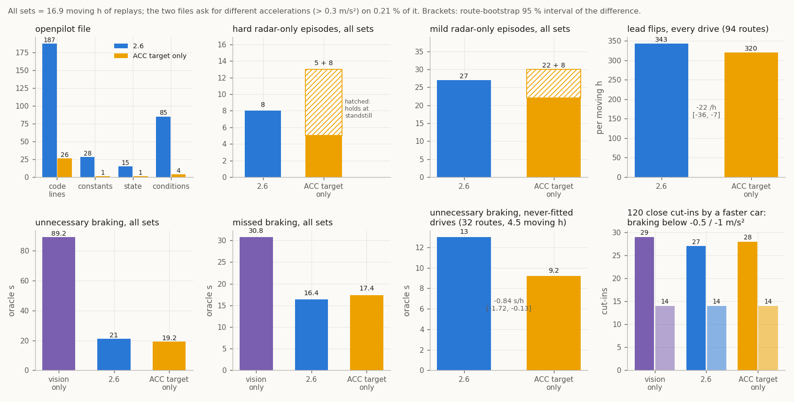

# 10. Research directions

The most promising next steps, ordered by how directly they would improve the radar in openpilot.

## For a better ride

1. **The far range of every track.** The object list reads far cars short of the radar's own ACC distance (5-8% at
   50-100 m) and the vision lead agrees with the ACC distance ([06](06_accuracy.md#distance)). `fused` takes the ACC
   distance for the car the radar follows; other tracks keep the object-list range, smoothed by range fusion. A drive
   behind a second car with a GNSS logger gives the true far distance and shows where the short reading comes from;
   until then range is smoothed separately from the speed filter (the object list's range rate and speed
   disagree by 10-20%, [12](12_kalman_filter.md#what-runs-before-and-around-the-filter)).
2. **More of the lead covered by the radar's own trackers.** The ACC target is present for 99% of radar-lead time at
   15-80 m and 66% beyond on the owner's car ([08](08_openpilot_integration.md#on-the-road)). Far leads without it depend on the object list
   and its wide error alone, which is where much of `fused`'s remaining mild radar-only braking comes from. Finding when and why the radar
   drops or delays its target (range, speed, curve, camera state) tells whether coverage can grow.
3. **A drive with the camera covered.** The ACC target's distance and speed hold steady where the camera's
   association changes, and the radar takes far targets without it ([05](05_acc_target_and_support.md)). The camera's
   messages to the radar never drop out in the logs, so one drive with the camera covered shows whether camera input beyond the
   association state (lane curves, objects) reaches the ACC target or its choice of target.
4. **Physical units for the uncertainty fields.** `240|7`, `232|7`, `224|7` and `248|7` are scaled against the radar's ACC
   target, the radar's own estimate ([03](03_slot_fields.md#uncertainty-and-quality)). An independent reference (a second car with a GPS logger,
   or a known far target) would give them physical units and test `fused`'s weights directly.
5. **Where the weighting lives.** radard's per-track filter is built for radars with a clean relative speed, so the
   ARS510's weighting stays in the interface. In replay, a pass-through interface that hands radard each reading's
   variance (radard also fusing the vision lead's speed) asks for hard radar-only braking about twice as often as
   `fused` (57 against 30 held-out ticks for `fused` 2.4, the version these radard variants ran against); radard's vision fusion (`VISION_V_STD_SCALE` 2.0) on top of `fused` lowers
   unnecessary braking against the hindsight oracle but misses more of it on the road drives (8.4 against 7.2 s)
   ([`radard_side_options.json`](../data/analysis/summaries/radard_side_options.json)). A radard that weighs every
   radar by its reported uncertainty needs its own filter design.
6. **Use the radar's own lead acceleration.** 0x235 byte 2 (relative acceleration) tracks lead acceleration better
   than radard's derived `aLeadK` against a smoothed lead acceleration from the object-list speed (correlation 0.64 vs 0.56, RMS 0.69 vs 0.80 m/s²)
   with less wobble (0.13 vs 0.15; [`acc_unit_recompute.json`](../data/analysis/summaries/acc_unit_recompute.json)). radard derives `aLeadK` from vRel for every car. Used as
   `aLeadK` for the ACC target's track (fork-side radard, replay) it starts braking 0.02 s earlier with fewer hard ticks,
   but a newly acquired target's acceleration starts near zero and replaces the deceleration radard has already built
   up, so more braking comes late on the road drives (7.2 → 10.8 s against the oracle,
   [`radard_side_options.json`](../data/analysis/summaries/radard_side_options.json)). A use needs a hand-over rule
   for new targets.
7. **Lead acceleration in fork planners.** StarPilot extrapolates `aLeadK` unchanged above 35 mph; a decaying
   extrapolation or an `aLeadTau` floor for radar leads would test whether the brake-then-accelerate swing goes away.
8. **Road miles with `fused`.** The replay results ([11](11_profiles_compared.md)) need closed-loop confirmation:
   drives with flagged moments, ideally from a second car, driver or radar firmware.

## Learn from Toyota's own longitudinal control

In the owner's experience, Toyota's stock ACC on this car brakes and slows well for a lead in its own lane, and holds on to a lead that leaves for
a turning lane. Those are likely two different parts of its pipeline; openpilot can learn from the first:

- **Target choice.** The radar picks its ACC target ([05](05_acc_target_and_support.md)) and
  keeps a departing car until its centre is a median 1.64 m off-axis (middle half 0.67-2.16 m; 22 departures). Measured
  against the radar's own lane boundary from the 0x85 curve cells, the release comes when the car's centre is a median
  0.29 m inside that line (21 departures): the release is consistent with the rule "keep the target until its centre reaches my lane
  line". On two matched cut-ins on the fresh drives (inconclusive at n = 2), openpilot's model moved to the new lead first
  (1.5 s and ≥ 6 s earlier); the `fused` profile leaves the lead choice to openpilot's model, which sees lanes.
- **The signal (Toyota's strength).** The radar's ACC speed is smooth and consistent with range during excursions,
  and 0x235 also carries a filtered relative acceleration. `fused` already uses the speed as a measurement.
- **The control law (◐, fitted on two cars).** While following, Toyota's 0x343 command is a linear law on its own ACC
  target: about 0.02 m/s² per metre of gap error, 0.25 m/s² per m/s of closing speed, and a time gap of about 1.1 s (1-bar
  setting, U1). The command trails the target through a short dead time (0.1 s), a slow first-order lag and a rate limit.
  A second car's stock drive only fits once a **set-speed cap** is added: at or above the set speed Toyota holds about 0
  instead of closing a large gap (u1 law R² −0.69 → 0.58 on the second car, U1 unchanged at 0.66). One law with that cap
  fits both cars (time gap 1.07 s). The law also explains Toyota's patience on far leads: a car closing at 3.5 m/s becomes
  the ACC target at 94 m, and Toyota holds +0.06 m/s² for 7 s. It first brakes at 66 m (about 15 s to contact) and
  reaches −0.83 m/s² at 52 m. No lead change or cut-in has yet been seen under stock control without the driver on the gas
  ([`stock_acc_law.json`](../data/analysis/summaries/stock_acc_law.json)).

Proposed study:

1. **Record stock ACC.** 20-30 minutes of mixed traffic with Toyota's ACC in control and the comma device logging
   (openpilot longitudinal off). The radar's own `ACC_CONTROL` (0x343) command then appears next to its target.
2. **Fit Toyota's law.** Model the requested acceleration from the radar's ACC target (distance, closing speed,
   relative acceleration), ego speed and the following-distance setting; compare it with openpilot's planner on the
   same moments (replayed with each radar profile).
3. **Separate signal from tuning.** Replay openpilot's planner fed with the radar's ACC values for the in-lane lead,
   and Toyota's fitted law fed with openpilot's lead. If the planner with Toyota's signal already behaves like Toyota,
   the remaining gap is radar handling (this repo); otherwise it is planner tuning, which belongs in the fork's
   longitudinal settings.
4. **Within-lane decisions.** Score both on in-lane braking events (onset, peak deceleration, jerk, gap at the end)
   and on lane-change / turn-lane departures, so a Toyota-like tune keeps openpilot's lead selection.

## For the drift discriminator

The goal: tell a velocity excursion from a real closing within about 1 s ([07](07_velocity_excursions.md)).

1. **A far-range truth drive.** Following a second car that logs its own speed (a second comma device, or a 5-10 Hz GNSS
   logger) at 40-120 m gives the lead's true velocity. The video-looming reference spans 10-130 m, with 148 of its 2,657
   windows beyond 90 m, and shares the camera with the vision model.
2. **The first second of an excursion.** Velocity steps of a consistent size and sign at onset would point to
   wrong-branch Doppler measurements leaking into the tracker; ordinary-sized steps point to low-SNR tracking
   ([07](07_velocity_excursions.md#what-the-radars-waveform-allows)).
3. **Ego-speed waveform modes.** The handbook table's three ego-speed bandwidths predict steps in the range noise floor
   at fixed ego speeds. Finding them, and the excursion rate in each mode, ties drift risk to a radar setting.

## For the decode

- **Lateral scale and range zero from slow circles.** A stationary object moves sideways at yaw rate × (range +
  3.5 m) while the car turns. Ordinary turns past parked cars already give 69 codes per metre (65-74.5,
  [06](06_accuracy.md#lateral-position)); a few minutes of slow circles in an empty lot with parked cars or poles would
  narrow that to a per-cent and pin the range zero from the gyro alone.
- **`272|5` under a known overhead object.** Driving under a bridge or gantry of known clearance, and past parked
  vehicles of known height, relates the code to height. Its ranking of pedestrians below cars points to a size- or
  reflectivity-like quantity.
- **0x85 curve cells: units and the remaining fields.** Heading `48|16` and curvature `64|15` are bounded to
  1.6-2.2e-5 rad and 2.0-2.7e-6 1/m per code ([04](04_metadata_record_0x85.md#lane--road-boundary-curves)). A camera lane polynomial with matched timing, or a drive along a surveyed curve of known radius, pins both
  units and names the flag `79|1` and the structured fields `0|9`, `20|4`, `24|4`, `44|4` and `80|6`
  ([04](04_metadata_record_0x85.md#lane--road-boundary-curves)).
- **Class 5:** a few recorded passes of a cyclist and of a pedestrian test the bicycle reading of its size and speed.
- **0x195 `q10` with brake pressure:** the logged brake pressure or the brake-assist state next to the event code
  names the deceleration quantity.
- **The radar's ACC tracker bytes and the night light records.** Two bytes of 0x237 rise while the ACC target
  accelerates or brakes, and the camera's 0x240 / 0x244 frames carry light-source records at night
  ([05](05_acc_target_and_support.md)). A drive behind a car with known braking, and a night drive past lights at known
  positions, would name their units.
- **What the camera association changes.** `112|3` shows which objects the camera has confirmed (inside 45 m by day,
  farther at night, [03](03_slot_fields.md#camera-association)). A drive with the camera covered shows what the radar
  does differently for those objects.

## For the integration

- **Other cars and firmware:** openpilot's fingerprints list `8821F0R01100` for the RAV4 2022 platform, the only other
  `8821F0R` entry besides the documented `8821F0R03100`. One capture from such a car confirms the
  layout and adds it to `ARS510_FW_VERSIONS` (until then it is detected by the bus-1 fallback on a warm
  restart). A second unit also shows whether 0x500 / 0x502 differ per unit.
- **More closed-loop driving** with the `fused` profile (the default), and a second car or driver.

## Keeping AEB under openpilot longitudinal

Without a radar CAN filter, openpilot longitudinal disables the radar and its AEB. A relay could bring AEB back: the
disabled radar keeps assessing threats on bus 1, and openpilot would pass its brake decision to the car as 0x283 / 0x344,
keep 0x344 running for the brake system's link check, and show PCS on the dash only while the relay is healthy. How it
would work, and what is needed first (above all, one recorded stock AEB activation with bus 0 and bus 1 logged), are in
[13](13_car_bus_messages.md#aeb-without-a-can-filter).

## What radard gets from other radars

What other radars in openpilot send (signals in their DBCs), and the ARS510 counterpart
([`opendbc/car/*/radar_interface.py`](https://github.com/commaai/opendbc/tree/master/opendbc/car)):

| what other radars send | examples | ARS510 today | what would close the gap |
|---|---|---|---|
| per-track **measured vs predicted** state (`RadarPoint.measured`) | Toyota `VALID` + `SCORE`, Rivian `STATE`, Tesla `Meas` | `107\|1` = predicted (◐) and `16\|8` = existence probability (◐); the fork build publishes `measured = not predicted` for forks that carry the field; upstream openpilot has deprecated it | in place in the fork build; excursions arrive on measured records, so this is hygiene |
| **new-track** flag | Toyota `NEW_TRACK`, Rivian new states | derived from the age field (●) | in place |
| the radar's own **relative** speed | `REL_SPEED` on Toyota, Honda, Hyundai, Chrysler | over-ground speed (`64\|10`) minus 0xB4 ego speed | the ACC target carries a relative speed for the followed car |
| relative **acceleration** | Hyundai `REL_ACCEL`, Tesla `LongAccel` | `84\|10` over-ground acceleration (◐, lags about 0.5 s); the ACC target's relative acceleration (●) | calibrate `84\|10` against independent motion |
| **lateral speed** | Tesla `LatSpeed` | `74\|10` (◐, 0.147-0.155 m/s per code against the gyro, `decode_references.json`) | already published as `yvRel` where forks carry it |
| radar **fault / blockage** status | Honda `RADAR_STATE`, Tesla `sensorBlocked` | "no record for 0.5 s" is reported; candidates: Toyota's car-bus 0x411 `PCS_HUD` alerts (`PCS_DUST2` sensor blocked, `PCS_INDICATOR` = 2 fault), the camera's object-list acknowledgement (0x101 byte 0, 0x197), and a long idle run of 0x680 while driving (longest 1.0 s in 7.8 h of normal driving) | a drive with a covered or dirty radar, or in heavy rain or snow, shows which of them reacts |
| measurement **uncertainty** | (rarely exposed) | `224/232/240/248\|7` family, scaled against the radar's ACC target | physical units would let radard weight radar against vision |
| plain **DBC** decode through `CANParser` | every upstream interface | a 742-byte record split over 106 frames | a reassembler of about 80 lines (`ars510/transport.py`) and a CRC check |

The closest relative in openpilot is the Tesla Model 3's Continental radar (`tesla_radar_continental`, 66 code lines at the opendbc used for the replays):
- the radar sends distance, relative speed and acceleration, lateral position and speed, `Tracked`, `Meas`, existence
  and obstacle probabilities, class, size and uncertainty sigmas; the interface publishes `dRel` / `yRel` / `vRel` of
  tracked points plus the radar status as errors;
- the ARS510 slot follows the same Continental pattern, which is how its existence, predicted-record and uncertainty
  fields were identified ([03](03_slot_fields.md#uncertainty-and-quality));
- the two pieces a Tesla-sized interface would add: a **fault / blockage status**, and handling of the far-range speed
  error, which `fused` does by weighting each reading by `240|7` and the radar's ACC target
  ([12](12_kalman_filter.md#the-model)).

## Towards an upstream (comma) interface

The integration installs on openpilot, sunnypilot, StarPilot and CarrotPilot as an appended hook. The proposal for
upstream is the ACC target alone, written the way opendbc writes radar interfaces.
[`upstream/opendbc_ars510.patch`](../upstream/opendbc_ars510.patch) applies to opendbc master and adds:
- `opendbc/dbc/toyota_tss2_ars510.dbc`: the radar's two ACC target messages, 0x235 `ACC_TARGET_1` and 0x237
  `ACC_TARGET_2` (same file: [`upstream/toyota_tss2_ars510.dbc`](../upstream/toyota_tss2_ars510.dbc));
- `opendbc/car/toyota/ars510_acc_target.py`: a CANParser on those messages that publishes one point at 20 Hz and reports
  `canError` when they stop (26 code lines; same file: [`upstream/ars510_acc_target.py`](../upstream/ars510_acc_target.py));
- in `values.py` the radar DBC for the radar-ACC RAV4 2022 and 2023-25 platforms (so `radarUnavailable` is false there),
  and in `radar_interface.py` the dispatch to it.

With the patch, opendbc's Toyota, platform-config, DBC-parser and car-interface tests pass and its ruff rules hold.
Through opendbc's own CANParser the DBC decodes the bundled frames exactly like the reference decoder
(`tests/test_acc_target_parser.py` checks the same in CI with a minimal parser). `install.py --profile acc` installs the
same file and DBC on a fork. Why the ACC target and not the object list: [the ACC target alone](#the-acc-target-alone--candidate).

If upstream wants every radar track instead, the candidate is the single file
[`upstream/ars510_radar.py`](../upstream/ars510_radar.py) (227 lines, 187 of them code). It holds the reassembler, the slot
decode, track IDs, the ACC target association, the Kalman speed filter and the path gate, in opendbc's style: it passes
opendbc's ruff rules (`upstream/ruff.toml`, checked in CI) and its `ty` type check. It is the smallest version with the
same driving as the full filter: parts were removed alone and together on 27 replay drives, and every hard brake was
checked against the radar's raw range, the camera and the driver ([12](12_kalman_filter.md#removing-parts-together));
the wider ACC match and the path gate came from road drives ([12](12_kalman_filter.md#path-gate)). The ledger below
says what each line buys. A test keeps it equal to `fused` point for point (bundled samples; on 2.4.1 also two full road
drives, 200,209 points, identical; `upstream_equality_2_4_1` in
[`fused_filter.json`](../data/analysis/summaries/fused_filter.json)), and `install.py --profile openpilot` drives it on a fork.
What upstream review is likely to ask, from recent openpilot / opendbc radar PRs:

1. **For the single file: a clear reason the filter belongs in the interface.** Every upstream radar interface except Ford's passes the radar's
   tracks through. The ARS510's object list has slow, correlated speed errors whose width the radar's `240|7` code
   follows as a continuous scale (◐); the unfiltered decode asks for hard braking three times as often as `fused`
   ([`profiles_vs_vision.json`](../data/analysis/summaries/profiles_vs_vision.json)). The candidate's test covers the filter
   (unfiltered, the bundled excursion dives to −6 m/s). With the interface a pass-through and radard weighting each reading by a per-point
   variance, replay asks for hard radar-only braking about twice as often as `fused` (57 against 30 ticks on 2.4; [item 5 above](#for-a-better-ride)). Processing in the interface has precedent: openpilot's Ford
   interface (Delphi MRR, 272 lines, 184 of them code) clusters raw detections into tracks and associates them over time.
2. **Small, separable PRs.** Decode and points first (opendbc, decode only, tested on recorded frames), the
   filter second with before/after plots and process-replay diffs.
3. **Fleet evidence.** Replays come from two cars on one firmware (`8821F0R03100`): the owner's, and 8.8 h from a second
   car that was never used for tuning ([12](12_kalman_filter.md#on-a-second-car)). Its radar unit has the same speed noise
   ([06](06_accuracy.md#velocity)). Drives on other cars and firmware, through `--profile openpilot`, are what upstream would weigh.
4. **Process replay coverage.** A route segment with the radar in openpilot's process-replay tests.
5. **Alpha longitudinal compatibility.** Covered for `8821F0R03100`: after openpilot's UDS radar-disable request the
   radar stops only its car-bus messages and keeps sending bus 1 on an unfiltered radar line
   ([01](01_radar_bus.md#openpilots-radar-disable)).

### Parts of the openpilot file

Each part of [`upstream/ars510_radar.py`](../upstream/ars510_radar.py), its code lines (no comments, docstrings or
blank lines; shared constants counted once), what removing it costs on the 27 replay drives, and its status for an
upstream PR.

| part | code lines | since | without it | for upstream |
|---|---|---|---|---|
| transport, CRC, slot decode, track IDs, ego speed, RadarInterface wrapper | 103 | 1.0 | no radar | required |
| ACC target decode and association | 27 | 2.0 (range scale 0.4 x since 2.3) | +24 unjustified hard ticks on 27 drives; with the 0.25 x scale, one road late brake -1.47 -> -2.36 m/s2 | keep |
| Kalman speed filter (one state, uncertainty-weighted) | 22 | 2.0 | hard radar-only braking about 3x (raw) | keep |
| young-track factor | 3 | 2.0 | further-drive hard ticks 2 -> 11 (on 2.0); second car (with the std gate, with the far rule): a −2.9 m/s² brake on a young track | keep |
| speed-std publication gate | 2 | 2.0 | further-drive hard ticks 2 -> 8 (on 2.0); second car: see the young-track factor | keep |
| age-60 publication gate | 2 | 1.0 | radar-only braking x3 (age 6); age 40: further-drive hard ticks 1 -> 9; age 80: more missed braking against the hindsight-lead oracle (3.3 -> 3.7 s) | keep |
| range fusion (incl. ACC distance as the followed car's range) | 9 | 2.0 (ACC distance 2.1) | braking neutral; lead flips +39 %, target episodes 4 -> 6; second car (with the far rule): braking neutral, flips +11 % | keep for lead stability; droppable at that cost |
| ego-speed alignment (0.149 m/s per code instead of the DBC 0.15) | 0 | 1.x | neutral (onset +12 ms); folded into the decode factor, so it costs no line | keep (no line) |
| state pruning | 7 | 2.0 | unbounded state | required |
| path gate (yaw rate) | 6 | 2.3 (2.2 from 60 m) | back to 2.1 (removed with the 0.4 x match; on 2.4): held-out target episodes 3 -> 4, owner 0 -> 1, further hard ticks 1 -> 2; two road false brakes; second car with the far rule: braking neutral, flips +7 % | candidate: keep, or move into radard as a lateral gate |
| far cars the radar does not follow (beyond 60 m only the ACC target's) | 2 | 2.6 | 2.5 over all four drive sets (16.9 moving h): oracle unnecessary braking 21.6 -> 28.5 s, lead flips 334 -> 418 /h, second car 0 -> 1 hard; with it a fast far closing waits ~1 s for the radar to make the car its ACC target | keep |
| stationary tracks path-gated close in too | 2 | 2.6 | all four drive sets: hard radar-only episodes 12 -> 8 (ticks 30 -> 16), mild 49 -> 26 with it; missed braking unchanged (parked cars at the curb while turning, a parked car alongside) | keep |
| fork compatibility (CP_SP argument, points assigned as a list) | 2 | 2.2 | crashes on sunnypilot | keep (harmless upstream) |

Numbers: [`openpilot_file_parts.json`](../data/analysis/summaries/openpilot_file_parts.json), with the evidence file for
each part.

### The ACC target alone (◐ candidate)

[`upstream/ars510_acc_target.py`](../upstream/ars510_acc_target.py) publishes only the radar's ACC target
(0x235 / 0x237: distance, lateral position, closing speed, target id) as openpilot's one radar point, the way Toyota's
own ACC uses the radar ([05](05_acc_target_and_support.md)). It has no object list, reassembly, track-ID logic, ego speed,
filter or gates: 26 code lines and a 7-signal DBC against 187 lines, 1 constant against 28, 4 conditions against 85.
The replay numbers below come from an earlier hand-decoded version that publishes the same points (all 11,028 bundled
reports identical); the DBC version reports `canError` instead of `radarUnavailableTemporary` when the frames stop
(13 gaps in 11.4 h of drives, all longer than 0.5 s, so both versions flag the same ones). The object list is the
tracker's raw state; the ACC target is its decision: one converged, in-path, moving target with a fine distance and a
filtered speed. Each part of `ars510_radar.py` above rebuilds a piece of that decision:
- the Kalman filter and the young-track factor rebuild the tracker's own speed filtering;
- the age and speed-std gates rebuild "converged";
- the path gates rebuild "in path";
- the far rule is the decision itself at range.

Passing the object list straight through gives hard braking, and so does one gate-free Kalman model over every
object. That model weights each reading by its own uncertainty, either over speed with a traffic prior, or over range
and range rate with the measured 3 % range noise (research profiles `shared_speed` / `shared_range`). It brakes hard
while moving 59 and 168 times against `fused`'s 8. Both object-list kinematic signals, speed and range, carry slow,
correlated errors that no inverse-variance weight removes. Passing the radar's decision through does not have them. sunnypilot's
Hyundai camera-SCC interface publishes that car's ACC lead as its single point the same way.

Replayed over every drive set (16.9 moving h, 62 routes, unchanged radard and planner):
- **Braking.** It asks for something different from 2.6 (> 0.3 m/s²) on 0.21 % of moving time. Every route-bootstrap
  difference to 2.6 includes zero: hard, mild, oracle unnecessary and missed braking.
- **Lead stability and onset.** Lead flips are lower (302 against 332 per hour). Braking starts 0.017 s before vision
  only on real closings (2.6: 0.010 s). The radar supplies the lead more often (88 % against 86 % of lead time),
  because the ACC target needs no age gate.
- **While moving,** it has 5 hard and 22 mild radar-only episodes against 8 and 27. Its other 8 count as hard because
  the car is stopped 0.7-4.8 m behind an object the camera does not report as a lead: radard's low-speed rule holds
  the car there, while vision only would ask to move off.
- **One far case:** a real object braking and drifting a lane to the right at 82 m, still flagged in-path. radard
  matches it to the camera's lead 27 m further on, at radard's 25 % distance limit (−2.6 m/s² for 0.35 s; 2.6 blends it
  down to −0.85).
- **On Toyota's stock-ACC drives** its requests track Toyota's command as closely as 2.6's: on U1 RMS 0.249 m/s² for
  both (jerk p99 0.167 against 0.176 m/s³); on the second car's stock drive (140 s) the two differ by 0.007 m/s² RMS,
  with correlation to Toyota 0.76 for both against 0.68 for vision only. The rest of the gap to Toyota is openpilot's
  planner (0.35 m/s² more braking where Toyota holds at its set speed), not the radar point.
- **No filter on top:** the ACC target's speed does not lag its own distance (best lag −0.06 s, gain 1.00), and its
  fast noise (0.027 m/s) is a fifth of its 0.125 m/s code step, so a filter could only add delay.
- **On drives never used for development or tuning** (32 routes of both cars, 4.54 moving h) it brakes unnecessarily less
  than 2.6: 9.2 against 13.0 oracle seconds (−0.84 s per moving hour, route bootstrap −1.72…−0.13). Hard and mild
  radar-only braking are equal (1 against 0, a correct hold at 0.3 m/s 1.3 m from an object; 10 against 9), and braking
  starts earlier on real closings (−0.020 against −0.008 s vs vision).
- **Close cut-ins** (the lead jumps at least 5 m closer to within 35 m; 450 in all drives): the radar's ACC target moves
  to the cut-in car after a median 0.2 s (0.3 s for a faster car). On the 120 where that car is faster than ego, `acc` and 2.6 never differ by
  more than 0.3 m/s² (braking below −0.5 m/s² in 28 against 27, below −1 in 14 against 14; vision only 29 / 14).
- **Over every drive** (94 routes, 21.45 moving h; it has no fitted constant, while 2.6 was tuned on most of them) it is
  never significantly worse than 2.6 and has fewer lead flips (−22 per moving hour, −36…−7). While moving it has 5 hard
  and 31 mild radar-only episodes against 8 and 36, 28.4 against 35.0 s of unnecessary and 22.9 against 20.3 s of missed
  braking (all route-bootstrap intervals include zero).
- **On 26 owner routes held out from every replay** (2.56 moving h):
  - unnecessary braking 7.7 against 2.6's 11.4 s, and lead flips 323 against 345 per hour (both route-bootstrap CIs
    exclude zero);
  - braking starts 0.053 s before vision only (2.6: 0.026 s);
  - hard, mild and missed braking tie within their intervals. Its one hard episode is a hold at 0.3 m/s, 1.3 m from an
    object, where the oracle asks for −2.65 m/s² too.

Each part earns its line, by what breaks without it (replays of every drive set):
- **Target id as track id.** With a constant id, radard's per-track filter carries the old target's speed into the new
  one: unnecessary braking 19.2 → 37.2 s, hard episodes 13 → 16.
- **Lateral position.** At 0, radard's low-speed rule (points within 1 m of the path) takes targets that are off the
  path: hard braking while moving 5 → 7, mild 22 → 27.
- **The radar's target-present flags.** Without them an absent target becomes a point at 0 m, which radard keeps
  switching to: lead flips 302 → 342 per hour, mild 30 → 32.
- **Reporting at 20 Hz.** No effect in replay, which runs radard in simulation mode; on the car radard accepts
  radarTracks only at 8-24 Hz.

The oracle's reference lead is built mostly from the ACC target's range, so its unnecessary and missed seconds lean
toward this file; the hard, mild and onset numbers do not use it. Numbers:
[`acc_target_parser.json`](../data/analysis/summaries/acc_target_parser.json).
