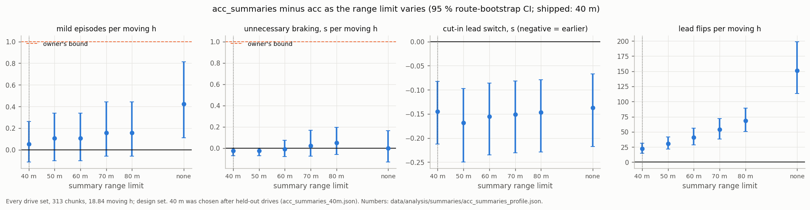

# 11. Profiles compared: `acc`, `acc_summaries` and `fused` against vision only

Three profiles carry the driving recommendation. **`acc`** (the install default, and the opendbc-compatible form)
publishes the radar's ACC target as one radar point. **`acc_summaries`** (the main alternative) adds up to two more
cars from the radar's own tracker within 40 m. **`fused`** publishes every radar car through one Kalman speed filter per
track. `raw` (the unfiltered decode) is the reference all three are measured against, and vision only (stock openpilot on
this car) is the baseline.
This page sets them side by side: how each works, replay numbers on the same drives, driving pros and cons, assumptions,
and how the code compares with openpilot's other radar interfaces.

Numbers: [`profiles_vs_vision.json`](../data/analysis/summaries/profiles_vs_vision.json),
[`acc_target_parser.json`](../data/analysis/summaries/acc_target_parser.json),
[`acc_summaries_40m.json`](../data/analysis/summaries/acc_summaries_40m.json) (the 60 m form: [`acc_summaries_profile.json`](../data/analysis/summaries/acc_summaries_profile.json)),
[`far_acc_only.json`](../data/analysis/summaries/far_acc_only.json),
[`fused_filter.json`](../data/analysis/summaries/fused_filter.json). Figures: `tools/make_fused_figures.py`,
`tools/make_profile_figures.py`.

## At a glance

| | `acc` (default) | `acc_summaries` | `fused` | `raw` |
|---|---|---|---|---|
| radar cars published | the one car the radar's ACC function follows | the ACC car plus up to two other moving cars from the summaries (the radar's two nearest movers), within 40 m | every radar car (60 m and closer); beyond 60 m only the car the ACC target follows | every radar car |
| source | ACC target frames 0x235 / 0x237 | ACC target + target summaries 0x191-0x194, speed from a Kalman filter on their range | object list 0x80 + ACC target, one Kalman speed filter per track | object list 0x80 |
| range of the followed car | ACC distance, 0.025 m per code | ACC distance (summary range, 1/16 m, for the others) | ACC distance (object-list range for other tracks) | object-list range |
| other cars | camera, through radard's usual vision match | two radar cars and camera | radar and camera | radar and camera |
| code | 45 code lines reading 7 DBC signals ([17](17_upstream.md#the-acc-target-alone--candidate)) | 88 code lines, no DBC | 187 code lines in the openpilot file ([17](17_upstream.md#parts-of-the-openpilot-file)) | fork build: relink and saturation guard on the shared decode |
| tuned constants | protocol values only | 40 m limit, speed-filter noise, ACC match 1 m / 0.5 m | sigma scale, young-track factor, process noise, clamp, readiness, path gate, far rule, ACC weight ([12](12_kalman_filter.md#the-model)) | protocol values only |
| hard radar-only braking ticks, 20 held-out routes, moving | 14 | 14 | 16 | 93 |
| braking only the radar asked for, per hour (driver on the gas) | 0 (0) | 0 (0) | 0 (0) | 1.75 (0.66) |
| first braking request vs vision only (95 % CI) | −0.04 s (−0.09 … +0.00) | −0.04 s (−0.09 … +0.00) | −0.01 s (−0.06 … +0.03) | −0.15 s (−0.26 … −0.05) |
| install | `install.py /data/openpilot` (`--profile acc` to switch back) | `--profile acc_summaries` | `--profile fused` | `--profile raw` |
| use | everyday driving; the upstream (opendbc) proposal | the main alternative: earlier radar backing on cut-ins, still small | every radar car, road-tested | research |

Alternatives that were tried (`shared_speed`, `shared_range` and other filter variants) are summarised in
[12](12_kalman_filter.md#kalman-variants-tested) and [17](17_upstream.md#the-acc-target-alone--candidate). The legacy names `anchor` and `steady` select `fused`.

## Head to head

The three profiles replayed through the unchanged openpilot card → radard → planner on every drive set, with the hindsight-lead
oracle ([`oracle_reference.json`](../data/analysis/summaries/oracle_reference.json)) as the judge of unnecessary and
missed braking seconds. Hard = request ≤ −2 m/s² while vision only asks ≥ −0.5; mild = ≤ −1 while vision ≥ −0.3 (episodes);
onset = first request ≤ −0.5 m/s² relative to vision (negative = earlier).
Source: `by_version_and_set` in [`acc_target_parser.json`](../data/analysis/summaries/acc_target_parser.json) and
`fast_suite_by_set` in [`acc_summaries_40m.json`](../data/analysis/summaries/acc_summaries_40m.json); the second car's
38 further drives: [`second_car_batch3.json`](../data/analysis/summaries/second_car_batch3.json) (not part of "all sets").

| drive set (moving h) | profile | unnecessary braking s | missed braking s | lead flips per h | hard / mild episodes | onset vs vision |
|---|---|---|---|---|---|---|
| 27 replay drives (4.18) | vision only | 25.5 | 10.0 | 0 | 0 / 0 | 0 |
| | `acc` | 3.3 | 2.5 | 338 | 13 / 17 | −0.069 s |
| | `acc_summaries` | 3.3 | 2.5 | 351 | 13 / 18 | −0.069 s |
| | `fused` | 2.2 | 3.1 | 383 | 8 / 10 | −0.062 s |
| owner road drives + 2 second-car drives (6.07) | vision only | 7.2 | 10.3 | 0 | 0 / 0 | 0 |
| | `acc` | 6.0 | 10.8 | 187 | 0 / 5 | +0.001 s |
| | `acc_summaries` | 6.0 | 10.8 | 217 | 0 / 5 | +0.001 s |
| | `fused` | 3.3 | 8.3 | 212 | 0 / 4 | −0.010 s |
| second car, held out from tuning (6.19) | vision only | 56.5 | 10.4 | 0 | 0 / 0 | 0 |
| | `acc` | 9.9 | 4.2 | 384 | 0 / 8 | +0.022 s |
| | `acc_summaries` | 9.8 | 4.2 | 410 | 0 / 9 | +0.028 s |
| | `fused` | 15.5 | 5.1 | 413 | 0 / 12 | +0.044 s |
| second car, 38 further drives held out (6.26; main c3e5e8f) | vision only | 70.3 | 12.9 | 0 | 0 / 0 | 0 |
| | `acc` | 4.0 | 4.5 | 304 | 1 / 8 | +0.116 s |
| | `acc_summaries` | 4.9 | 4.5 | 331 | 1 / 8 | +0.114 s |
| | `fused` | 16.8 | 4.8 | 332 | 2 / 15 | +0.085 s |
| fresh owner drives (0.47) | vision only | 0.0 | 0.0 | 0 | 0 / 0 | 0 |
| | `acc` | 0.0 | 0.0 | 386 | 0 / 0 | +0.004 s |
| | `acc_summaries` | 0.0 | 0.0 | 398 | 0 / 0 | +0.004 s |
| | `fused` | 0.0 | 0.0 | 347 | 0 / 1 | +0.004 s |
| **all sets (16.91)** | vision only | 89.2 | 30.8 | 0 | 0 / 0 | 0 |
| | **`acc`** | 19.2 | 17.4 | **302** | 13 / 30 | −0.017 s |
| | **`acc_summaries`** | **19.1** | 17.4 | 325 | 13 / 32 | −0.015 s |
| | **`fused`** | 21.0 | **16.4** | 332 | 8 / 27 | −0.010 s |

What the table shows:

- **`acc_summaries` brakes like `acc` and flips more.** Over all sets it has 19.1 s of unnecessary and 17.4 s of missed
  braking (`acc` 19.2 / 17.4), the same 13 hard episodes as `acc`, one more mild episode, and 325 lead flips per hour
  against `acc`'s 302 (the summary cars give radard more radar points to switch between).
- **`acc` and `fused` ask for nearly the same braking.** Over all sets they differ by more than 0.3 m/s² on 0.21 % of
  moving time, and where they differ `acc` is the closer to the oracle in 79 % of the time (95 % CI 73 … 85 %).
  Both cut vision only's unnecessary braking by 76-78 % (89.2 s → 19.2-21.0 s) and its missed braking by 43-47 %
  (30.8 s → 16.4-17.4 s).
- **`acc` flips between a radar and a vision lead less often** (302 against 332 per hour; route-bootstrap difference
  −29.6 per hour, 95 % CI −43.8 … −15.6 over 62 routes). The other differences over the 62 routes include zero: hard
  +0.30 per hour (−0.33 … +1.11), mild +0.18 (−0.75 … +1.21), unnecessary −0.10 s (−0.55 … +0.31), missed +0.06 s
  (−0.19 … +0.34). Part of the flip edge comes from 28 drives whose camera driving model (some sunnypilot community models)
  reports a saturated lead uncertainty, so radard matches a multi-point profile such as `fused` on lateral position only.
  Without them the flip difference is −20.6 per hour (−34.0 … +2.9) and unnecessary braking +0.26 s (−0.03 … +0.74).
- **The yardstick.** The hindsight oracle takes its lead from the radar's ACC target 96 % of the time. Against a
  camera-only hindsight reference instead, `acc` minus `fused` is −0.48 s of unnecessary braking per moving hour
  (−1.44 … +0.36) and −0.16 s of missed braking (−0.35 … −0.02), so `acc`'s standing does not come from the
  oracle. On 10 episodes where the two references disagree, video sides with the oracle 6 times and with the camera
  twice ([`yardstick_check.json`](../data/analysis/summaries/yardstick_check.json)).
- **`acc`'s hard episodes are mostly standstill holds.** Of its 13 hard episodes, 8 start with the ego car below
  0.5 m/s: the request holds a stopped car 0.7-4.8 m behind an object the camera leaves out of its lead list (a wall, a
  fence, a junction island on video), through radard's low-speed rule. The radar keeps these holds as live tracks, not
  frozen values: on a second car parked with the radar's car-bus output disabled, the ACC target held a small return 7 m
  ahead for 43 s after an SUV crossed in front (range code moving on 2 % of cycles, never in the object list), inside the
  range of 229 other standstill holds, and `acc` would publish it as a lead
  ([`acc_function_tracker.json`](../data/analysis/summaries/acc_function_tracker.json)). While moving, `acc` has 5 hard episodes against
  `fused`'s 8, and 22 mild against 27.
- **Both reach the planner with fine range.** The followed car's range comes from the ACC distance in both
  (per-frame scatter 0.002-0.035 m against 0.1-2.8 m for the object-list range).

### Drives held out from every choice

| set | profile | unnecessary braking s | missed braking s | flips per h | hard / mild |
|---|---|---|---|---|---|
| 26 owner routes outside every replay set (4.28 h, 2.56 h moving) | vision only | 40.1 | 9.9 | 0 | 0 / 0 |
| | `acc` | 7.7 | 5.3 | 323 | 1 / 9 |
| | `acc_summaries` | 7.7 | 5.5 | 339 | 1 / 9 |
| | `fused` | 11.4 | 3.6 | 345 | 0 / 7 |
| 12 second-car routes + 1 owner route held out from every parser decision (1.98 moving h) | vision only | — | — | 0 | — |
| | `acc` | 1.1 | 0.0 | 474 | 0 / 1 |
| | `acc_summaries` | 1.6 | 0.0 | 543 | 0 / 2 |
| | `fused` | 1.6 | 0.0 | 433 | 0 / 2 |

On the 26 held-out owner routes `acc` minus `fused` per moving hour (route-bootstrap 95 % CI, 19 routes) is −1.45 s of
unnecessary braking (−2.79 … −0.26) and −22 lead flips (−36.5 … −3.3); the differences in hard (+0.39,
0.0 … +1.24), mild and missed braking include zero. Pooling every drive held out of development, including a second
car's 12 later drives that no tuning touched (6.46 moving h, 2.0 h above 20 m/s), `acc` has 14.0 against 18.6 s of unnecessary braking
(−0.72 s per hour, −1.65 … +0.15): fewer, but the interval now includes zero. On those 12 drives alone the two tie on every
measure (hard 1 against 1, the same real closing; mild 5 against 4; unnecessary 5.2 against 5.7 s; onset vs vision −0.002 against
+0.007 s), and both follow Toyota's own command about equally (RMS 0.309 against 0.313 m/s², vision 0.345;
[`profiles_vs_vision.json`](../data/analysis/summaries/profiles_vs_vision.json)). Over every drive (94 routes, 21.45 moving h) the
unnecessary-braking difference is −0.31 s per hour (−0.72 … +0.06) and the flip difference −22 per hour (−35.9 … −7.4).

**`acc_summaries` on these drives.** On the 26 owner routes it brakes like `acc` (per moving hour, `acc_summaries` minus
`acc`): unnecessary equal, missed +0.08 s (0 … +0.26), hard and mild identical. On the 13 routes one more mild request
remains, with unnecessary +0.23 s (0 … +0.85). Lead flips rise by 16 per hour on the owner routes and 69 on the 13 routes.
The earlier 60 m limit braked more on both sets (unnecessary +0.61 s per hour on each, missed +0.90 s on the owner
routes): radard took a summary car at 47-58 m as its lead before the radar's ACC picked the real one
([above](#acc_summaries-acc-plus-the-summary-cars)).

### Stock ACC span and cut-ins

- **Lead speed against Toyota's own ACC.** On a recorded span with stock ACC engaged (drive U1), the lead speed
  `acc` publishes matches the one Toyota's ACC acted on to 0.027 m/s RMS (`fused` 0.041, vision only 0.709).
  On the second car's stock-ACC span (S2, 140 s scoreable) the figures are 0.039 (`acc`), 0.086 (`fused`) and 0.92 (vision
  only) m/s; the planner's request correlates with Toyota's at r = 0.758, 0.755 and 0.678.
- **Close cut-ins** (a lead jumps ≥ 5 m closer within 0.5 s to under 35 m, ego above 5 m/s; 450 cases): `acc` picks the
  cutting car after a median 0.2 s (0.33 s for a cutting car that is opening, 120 cases). The median minimum request
  is −0.81 m/s² (`acc`), −0.85 (`fused`) and −0.80 (vision only); for the opening cars all three request about
  −0.15 m/s².
- **The radar names a cutting-in car before the camera does.** On 111 cut-ins found from the object list's geometry against
  the camera's lane lines (two cars), the ACC target switches to the cutting car a median 0.52 s before the camera model's
  lead does (first on 73 %, by more than 0.5 s on 50 %); the camera is first by more than 0.5 s on 16 %, mostly far cars.
  `acc`'s radard lead follows the switch within 0.04 s. The radar's own lane-crossing code (`120|3`) comes earlier still
  when it fires, but it misses 40 % of cut-ins and fires about four times per real cut-in on cars that never enter the lane
  ([`cutin_signals.json`](../data/analysis/summaries/cutin_signals.json)).

## Why `acc` is the default

- **Equal braking, fewer lead flips, less unnecessary braking on held-out drives** (tables above), with the same
  standing under a camera-only reference. Over every set held out of all tuning (12.72 moving h: owner routes and three
  second-car sets) `acc` has 1.37 s less unnecessary braking per moving hour than `fused` (95 % CI 0.44 … 2.39) with
  the same hard episodes (3 / 3). On the second car's 38 latest drives all 9 of `acc`'s radar-only episodes were real
  closings, while `fused` added 6 the hindsight lead does not confirm, among them a −3.31 m/s² request at 30 m/s for an
  object-list track at 54 m whose closing speed read 23.7 m/s while its range held still (a speed excursion,
  [07](07_velocity_excursions.md)); `acc` stayed on the ACC target 12 m beyond it ([`second_car_batch3.json`](../data/analysis/summaries/second_car_batch3.json)).
- **No slower launches.** When a stopped lead pulls away, the ACC target reports it moving (+0.5 m/s) a median 0.11 s
  before the camera lead and 0.20 s before the object list (168 departures, two cars), and Toyota's own ACC releases at
  that same +0.5 m/s. A slow green-light launch is the planner's, not the radar's
  ([`timing_launch_health.json`](../data/analysis/summaries/timing_launch_health.json)).
- **A new stationary vehicle reaches the planner at once.** `fused` publishes a track once it is 60 radar cycles
  old (3.6 s), which shields the planner from a young track's unconverged speed. In a short city approach that can be
  the whole encounter. On U3 a pickup parked in the lane was tracked from about 30 m ahead and lost at 14 m, one cycle
  short of age 60, so `fused` drove as vision only. `acc` published it from 18.9 m, 0.6 s before Toyota's PCS warned,
  with the radar's range; vision put the lead 3-4 m closer
  ([15](15_aeb_pcs.md#a-recorded-stock-pcs-alarm-u3);
  [`pcs_activation_u3.json`](../data/analysis/summaries/pcs_activation_u3.json), `replay_open_loop`).
- **Small and auditable.** 45 code lines reading 7 DBC signals, protocol values only: it passes on the radar's own
  decision, the one Toyota's ACC acts on.
- **Replay evidence on 21.45 moving hours.** `fused` also has road drives (sunnypilot and a second driver's car,
  [08](08_openpilot_integration.md#on-the-road)). `acc` has a small road record on sunnypilot (the owner's nine drives, 1.62 h with
  openpilot longitudinal, and a second driver's 26 drives, 0.92 h): with the camera's lead within 80 m, radard's lead was radar-backed 98.5-98.9 % of the engaged
  time, and the first two drives stopped at openpilot's designed gap.

## `acc_summaries`: `acc` plus the summary cars

The target summaries (0x191-0x194, [05](05_acc_target_and_support.md#0x191-0x194-selected-target-summaries)) carry the two
nearest moving vehicles of the same internal tracker that drives the ACC target. `acc_summaries`
([`openpilot/standalone/ars510_acc_summaries.py`](../openpilot/standalone/ars510_acc_summaries.py), 99 code lines,
no DBC) publishes them next to the ACC target:
- **The ACC car once.** A summary within 1 m / 0.5 m of the ACC point is that car and is not published again.
- **Identity.** Every other summary is `trackId 64 + code` (its pair code). It is published once its code has 8 ranges
  within 0.6 s, so a code that returns after a gap does not mix old and new ranges.
- **Speed.** A summary range is the tracker's range rounded down to 1/16 m. Each code gets a constant-velocity Kalman
  filter, timed by the radar's own cycle clock (0x190) and fed the middle of each 1/16 m step. It restarts with the car's
  history (a new code or a 5 m range jump). Against the ACC target's own speed on the same car the filter
  has 0.142 m/s RMS error where that slope had 0.166 (second car 0.157 against 0.170; 99th percentile 0.51 against
  0.61 m/s), and it brakes the same in replay (23 moving h: hard, mild and missed unchanged, unnecessary 32.2 → 32.1 s;
  [`accsum_summary_speed.json`](../data/analysis/summaries/accsum_summary_speed.json)). The filter needs few guards.
  Dropping a cycle-time window, a slope fallback, a minimum update count, a duplicate-cycle check and a gap restart
  leaves the braking identical (same totals on every measure; requests differ on 0.12 % of ticks, by at most
  0.11 m/s²). The 5 m jump restart and the 8-ranges-in-0.6 s publication gate do carry weight
  ([`accsum_guard_ablation.json`](../data/analysis/summaries/accsum_guard_ablation.json)).
- **Optional point fields, for forks.** On forks whose RadarPoint still has `aRel` / `yvRel` / `measured`, the ACC point
  carries the radar's own `REL_ACCEL` as `aRel` and `LAT_SPEED` as `yvRel` (d(LAT_DIST)/dt in the car's frame, left
  positive; a wrapped value is restored from the frame's check byte); a summary car carries the slope of its last 8 laterals
  as `yvRel` and `aRel` NaN (the radar sends no acceleration for it); `measured` is true. On two owner drives (46,170
  reports) the published tracks are unchanged; the ACC `aRel` follows the target's own speed change (correlation 0.955,
  slope 0.96); and `yvRel` predicts the lateral position 0.5 s ahead with RMS 0.137 m against 0.166 m for zero (ACC point)
  and 0.278 m against 0.441 m (summary cars) ([`accsum_optional_fields.json`](../data/analysis/summaries/accsum_optional_fields.json)). sunnypilot and StarPilot do not read these fields;
  CarrotPilot's radar code uses `yvRel` for lateral prediction and cut-ins, reads `aRel`, and skips points whose `measured`
  is false.
- **Within 40 m.** Beyond 40 m only the ACC target is published. Further out radard can take a summary car in the next
  lane as the camera's lead before the radar's ACC has picked the real one: on held-out owner routes it took cars at
  47-58 m, 10-14 m off the camera's lead range, once braking for the wrong car and once missing a slowing lead. Without
  any limit it gave two hard spikes from cars 7 m to the side at 86-93 m. The Kalman speed does not change this: without
  the limit it adds one hard and nine mild episodes over 23 moving hours (mild +0.39 per hour [+0.14, +0.68]) and 128
  more lead flips per hour ([`accsum_guard_ablation.json`](../data/analysis/summaries/accsum_guard_ablation.json)).

Replayed against `acc` on the fast suite, both held-out sets and every captured drive no replay set had used (103 routes,
23.0 moving hours; route-bootstrap 95 % CI of the difference per moving hour,
[`acc_summaries_40m.json`](../data/analysis/summaries/acc_summaries_40m.json)):

| | `acc` | `acc_summaries` | difference per moving h |
|---|---|---|---|
| hard episodes | 14 | 14 | 0 [0, 0]; no new episode |
| mild episodes | 43 | 46 | +0.13 [0, +0.31] |
| oracle unnecessary braking | 31.8 s | 32.2 s | +0.02 [−0.01, +0.06] s |
| oracle missed braking | 30.7 s | 29.9 s | −0.04 [−0.13, +0.02] s |
| lead flips per hour | 315 | 342 | +26 [+19, +36] |

- **Earlier radar backing.** On 276 close cut-ins in the fast suite radard's lead becomes radar-backed 0.09 s earlier than
  with `acc` [−0.14, −0.04]: earlier on 24, later on 3.
- **Against the 60 m limit** on the same drives: mild −0.04 per hour (−0.15 … 0), unnecessary −0.10 s (−0.28 … +0.03),
  missed −0.03 s (−0.33 … +0.24), lead flips −19 per hour (−28 … −13); the cut-in head start goes from 0.10 to 0.09 s.
  On the three sets outside the design drives (6.1 moving h) the 60 m limit gave +0.45 s of unnecessary and +0.38 s of
  missed braking per hour against `acc`; at 40 m they are +0.07 and −0.13 s.
- **The short form drives like the longer first version.** An 82-line version that tracked each summary on the radar
  clock, restarted it on range jumps and matched the ACC car by its exact rounding gives the same braking on every
  measure (hard, mild and missed identical; unnecessary −0.02 s/h [−0.07, +0.02]); its speeds were slightly cleaner
  offline (0.18 against 0.21 m/s RMS against the ACC speed).
- **Choice of 40 m.** On the design drives every limit from 40 to 80 m brakes alike and the limit mainly trades lead flips
  against how early a camera lead becomes radar-backed; the held-out drives place the mismatches beyond 40 m. Also leaving
  out cars beyond the ACC car does not brake better (unnecessary +0.02 s per hour, flips −4), and publishing the summary
  cars only while an ACC target exists loses the cut-in gain, so the profile keeps one range limit.
- **Remaining mild requests.** They come from a car the camera also leads on, sweeping across the frame in a bend after
  the radar's ACC function released it; its range slope then reads 2-3 m/s more closing than the camera. `acc` stays the
  default; `acc_summaries` is the recommended alternative. Its road record is two short StarPilot drives (5.2 min
  with openpilot longitudinal; radar-backed 97 % of the engaged time with the camera's lead within 80 m, a summary car as
  radard's lead on 0.13-0.22 % of moving time; [08](08_openpilot_integration.md#on-the-road)).

## Which profile for what

| situation | profile |
|---|---|
| everyday driving, the upstream (opendbc) proposal | `acc` |
| radar backing for close cut-ins and the nearest other cars, in a small file | `acc_summaries` |
| every radar car within 60 m, with the longest road record | `fused` |
| an all-tracks candidate for upstream, in one file | `openpilot` (`fused` in `upstream/ars510_radar.py`) |
| research on the object list's own errors | `raw` |

`acc` publishes the followed car; Toyota's own ACC follows that same car. `acc_summaries` adds the radar
tracker's two nearest moving cars when they are not that car. `fused` keeps the radar's other cars, which
radard matches to the camera's lead through its distance and speed gates.

## How each profile works

*Each row is one processing step; coloured cells are the steps a profile runs. Line counts are code lines of the
fork build (`ars510/`). `acc` and `acc_summaries` are each one whole file: `acc_summaries`' 63 lines include its own ACC target decode, so they
are not added to `acc`'s 45;
the object-list steps belong to `raw` and `fused`.*

- **`acc`** publishes the radar's ACC target: the one car the radar's own ACC function follows, already chosen,
  converged and in path, with its fine distance (0.025 m), lateral position and closing speed. Toyota's ACC uses
  that same output. The radar's target ID is the track ID; every other car comes from the camera through radard's usual
  vision match. The protocol part: opendbc's CANParser on three DBC messages, the target-present flags, `canError` when
  the ACC frames stop (CANParser's timeout), and one report per radar cycle (16.6 Hz, when the radar's cycle clock in 0x239 advances).
- **`acc_summaries`** publishes the same ACC point and, from the target summaries 0x191-0x194, the radar's two nearest
  other moving cars within 40 m: range and lateral position at 1/16 m and 0.015 m, `trackId` 64 + the summary's pair code,
  and a speed from the least-squares slope of that code's last 8 ranges. A summary within 1 m / 0.5 m of the ACC point
  is the ACC car and is skipped. Details [above](#acc_summaries-acc-plus-the-summary-cars).
- **`fused`** adds range fusion and **one Kalman filter per track** on the lead's over-ground speed
  ([12](12_kalman_filter.md#the-model)). It uses the scalar Kalman equations with a process-noise scale of 1.5 m/s²
  (a lead-acceleration bound). Each reading updates it in turn, weighted by its model variance: object-list speed has
  σ = 0.045 m/s × max(`240|7`, 1), multiplied by 1.8 through age 60 and tapered to 1 at age 100. The matched ACC target
  uses σ 0.13 m/s for the one track it describes. Innovations beyond 3 innovation standard deviations are clamped (a
  robust Kalman update), and a track is first published once its modeled speed standard deviation is at most 0.75 m/s
  (and age at least 60), which is a readiness measure for publication. radard then runs its own Kalman filter on the
  lead; `fused` feeds it one speed per track that combines what the radar knows.
- **`raw`** publishes the object list as decoded: tracks from age 60 (≈ 3.6 s, once range and speed have converged),
  the radar's own track IDs re-linked across short gaps, speed relative to the ego car, and the invalid velocity code
  withheld. Velocity excursions (1-10 s false closings beyond 40 m, [07](07_velocity_excursions.md)) reach the planner.

*Left: how much `fused` trusts each reading by range. Middle: the share of the estimate coming from the radar's ACC
target when it is present. Very close in, the object list dominates; from about 10 m on the ACC target does. Right:
speed standard deviation of a new track against age; the 0.75 m/s line is the publication gate, which holds young far
tracks back through the filter's own uncertainty.*

*`raw` and `fused` on the two bundled excursions (regenerated from `data/sample/`). The dashed line is the radar's ACC
target, which is exactly what `acc` publishes. Drive A's capture holds 0 frames of 0x235 / 0x237, so there `acc` publishes an empty list and radard
uses the camera lead.*

## Against vision only

Each profile was replayed on the same 27 drives through the unchanged openpilot card → radard → planner, and
judged against what the driver did, with the pre-registered definitions used for the original radar-vs-vision test
([`driver_agreement_preregistered.json`](../data/analysis/summaries/driver_agreement_preregistered.json)).
The 20-route "held-out" set (the name from the original radar-vs-vision test; development also used its drives): 4.56 h with the driver controlling speed, 167 driver brake presses, 47 hard slowdowns.

| driver brake presses (167) | vision only | `acc` | `acc_summaries` | `fused` | `raw` |
|---|---|---|---|---|---|
| first request ≤ −0.5 m/s², mean vs vision (95 % CI) | — | −0.04 s [−0.09, +0.00] | −0.04 s [−0.09, +0.00] | −0.01 s [−0.06, +0.03] | −0.15 s [−0.26, −0.05] |
| median first request vs the brake press | −0.58 s | −0.68 s | −0.68 s | −0.69 s | −0.87 s (vision −0.61 s) |
| already asking ≤ −0.5 m/s² from 3 s before to 0.5 s after | 80.8 % | 82.0 % | 82.0 % | 82.0 % | 84.4 % |
| already asking ≤ −1.0 m/s² from 3 s before to 0.5 s after | 40.1 % | 44.9 % | 44.9 % | 44.9 % | 44.3 % |
| hard slowdowns missed (request stayed above −1 m/s², of 47) | 10 | 9 | 9 | 10 | 9 |

| over 4.56 h of driver-controlled driving (jerk, error, lead share and flips: its 2.66 h moving) | vision only | `acc` | `acc_summaries` | `fused` | `raw` |
|---|---|---|---|---|---|
| braking (≤ −1 m/s², ≥ 0.3 s) only this system asked for, per hour | 0 | 0 | 0 | 0 | 1.75 |
| … of which the driver was on the gas | — | 0 | 0 | 0 | 0.66 |
| hard radar-only braking ticks (≤ −2 m/s² while vision ≥ −0.5; while moving) | — | 66 (14) | 66 (14) | 16 (16) | 93 |
| driver overrides (38): radar request closer / further than vision to what the driver then did | — | 7 / 0 | 7 / 0 | 7 / 0 | 7 / 2 |
| request error vs the driver's acceleration 0.5 s later (RMS) | 0.409 m/s² | 0.411 | 0.411 | 0.412 | 0.422 |
| request jerk (mean \|da/dt\|) | 1.003 | 0.985 | 0.985 | 0.993 | 1.029 |
| share of lead time on a radar lead | 0 | 84.8 % | 85.9 % | 83.1 % | 86.6 % |
| flips between a radar and a vision lead, per hour | 0 | 318 | 345 | 347 | 939 |

The median row uses each column's own paired set: 149 paired brake presses for `acc`, `acc_summaries` and `fused` (vision −0.58 s), 148
for `raw` (vision −0.61 s).

What the radar adds, by profile:

- **`acc`** starts braking 0.04 s before vision only on average (95 % CI −0.09 … +0.00), anticipates 44.9 % of
  driver brakes at ≤ −1 m/s² (vision 40.1 %), misses one hard slowdown fewer than `fused`, asks for 0 braking per hour that only
  the radar wanted, and has the lowest jerk and the fewest lead flips. Its 66 hard ticks are 14 while moving and 52
  holds at standstill. On the 4 further drives it has one moving hard episode (7 ticks, a real object drifting a lane
  over at 82 m that radard matches to the camera's lead 27 m further on) and 12 ticks at standstill; `fused` has 0.
- **`acc_summaries`** answers driver brakes exactly as `acc` does on these drives (same anticipation, misses, hard ticks
  and overrides); radard follows a radar lead slightly more often (85.9 %) and flips more (345 per hour).
- **`fused`** removes the object list's over-closing bias and with it all radar-only braking on the held-out drives
  (0 per hour). It starts braking when vision does on average (−0.01 s, 95 % CI −0.06 … +0.03): 18 of 149 paired
  driver brakes are answered earlier than vision and 12 later, and it asks for ≤ −1 m/s² before 44.9 % of brake presses
  (vision 40.1 %). In the 4 s before driver brakes, while its lead is a radar point, it shows on average 0.31 m/s less
  closing than the vision lead (median 0.16).
- **`raw`** brakes 0.15 s earlier than vision on average and anticipates a few more driver brakes. Part of that head
  start is real (the radar sees closings through curves and before the camera's distance estimate settles); part is
  the object list's over-closing bias, which also causes its radar-only braking.
- **Every radar profile follows a radar lead 83-87 % of the time a lead exists** (`acc` 84.8 %, `acc_summaries` 85.9 %, `fused` 83.1 %, `raw`
  86.6 %), so radard uses the radar distance for those leads. In both `acc` and `fused` the followed car is published at the
  radar's ACC distance, which agrees with the vision lead within a metre up to 90 m; in `fused` the ACC distance also cut
  the lead flips by 30 % when it was added in 2.1
  ([12](12_kalman_filter.md#matching-the-radars-trackers-to-tracks)). `fused`'s other tracks keep the
  object-list range (6 cm resolution; frame-to-frame jitter about 3 % of range far out).

### What the Kalman filter does on its own

`fused` 2.0 with the ACC target switched off runs the filter on the object list alone: 48 hard radar-only ticks on the held-out routes
against `raw`'s 93, 0.88 radar-only braking events per hour (0.22 with the driver on the gas) against 1.75 (0.66), first
request −0.03 s against −0.15 s, 41.9 % anticipation at ≤ −1 m/s² against 44.3 %. The ACC target supplies the rest of
`fused`'s drop (16 hard ticks, 0 radar-only braking per hour). The filter alone is the behaviour of a `fused` track
whose lead comes from the object list alone.

## Driving experience: pros and cons

| profile | pros | cons |
|---|---|---|
| vision only | smooth; braking follows the camera alone | camera distance at range; closings through curves or far away are seen later than the radar sees them |
| `acc` | a DBC and 45 code lines, protocol values only; uses the radar the way Toyota's ACC does; lowest jerk and fewest flips in replay; slightly earlier than vision; new stationary vehicles published at once | one radar car; a fast closing beyond 60 m reaches the planner through the camera until the radar picks the car (about 1 s later on one owner drive, 0.8 s on another; `fused` publishes only the ACC target there too); close cut-ins are picked after a median 0.2 s and brake as with `fused`; holds at standstill behind close objects that the camera leaves out of its lead list; replay evidence on 21.45 moving hours and a small road record (nine drives) |
| `acc_summaries` | 99 code lines, no DBC; braking as `acc` on every drive set, held-out drives included; radar backing 0.09 s earlier on close cut-ins | more lead flips (+26 per hour); two short road drives so far |
| `fused` | every radar car within 60 m; closest to vision in feel, radar-only braking gone, as early as vision on average; sunnypilot road drives and a second driver's car | the head start over vision is small on average; 187 code lines with tuned gates; a track is published 3.6 s after it appears |
| `raw` | earliest reaction to real slowdowns (−0.15 s vs vision) | the most radar-only braking (1.75 per hour, over a third with the driver on the gas): occasional sharp brakes on false closings beyond 40 m |

## Assumptions and limits

- **Open-loop replay.** The recorded drives are replayed through the unchanged openpilot (or sunnypilot) radard and
  planner; the car's actual motion stays as recorded, so differences are what the planner would have asked for.
- **The driver is the reference.** "Earlier" and "anticipated" are measured against the moment the driver pressed the
  brake; braking before the driver can be right or early, which is why hard brakes are also judged one by one
  ([12](12_kalman_filter.md#what-each-part-is-worth)).
- **Vision only is stock openpilot's own lead model** on the same recorded camera frames; its lead speed is noisy and
  serves as a comparison. The radar's ACC target is the radar's own estimate (sent by the radar ◐,
  [05](05_acc_target_and_support.md)), so it shares the radar's view of the scene.
- **Scope.** One car (RAV4 2022, firmware `8821F0R03100`), 27 replay drives (20 held-out routes, 4.56 h of
  driver-controlled time; 4 further drives; 3 owner sunnypilot drives) used during development, plus 8 fresh drives, 26
  held-out owner routes and the second car's routes. In the driver-brake table, at most 7 brake presses separate
  the columns in each row.
- **Versions.** `fused` rows are release 2.6.0 (far rule, stationary path gate, ACC target weight 0.13 m/s, summaries
  off). `acc_summaries` rows are the public `openpilot/standalone/ars510_acc_summaries.py` with its 40 m limit and summary-glitch guards ([`summary_all_ones_glitch.json`](../data/analysis/summaries/summary_all_ones_glitch.json)). `acc` rows are the public `upstream/ars510_acc_target.py` replayed through the same harness; the replayed
  file is a hand-decoded version that publishes the same points as the current DBC file (45 code lines) on
  all 11,028 bundled reports; the file's lateral-wrap unwrap changes no planner tick in the replay
  ([`acc_lat_dist_wrap.json`](../data/analysis/summaries/acc_lat_dist_wrap.json)).
- **Definitions.** Hard radar-only tick: planner ≤ −2 m/s² while vision only asks ≥ −0.5. Driver-brake metrics use
  [−3, +0.5] s (anticipation), [−3, +2] s (first request) and [−3, +1] s (missed hard slowdown) around the brake press.

## Compared with the other radar interfaces in openpilot

The ARS510 files against openpilot's other radar interfaces, line by line, are in
[17](17_upstream.md#compared-with-the-other-radar-interfaces-in-openpilot).
