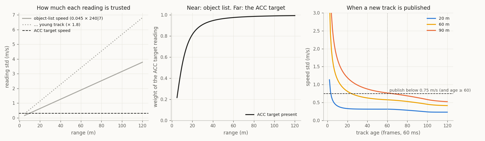
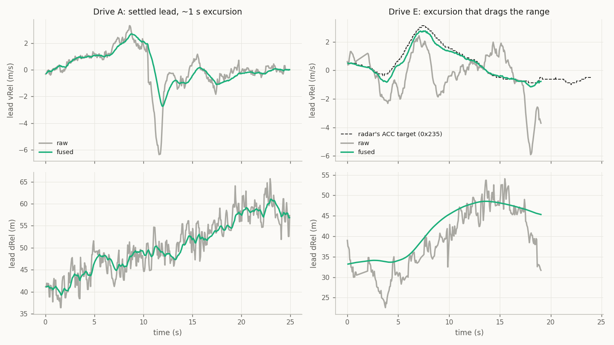

# 11. Profiles compared: `acc` and `fused` against vision only

Two profiles carry the driving recommendation. **`acc`** (the install default) publishes the radar's ACC target as
one radar point. **`fused`** publishes every radar car through one Kalman speed filter per track. `raw` (the unfiltered
decode) is the reference both are measured against, and vision only (stock openpilot on this car) is the baseline.
This page sets them side by side: how each works, replay numbers on the same drives, driving pros and cons, assumptions,
and how the code compares with openpilot's other radar interfaces.

Numbers: [`profiles_vs_vision.json`](../data/analysis/summaries/profiles_vs_vision.json),
[`acc_target_parser.json`](../data/analysis/summaries/acc_target_parser.json),
[`far_acc_only.json`](../data/analysis/summaries/far_acc_only.json),
[`fused_filter.json`](../data/analysis/summaries/fused_filter.json). Figures: `tools/make_fused_figures.py`,
`tools/make_profile_figures.py`.

## At a glance

| | `acc` (default) | `fused` | `raw` |
|---|---|---|---|
| radar cars published | the one car the radar's ACC function follows | every radar car (60 m and closer); beyond 60 m only the car the ACC target follows | every radar car |
| source | ACC target frames 0x235 / 0x237 | object list 0x80 + ACC target, one Kalman speed filter per track | object list 0x80 |
| range of the followed car | ACC distance, 0.025 m per code | ACC distance (object-list range for other tracks) | object-list range |
| other cars | camera, through radard's usual vision match | radar and camera | radar and camera |
| code | 33 code lines and a three-message, 8-signal DBC ([17](17_upstream.md#the-acc-target-alone--candidate)) | 187 code lines in the openpilot file ([17](17_upstream.md#parts-of-the-openpilot-file)) | fork build: relink and saturation guard on the shared decode |
| tuned constants | protocol values only | sigma scale, young-track factor, process noise, clamp, readiness, path gate, far rule, ACC weight ([12](12_kalman_filter.md#the-model)) | protocol values only |
| hard radar-only braking ticks, 20 held-out routes, moving | 14 | 16 | 93 |
| braking only the radar asked for, per hour (driver on the gas) | 0 (0) | 0 (0) | 1.75 (0.66) |
| first braking request vs vision only (95 % CI) | −0.04 s (−0.09 … +0.00) | −0.01 s (−0.06 … +0.03) | −0.15 s (−0.26 … −0.05) |
| install | `install.py /data/openpilot` | `--profile fused` | `--profile raw` |
| use | everyday driving | the all-tracks alternative | research |

Alternatives that were tried (`colored`, `shared_speed`, `shared_range`) are summarised in
[12](12_kalman_filter.md#kalman-variants-tested) and [17](17_upstream.md#the-acc-target-alone--candidate). The legacy names `anchor` and `steady` select `fused`.

## `acc` and `fused` head to head

Both profiles replayed through the unchanged openpilot card → radard → planner on every drive set, with the hindsight-lead
oracle ([`oracle_reference.json`](../data/analysis/summaries/oracle_reference.json)) as the judge of unnecessary and
missed braking seconds. Hard = request ≤ −2 m/s² while vision only asks ≥ −0.5; mild = ≤ −1 while vision ≥ −0.3 (episodes);
onset = first request ≤ −0.5 m/s² relative to vision (negative = earlier).
Source: `by_version_and_set` in [`acc_target_parser.json`](../data/analysis/summaries/acc_target_parser.json).

| drive set (moving h) | profile | unnecessary braking s | missed braking s | lead flips per h | hard / mild episodes | onset vs vision |
|---|---|---|---|---|---|---|
| 27 replay drives (4.18) | vision only | 25.5 | 10.0 | 0 | 0 / 0 | 0 |
| | `acc` | 3.3 | 2.5 | 338 | 13 / 17 | −0.069 s |
| | `fused` | 2.2 | 3.1 | 383 | 8 / 10 | −0.062 s |
| owner road drives + 2 second-car drives (6.07) | vision only | 7.2 | 10.3 | 0 | 0 / 0 | 0 |
| | `acc` | 6.0 | 10.8 | 187 | 0 / 5 | +0.001 s |
| | `fused` | 3.3 | 8.3 | 212 | 0 / 4 | −0.010 s |
| second car, held out from tuning (6.19) | vision only | 56.5 | 10.4 | 0 | 0 / 0 | 0 |
| | `acc` | 9.9 | 4.2 | 384 | 0 / 8 | +0.022 s |
| | `fused` | 15.5 | 5.1 | 413 | 0 / 12 | +0.044 s |
| fresh owner drives (0.47) | vision only | 0.0 | 0.0 | 0 | 0 / 0 | 0 |
| | `acc` | 0.0 | 0.0 | 386 | 0 / 0 | +0.004 s |
| | `fused` | 0.0 | 0.0 | 347 | 0 / 1 | +0.004 s |
| **all sets (16.91)** | vision only | 89.2 | 30.8 | 0 | 0 / 0 | 0 |
| | **`acc`** | **19.2** | 17.4 | **302** | 13 / 30 | −0.017 s |
| | **`fused`** | 21.0 | 16.4 | 332 | 8 / 27 | −0.010 s |

What the table shows:

- **The two profiles ask for nearly the same braking.** Over all sets they differ by more than 0.3 m/s² on 0.21 % of
  moving time, and where they differ `acc` is the closer to the oracle in 79 % of the time (95 % CI 73 … 85 %).
  Both cut vision only's unnecessary braking by 76-78 % (89.2 s → 19.2-21.0 s) and its missed braking by 43-47 %
  (30.8 s → 16.4-17.4 s).
- **`acc` flips between a radar and a vision lead less often** (302 against 332 per hour; route-bootstrap difference
  −29.6 per hour, 95 % CI −43.8 … −15.6 over 62 routes). The other differences over the 62 routes include zero: hard
  +0.30 per hour (−0.33 … +1.11), mild +0.18 (−0.75 … +1.21), unnecessary −0.10 s (−0.55 … +0.31), missed +0.06 s
  (−0.19 … +0.34).
- **`acc`'s hard episodes are mostly standstill holds.** Of its 13 hard episodes, 8 start with the ego car below
  0.5 m/s: the request holds a stopped car 0.7-4.8 m behind an object the camera leaves out of its lead list (a wall, a
  fence, a junction island on video), through radard's low-speed rule. While moving, `acc` has 5 hard episodes against
  `fused`'s 8, and 22 mild against 27.
- **Both reach the planner with fine range.** The followed car's range comes from the ACC distance in both
  (per-frame scatter 0.002-0.035 m against 0.1-2.8 m for the object-list range).

### Drives held out from every choice

| set | profile | unnecessary braking s | missed braking s | flips per h | hard / mild |
|---|---|---|---|---|---|
| 26 owner routes outside every replay set (4.28 h, 2.56 h moving) | vision only | 40.1 | 9.9 | 0 | 0 / 0 |
| | `acc` | 7.7 | 5.3 | 323 | 1 / 9 |
| | `fused` | 11.4 | 3.6 | 345 | 0 / 7 |
| 12 second-car routes + 1 owner route held out from every parser decision (1.98 moving h) | vision only | — | — | 0 | — |
| | `acc` | 1.1 | 0.0 | 474 | 0 / 1 |
| | `fused` | 1.6 | 0.0 | 433 | 0 / 2 |

On the 26 held-out owner routes `acc` minus `fused` per moving hour (route-bootstrap 95 % CI, 19 routes) is −1.45 s of
unnecessary braking (−2.79 … −0.26) and −22 lead flips (−36.5 … −3.3); the differences in hard (+0.39,
0.0 … +1.24), mild and missed braking include zero. Pooling every drive held out of development (32 routes, 4.54 moving
h), `acc` has −0.84 s of unnecessary braking per hour (−1.72 … −0.13). Over every drive (94 routes, 21.45 moving h) the
unnecessary-braking difference is −0.31 s per hour (−0.72 … +0.06) and the flip difference −22 per hour (−35.9 … −7.4).

### Stock ACC span and cut-ins

- **Lead speed against Toyota's own ACC.** On a recorded span with stock ACC engaged (drive U1), the lead speed
  `acc` publishes matches the one Toyota's ACC acted on to 0.027 m/s RMS (`fused` 0.041, vision only 0.709).
  On the second car's stock-ACC span (S2, 140 s scoreable) the figures are 0.039 (`acc`), 0.086 (`fused`) and 0.92 (vision
  only) m/s; the planner's request correlates with Toyota's at r = 0.758, 0.755 and 0.678.
- **Close cut-ins** (a lead jumps ≥ 5 m closer within 0.5 s to under 35 m, ego above 5 m/s; 450 cases): `acc` picks the
  cutting car after a median 0.2 s (0.33 s for a cutting car that is opening, 120 cases). The median minimum request
  is −0.81 m/s² (`acc`), −0.85 (`fused`) and −0.80 (vision only); for the opening cars all three request about
  −0.15 m/s².

## Why `acc` is the default

- **Equal braking, fewer lead flips, less unnecessary braking on held-out drives** (tables above).
- **A new stationary vehicle reaches the planner at once.** `fused` publishes a track once it is 60 radar cycles
  old (3.6 s), which shields the planner from a young track's unconverged speed. In a short city approach that can be
  the whole encounter. On U3 a pickup parked in the lane was tracked from about 30 m ahead and lost at 14 m, one cycle
  short of age 60, so `fused` drove as vision only. `acc` published it from 18.9 m, 0.6 s before Toyota's PCS warned,
  with the radar's range; vision put the lead 3-4 m closer
  ([15](15_aeb_pcs.md#a-recorded-stock-pcs-alarm-u3);
  [`pcs_activation_u3.json`](../data/analysis/summaries/pcs_activation_u3.json), `replay_open_loop`).
- **Small and auditable.** 33 code lines and a three-message, 8-signal DBC with protocol values only: it passes on the radar's own
  decision, the one Toyota's ACC acts on.
- **Replay evidence on 21.45 moving hours.** `fused` also has road drives (sunnypilot and a second driver's car,
  [08](08_openpilot_integration.md#on-the-road)); road drives with `acc` are the next evidence.

## Which profile for what

| situation | profile |
|---|---|
| everyday driving, the upstream proposal | `acc` |
| a second lead (the car ahead of the car ahead) or any radar car beyond what Toyota's ACC follows, within 60 m | `fused` |
| an all-tracks candidate for upstream, in one file | `openpilot` (`fused` in `upstream/ars510_radar.py`) |
| research on the object list's own errors | `raw` |

`acc` publishes the followed car; Toyota's own ACC follows that same car. `fused` keeps the radar's other cars, which
radard matches to the camera's lead through its distance and speed gates.

## How each profile works

*Each row is one processing step; coloured cells are the steps a profile runs. Line counts are code lines of the
fork build (`ars510/`); the summaries are a fork option. `acc` reads the ACC target in its whole file;
the object-list steps belong to `raw` and `fused`.*

- **`acc`** publishes the radar's ACC target: the one car the radar's own ACC function follows, already chosen,
  converged and in path, with its fine distance (0.025 m), lateral position and closing speed. Toyota's ACC uses
  that same output. The radar's target ID is the track ID; every other car comes from the camera through radard's usual
  vision match. The protocol part: opendbc's CANParser and a three-message DBC, the target-present flags, `canError` when
  the ACC frames stop (CANParser's timeout), and one report per radar cycle (16.7 Hz, when the radar's cycle clock in 0x239 advances).
- **`fused`** adds range fusion and **one Kalman filter per track** on the lead's over-ground speed
  ([12](12_kalman_filter.md#the-model)). It uses the scalar Kalman equations with a process-noise scale of 1.5 m/s²
  (a lead-acceleration bound). Each reading updates it in turn, weighted by its model variance: object-list speed has
  σ = 0.045 m/s × max(`240|7`, 1), multiplied by 1.8 through age 60 and tapered to 1 at age 100. The matched ACC target
  uses σ 0.13 m/s for the one track it describes. Innovations beyond 3 innovation standard deviations are clamped (a
  robust Kalman update), and a track is first published once its modeled speed standard deviation is at most 0.75 m/s
  (and age at least 60), which is a readiness measure for publication. radard then runs its own Kalman filter on the
  lead; `fused` feeds it one speed per track that combines what the radar knows.
- **`raw`** publishes the object list as decoded: tracks from age 60 (≈ 3.6 s, once range and speed have converged),
  the radar's own track IDs re-linked across short gaps, speed relative to the ego car, and the invalid velocity code
  withheld. Velocity excursions (1-10 s false closings beyond 40 m, [07](07_velocity_excursions.md)) reach the planner.

*Left: how much `fused` trusts each reading by range. Middle: the share of the estimate coming from the radar's ACC
target when it is present. Very close in, the object list dominates; from about 10 m on the ACC target does. Right:
speed standard deviation of a new track against age; the 0.75 m/s line is the publication gate, which holds young far
tracks back through the filter's own uncertainty.*

*`raw` and `fused` on the two bundled excursions (regenerated from `data/sample/`). The dashed line is the radar's ACC
target, which is exactly what `acc` publishes. Drive A's capture holds 0 frames of 0x235 / 0x237, so there `acc` publishes an empty list and radard
uses the camera lead.*

## Against vision only

Each profile was replayed on the same 27 drives through the unchanged openpilot card → radard → planner, and
judged against what the driver did, with the pre-registered definitions used for the original radar-vs-vision test
([`driver_agreement_preregistered.json`](../data/analysis/summaries/driver_agreement_preregistered.json)).
The 20-route "held-out" set (the name from the original radar-vs-vision test; development also used its drives): 4.56 h with the driver controlling speed, 167 driver brake presses, 47 hard slowdowns.

| driver brake presses (167) | vision only | `acc` | `fused` | `raw` |
|---|---|---|---|---|
| first request ≤ −0.5 m/s², mean vs vision (95 % CI) | — | −0.04 s [−0.09, +0.00] | −0.01 s [−0.06, +0.03] | −0.15 s [−0.26, −0.05] |
| median first request vs the brake press | −0.58 s | −0.68 s | −0.69 s | −0.87 s (vision −0.61 s) |
| already asking ≤ −0.5 m/s² from 3 s before to 0.5 s after | 80.8 % | 82.0 % | 82.0 % | 84.4 % |
| already asking ≤ −1.0 m/s² from 3 s before to 0.5 s after | 40.1 % | 44.9 % | 44.9 % | 44.3 % |
| hard slowdowns missed (request stayed above −1 m/s², of 47) | 10 | 9 | 10 | 9 |

| over 4.56 h of driver-controlled driving (jerk, error, lead share and flips: its 2.66 h moving) | vision only | `acc` | `fused` | `raw` |
|---|---|---|---|---|
| braking (≤ −1 m/s², ≥ 0.3 s) only this system asked for, per hour | 0 | 0 | 0 | 1.75 |
| … of which the driver was on the gas | — | 0 | 0 | 0.66 |
| hard radar-only braking ticks (≤ −2 m/s² while vision ≥ −0.5; while moving) | — | 66 (14) | 16 (16) | 93 |
| driver overrides (38): radar request closer / further than vision to what the driver then did | — | 7 / 0 | 7 / 0 | 7 / 2 |
| request error vs the driver's acceleration 0.5 s later (RMS) | 0.409 m/s² | 0.411 | 0.412 | 0.422 |
| request jerk (mean \|da/dt\|) | 1.003 | 0.985 | 0.993 | 1.029 |
| share of lead time on a radar lead | 0 | 84.8 % | 83.1 % | 86.6 % |
| flips between a radar and a vision lead, per hour | 0 | 318 | 347 | 939 |

The median row uses each column's own paired set: 149 paired brake presses for `acc` and `fused` (vision −0.58 s), 148
for `raw` (vision −0.61 s).

What the radar adds, by profile:

- **`acc`** starts braking 0.04 s before vision only on average (95 % CI −0.09 … +0.00), anticipates 44.9 % of
  driver brakes at ≤ −1 m/s² (vision 40.1 %), misses one hard slowdown fewer than `fused`, asks for 0 braking per hour that only
  the radar wanted, and has the lowest jerk and the fewest lead flips. Its 66 hard ticks are 14 while moving and 52
  holds at standstill. On the 4 further drives it has one moving hard episode (7 ticks, a real object drifting a lane
  over at 82 m that radard matches to the camera's lead 27 m further on) and 12 ticks at standstill; `fused` has 0.
- **`fused`** removes the object list's over-closing bias and with it all radar-only braking on the held-out drives
  (0 per hour). It starts braking when vision does on average (−0.01 s, 95 % CI −0.06 … +0.03): 18 of 149 paired
  driver brakes are answered earlier than vision and 12 later, and it asks for ≤ −1 m/s² before 44.9 % of brake presses
  (vision 40.1 %). In the 4 s before driver brakes, while its lead is a radar point, it shows on average 0.31 m/s less
  closing than the vision lead (median 0.16).
- **`raw`** brakes 0.15 s earlier than vision on average and anticipates a few more driver brakes. Part of that head
  start is real (the radar sees closings through curves and before the camera's distance estimate settles); part is
  the object list's over-closing bias, which also causes its radar-only braking.
- **Both radar profiles follow a radar lead 83-87 % of the time a lead exists** (`acc` 84.8 %, `fused` 83.1 %, `raw`
  86.6 %), so radard uses the radar distance for those leads. In both `acc` and `fused` the followed car is published at the
  radar's ACC distance, which agrees with the vision lead within a metre up to 90 m; in `fused` the ACC distance also cut
  the lead flips by 30 % when it was added in 2.1
  ([12](12_kalman_filter.md#matching-the-radars-trackers-to-tracks)). `fused`'s other tracks keep the
  object-list range (6 cm resolution; frame-to-frame jitter about 3 % of range far out).

### What the Kalman filter does on its own

`fused` 2.0 with the ACC target switched off runs the filter on the object list alone: 48 hard radar-only ticks on the held-out routes
against `raw`'s 93, 0.88 radar-only braking events per hour (0.22 with the driver on the gas) against 1.75 (0.66), first
request −0.03 s against −0.15 s, 41.9 % anticipation at ≤ −1 m/s² against 44.3 %. The ACC target supplies the rest of
`fused`'s drop (16 hard ticks, 0 radar-only braking per hour). The filter alone is the behaviour of a `fused` track
whose lead comes from the object list alone.

## Driving experience: pros and cons

| profile | pros | cons |
|---|---|---|
| vision only | smooth; braking follows the camera alone | camera distance at range; closings through curves or far away are seen later than the radar sees them |
| `acc` | a DBC and 33 code lines, protocol values only; uses the radar the way Toyota's ACC does; lowest jerk and fewest flips in replay; slightly earlier than vision; new stationary vehicles published at once | one radar car; a fast closing beyond 60 m reaches the planner through the camera until the radar picks the car (about 1 s later on one owner drive, 0.8 s on another; `fused` publishes only the ACC target there too); close cut-ins are picked after a median 0.2 s and brake as with `fused`; holds at standstill behind close objects that the camera leaves out of its lead list; replay evidence on 21.45 moving hours, road drives are the next evidence |
| `fused` | every radar car within 60 m; closest to vision in feel, radar-only braking gone, as early as vision on average; sunnypilot road drives and a second driver's car | the head start over vision is small on average; 187 code lines with tuned gates; a track is published 3.6 s after it appears |
| `raw` | earliest reaction to real slowdowns (−0.15 s vs vision) | the most radar-only braking (1.75 per hour, over a third with the driver on the gas): occasional sharp brakes on false closings beyond 40 m |

## Assumptions and limits

- **Open-loop replay.** The recorded drives are replayed through the unchanged openpilot (or sunnypilot) radard and
  planner; the car's actual motion stays as recorded, so differences are what the planner would have asked for.
- **The driver is the reference.** "Earlier" and "anticipated" are measured against the moment the driver pressed the
  brake; braking before the driver can be right or early, which is why hard brakes are also judged one by one
  ([12](12_kalman_filter.md#what-each-part-is-worth)).
- **Vision only is stock openpilot's own lead model** on the same recorded camera frames; its lead speed is noisy and
  serves as a comparison. The radar's ACC target is the radar's own estimate (sent by the radar ◐,
  [05](05_acc_target_and_support.md)), so it shares the radar's view of the scene.
- **Scope.** One car (RAV4 2022, firmware `8821F0R03100`), 27 replay drives (20 held-out routes, 4.56 h of
  driver-controlled time; 4 further drives; 3 owner sunnypilot drives) used during development, plus 8 fresh drives, 26
  held-out owner routes and the second car's routes. In the driver-brake table, at most 7 brake presses separate
  the columns in each row.
- **Versions.** `fused` rows are release 2.6.0 (far rule, stationary path gate, ACC target weight 0.13 m/s, summaries
  off). `acc` rows are the public `upstream/ars510_acc_target.py` replayed through the same harness; the replayed
  file is the hand-decoded 33-code-line version that publishes the same points as the current 26-line DBC file on
  all 11,028 bundled reports.
- **Definitions.** Hard radar-only tick: planner ≤ −2 m/s² while vision only asks ≥ −0.5. Driver-brake metrics use
  [−3, +0.5] s (anticipation), [−3, +2] s (first request) and [−3, +1] s (missed hard slowdown) around the brake press.

## Compared with the other radar interfaces in openpilot

The ARS510 files against openpilot's other radar interfaces, line by line, are in
[17](17_upstream.md#compared-with-the-other-radar-interfaces-in-openpilot).
