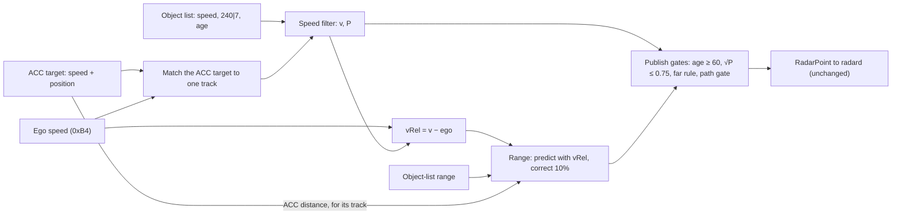
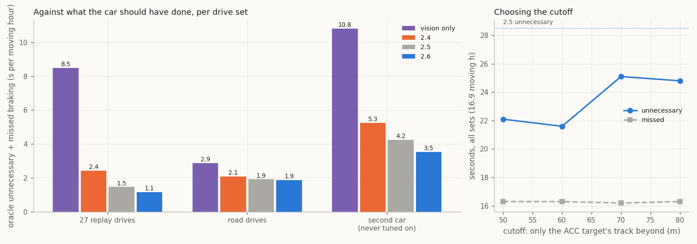
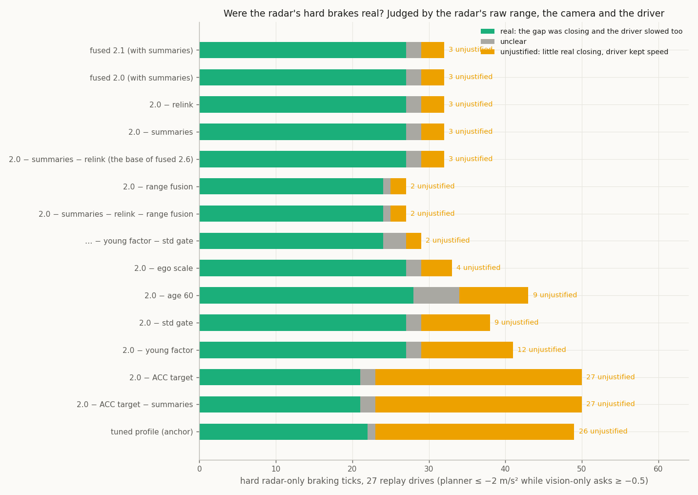
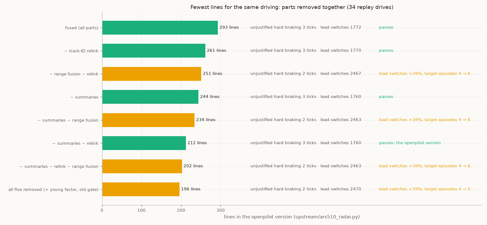
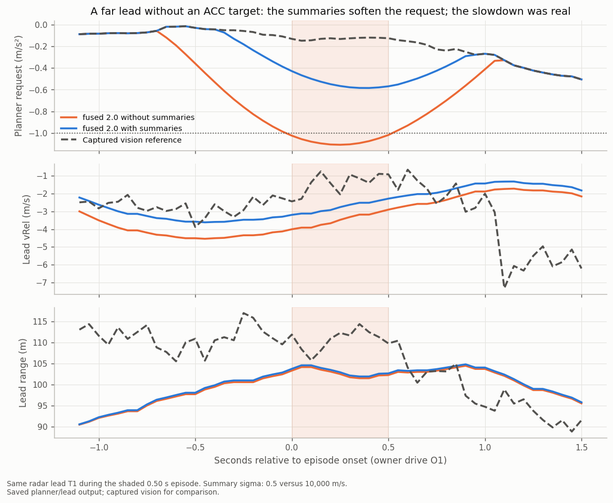
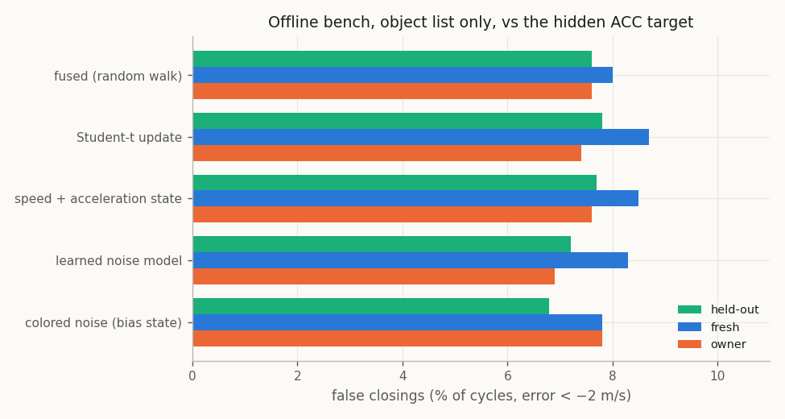

# 12. The Kalman speed filter

The object list's speed has slow, correlated errors at range: false closings of 1-10 s beyond about 40 m
([07](07_velocity_excursions.md)). Their size follows the radar's `240|7` code, a per-reading error width (◐). The
`fused` profile (`install.py --profile fused`, current version 2.6) handles them with **one Kalman filter per track** on
the lead's speed over ground. Every reading is weighted by its own uncertainty: the object list and the radar's ACC
target. radard then runs its usual filter on what this one publishes. `fused` is the all-tracks alternative to the
default `acc` profile, which publishes the radar's ACC target alone ([11](11_profiles_compared.md)).

Code: `Ars510NativeRadarInterface._fused_speed` in [`ars510/interface.py`](../ars510/interface.py) (fork build), and
the same filter in [`upstream/ars510_radar.py`](../upstream/ars510_radar.py) (the openpilot version: 187 code lines, 227
lines in all; the installer's single-file `fused`). Numbers:
[`fused_filter.json`](../data/analysis/summaries/fused_filter.json) and the JSONs named in each section.

## fused and acc side by side

Same drives, same openpilot card → radard → planner, same pre-registered definitions per row
([11](11_profiles_compared.md) has the full comparison with `raw`). `fused` is version 2.6 and `acc` is
[`upstream/ars510_acc_target.py`](../upstream/ars510_acc_target.py): 26 code lines of 41 and a two-message, 7-signal DBC (`fused`: 187
code lines, 28 constants, 85 conditions; `acc`: 1 constant, 4 conditions). The `acc` replays ran the hand-decoded
33-line version that publishes identical points on 11,028 bundled reports. Sources:
[`profiles_vs_vision.json`](../data/analysis/summaries/profiles_vs_vision.json),
[`acc_target_parser.json`](../data/analysis/summaries/acc_target_parser.json) and
[`oracle_reference.json`](../data/analysis/summaries/oracle_reference.json).

**Driver agreement: 20 held-out routes** (4.56 h with the driver controlling speed, 167 brake presses, 47 hard
slowdowns; 2.66 h moving for the last three rows):

| measure | `fused` 2.6 | `acc` | vision only |
|---|---|---|---|
| first request ≤ −0.5 m/s² vs vision, mean (95 % CI) | −0.013 s [−0.063, +0.033] | −0.036 s [−0.085, +0.003] | – |
| already asking ≤ −1 m/s² from 3 s before to 0.5 s after a brake press | 44.9 % | 44.9 % | 40.1 % |
| hard slowdowns answered with a request below −1 m/s² | 37 of 47 | 38 of 47 | 37 of 47 |
| hard radar-only braking ticks, all / while moving | 16 / 16 | 66 / 14 | – |
| hard radar-only braking ticks on the 4 further drives, all / while moving | 0 / 0 | 19 / 7 | – |
| braking only the radar asked for, per hour | 0 | 0 | – |
| driver overrides (38): radar request closer / further than vision to what the driver did | 7 / 0 | 7 / 0 | – |
| request RMS vs driver acceleration 0.5 s later / mean request jerk | 0.412 / 0.993 | 0.411 / 0.985 | 0.409 / 1.003 |
| lead flips per hour (share of lead time on a radar lead) | 347 (83.1 %) | 318 (84.8 %) | 0 (0 %) |

**Hindsight-lead oracle and all drive sets** (6-segment replay chunks, 16.9 moving hours; the second car's 6.2 hours were
held out of all tuning):

| measure | `fused` 2.6 | `acc` | vision only |
|---|---|---|---|
| hard radar-only episodes (ticks) | 8 (16) | 13 (72) | 0 |
| mild radar-only episodes | 27 | 30 | 0 |
| unnecessary / missed braking against the oracle | 21.0 / 16.4 s | 19.2 / 17.4 s | 89.2 / 30.8 s |
| lead flips per moving hour | 332 | 302 | 0 |
| first braking request vs vision on real closings | −0.010 s | −0.017 s | 0 |
| second car: unnecessary + missed per moving hour | 3.3 s | 2.3 s | 10.8 s |
| 27 replay drives (6.72 h, oracle): unnecessary / missed | 2.2 / 3.1 s | 3.3 / 2.5 s | 31.9 / 10.0 s |
| road drives (7.65 h, oracle): unnecessary / missed | 3.3 / 8.2 s | 6.0 / 10.8 s | 10.2 / 10.3 s |
| 26 owner routes held out from every replay (2.56 moving h): unnecessary / missed, flips per hour | 11.4 / 3.6 s, 345 | 7.7 / 5.3 s, 323 | 40.1 / 9.9 s, 0 |

- **Equal braking onset.** Both start braking within 0.04 s of vision only and ask for ≤ −1 m/s² before the same 44.9 %
  of brake presses.
- **Where they differ.** `acc` publishes one point; 52 of its 66 held-out hard ticks are standstill holds behind
  objects the camera leaves out of its lead list ([11](11_profiles_compared.md)). `fused` publishes every track and carries the gates
  of the sections below. `acc` has the lower unnecessary braking on the second car and the held-out owner routes, `fused`
  the lower missed braking on the road drives and all sets.
- **Reference.** The oracle takes its range from the ACC target, so it favours profiles built on that target; the
  driver-agreement rows are independent of it ([below](#against-what-the-car-should-have-done)).

## Versions the numbers were measured on

Each replay number below names its `fused` version. 2.6 is the current profile and the openpilot version.

| version | what it is |
|---|---|
| 2.0 | speed filter with the ACC target (σ 0.5 m/s) and the summaries, range fusion, track-ID relink, 0.25 × ACC match scale; the ablations and combinations |
| 2.1 | ACC distance as the followed car's range; trackers matched by position |
| 2.3 | path gate beyond 15 m (2.5 m); ACC match scale 0.4 × |
| 2.4 | 2.3 with the summaries and the relink removed: the openpilot version of 2.4 |
| 2.5 | 2.4 with the ACC target at σ 0.3 m/s |
| 2.6 | 2.5 with the far rule (beyond 60 m only the ACC target's track), the stationary path gate and ACC σ 0.13 m/s |

## The model

One state per track: the lead's speed over ground `v`, with modelled variance `P`. Every radar cycle (`Δt` ≈ 60 ms):

```text
predict      v⁻ = v                          P⁻ = P + (a · Δt)²             a = 1.5 m/s² (process-noise scale)
for each reading z with standard deviation σ (object list first, then the ACC target if matched):
  innovation e = z − v⁻,  S = P⁻ + σ²,  e clamped to ±3·√S                (robust update)
  gain       K = P⁻ / S
  update     v = v⁻ + K·e                    P = (1 − K)·P⁻
publish      vRel = v − v_ego                 first publication once √P ≤ 0.75 m/s (and age ≥ 60)
```

| reading | σ | where the value comes from |
|---|---|---|
| object-list speed `64\|10` | 0.045 m/s × max(`240\|7`, 1); × 1.8 up to age 60, tapering to × 1 at age 100 | `240\|7` scales with the error against the ACC target ([07](07_velocity_excursions.md#far-range-excursions-match-the-reported-velocity-error-scale)); young tracks err 1.4-2× more |
| ACC target speed (0x235 at 0.125 m/s per code, + ego speed) | 0.13 m/s | the radar's own ACC tracker, for the one track it matches by position ([05](05_acc_target_and_support.md)); blended with the object list ([below](#the-acc-targets-weight)) |
| summary speed (0x192 / 0x194 range, (code − 160) / 16 m; 1 s slope), fork option, off in `fused` | 0.5 m/s, up to 80 m | the positions of the radar's selected targets, each attached to the track at that position (range within max(5 m, 15 %), lateral within 1 m); the ACC track takes the ACC target ([below](#what-the-summaries-do)) |

The ACC target's units are checked against the absolute `0x680` range ([05](05_acc_target_and_support.md#units-of-the-acc-target)).

`fused` 2.6 constants in one place (`FUSED_CONFIG` and the openpilot file agree): σ 0.045 m/s per `240|7` count, young-track
factor 1.8 below age 100, lead acceleration 1.5 m/s², clamp 3 σ, ACC σ 0.13 m/s, publication at √P ≤ 0.75 m/s and age 60,
range gain 0.1, ACC match scale max(12 m, 0.4 x), path gate 2.5 m beyond 15 m, far rule beyond 60 m, stationary gate
below 0.5 m/s within 1.5 m.



The object-list σ matches the error seen against a second tracker output, the 2 Hz object stream 0x680 (a
tracker-quality witness for vehicles; half of its matched frames are the ACC target, the rest other cars). The
object-list speed error is 1.1-1.5× the filter's σ: 0.8 / 1.3 / 2.4 / 2.9 / 4.4 m/s RMS at
0-40 / 40-60 / 60-80 / 80-110 / 110-170 m, where 0.045 m/s × `240|7` gives 0.6 / 1.1 / 1.6 / 2.6 / 3.4 m/s, and 1-4 % of
frames lie beyond 3 σ. The error leans toward closing (median −0.2 to −0.7 m/s up to 110 m, −1.9 m/s beyond), and the
ACC target supplies the correction where it is present
([`object_stream_0x680.json`](../data/analysis/summaries/object_stream_0x680.json)).

A new track (or one that stalls for over 0.5 s) starts from its object-list speed with `P = σ²`. Each track gets the
object-list reading plus, for the one track the ACC target describes, the ACC reading.

**The gain changes every cycle.** radard's filter uses one precomputed gain for every track. Here `K` follows the
radar's own uncertainty code and whether the ACC target is present. A near car with a small `240|7` is followed
almost directly. A far car with a large `240|7` moves only a few percent per reading. While the ACC target is
present, it dominates at every range but the closest.


*Bundled drive E (`fused` 2.6). Top: the object-list readings (grey) dive to −5.9 m/s at 18 s while the ACC target stays
near −0.9; the estimate follows the ACC target. Bottom: the gain on each reading. Each object-list reading moves the
estimate by about 2%, each ACC target reading by about half (0.48). The dotted line is the object-list σ from `240|7`.*


*Left: how much the filter trusts each reading by range. Middle: the share of the estimate from the radar's ACC
target. Right: a new track's speed std against age; the 0.75 m/s line is the publication gate.*


*`raw` and `fused` on the bundled excursions: on drive E `fused` (green) follows the radar's ACC target (which is what
`acc` publishes); on drive A, where the object list carries the lead alone, `fused` dips to −2.7 m/s where the object list reads −6.4.*

**What `P` means.** The model assumes independent readings, while the ACC target and the object list are both
estimates from the same radar, with persistent errors. So `√P` is a readiness measure in m/s: it sets the gain and the
publication gate, and the replays below justify the constants
([Särkkä, *Bayesian Filtering and Smoothing*, ch. 4](https://users.aalto.fi/~ssarkka/pub/cup_book_online_20131111.pdf)).

## How it fits with radard

radard runs its own per-track Kalman filter on `[vLead, aLead]` with a fixed gain; its `aLeadK` is the lead
acceleration the planner uses. This filter cleans the speed it hands over, so radard and the planner run
unchanged, and lead acceleration stays radard's job; one speed state scores better here than a speed + acceleration
state ([below](#kalman-variants-tested)).

The two filters run in series, so all replay numbers include their combined effect. Measured directly on
148,219 radar-lead ticks of the 20 held-out routes (`fused` 2.0, `radard_cascade` in
[`fused_filter.json`](../data/analysis/summaries/fused_filter.json)):
- **Smoother acceleration:** `aLeadK` changes at 0.46 m/s³ on average with `fused`, against 0.72 for vision only.
- **Same timing:** `fused`'s `aLeadK` peaks in cross-correlation at a median of 0 ticks against the tuned
  profile's (range 0-1 tick of 50 ms over 15 routes; 0 on 14 of them,
  [`driving_claim_sources.json`](../data/analysis/summaries/driving_claim_sources.json)).

## What runs before and around the filter

- **Plain decode (every profile):**
  - publish from age 60 (~3.6 s), when range and speed have converged ([02](02_object_list.md)). Age 40
    gives the young far false closings (further-drive hard ticks 1 → 9), as does publishing the ACC target's track
    early; age 80 raises missed braking against the hindsight-lead oracle from 3.3 to 3.7 s on 27 drives (measured on 2.3);
  - read the object list's over-ground speed at 0.149 m/s per code (nominal decoder 0.15; empirical profile setting), then subtract 0xB4 ego speed;
  - publish a point with a fresh ego speed (at most 0.5 s old); a NaN would persist in radard's filter.
- **Saturation guard (`raw` only):** velocity code 1023 (and 0) is an invalid sentinel that decays over ~6 records.
  `raw` withholds the track until the speed is back within 5 m/s (or 1 s), then continues under a new ID. Held-out
  hard ticks 117 → 93 (`saturation_guard_heldout` in [`fused_filter.json`](../data/analysis/summaries/fused_filter.json)). In `fused` the robust update absorbs the sentinel, so the guard is off.
- **Track-ID relink (`raw` only):** a track lost and re-found within 3.5 s keeps its ID. With the filter on, the
  braking counts are identical with the relink on or off (lead switches 1,770 vs 1,772), so `fused` runs with it off.
- **Range fusion (`fused`):** range walks by metres at 60-100 m (about 3 % of range per frame). A fixed-gain predictor,
  separate from the speed filter:

  ```text
  predicted range = previous range + 0.5 × (previous vRel + current vRel) × Δt
  output range    = predicted range + 0.1 × (object-list range − predicted range)
  ```

  It cuts 1.5 s range walks by about a third. Range is its own estimate, separate from the speed state, because range rate and speed differ by
  10-20 %. For the track the ACC target describes, the measurement is
  the radar's ACC distance instead of the object-list range ([below](#matching-the-radars-trackers-to-tracks)).

## Matching the radar's trackers to tracks

The ACC target is a position from the radar's function-level tracker; the filter needs to know which object-list track
it describes. The summaries (a fork option) are matched the same way.

| tracker | match | kept while |
|---|---|---|
| ACC target (0x235 / 0x237) | cost = \|dRel − x\| / max(12 m, 0.4 x) + \|yRel − y\| / 0.5 m below 1, at least 1 better than the next track, track age ≥ 20; x is the 0.025 m ACC distance, y its 0.01 m lateral | the track's cost stays below 4 and the ACC position moves at most 8 m / 1 m per update |
| summary (0x192 / 0x194), option | the track within max(5 m, 15 %) in range and 1 m laterally of the summary position, unambiguous (alone or 3 m nearer than the next), track age ≥ 20 | the track stays within max(8 m, 25 %) in range and 2 m laterally |

- **Matched by position.** Both matches use the tracker's own position, so they hold through object-list speed
  excursions: replayed over the logged frames, a summary matched by position sits on its track on 99.5-100 % of cycles,
  also during excursions, where a speed-agreement rule kept 17-56 %
  ([`tracker_association.json`](../data/analysis/summaries/tracker_association.json)).
- **Room for the object list's short far range.** The object list reads the followed car several metres short of the ACC
  distance beyond 50 m ([06](06_accuracy.md#distance)), so the ACC cost scales its range term with range. With 2.1's
  0.25 x scale the ACC target sat on the in-lane lead on 92.7 / 74.0 / 37.6 % of lead records at 60-80 / 80-100 /
  100-130 m (it is present on 94.8 / 76.9 / 39.9 %); 0.4 x widens the match further.
- **The ACC distance is the followed car's range.** The matched track takes the ACC distance as the measurement of the
  range fusion: the radar's own smooth range (0.04 m jitter against 0.9 m,
  [`acc_fields.json`](../data/analysis/summaries/acc_fields.json)), which the vision lead agrees with. radard
  receives a lead distance within a metre of the vision lead's median up to 90 m (the object-list range reads 1-5 m short of it at 30-90 m), half as rough from
  tick to tick, and flips between a radar and a vision lead 30 % less often (1,764 → 1,231 on the 20 held-out drives,
  2.1 replays).
- **New tracks can start far short.** 10-21 % of new in-lane tracks the ACC target follows read more than 10 m
  short of it, often for seconds; on one road drive a track first read 47 m for a car at 63 m and drew −2.36 m/s² in
  2.1's replay (vision −1.61). The match allows 0.4 x in range (25 m at 63 m), so such a track takes the ACC
  distance; range fusion pulls it there within about a second (2.3: first radar lead at 63 m, request −1.47 m/s²). The
  margin to the next track keeps two cars apart.


Each of these matching rules was replayed on the 27 drives against the previous version with limits fixed before the
run; hard radar-only braking held at 30 held-out ticks throughout (2.1-2.4)
([`tracker_association.json`](../data/analysis/summaries/tracker_association.json)).

## Path gate

radard picks the radar track that best matches the vision lead in distance, lateral position and speed (each weighted by
the camera's uncertainty) and then checks distance and speed, so far out a car in the next lane at the lead's
range can become the lead. On 2.1 road drives this caused one of the two mild unprompted slowdowns
(about 1.5 m/s², driver on the gas) and a hard brake in a second car's replay. Beyond 15 m, a track other than the ACC
target's that is more than 2.5 m from the ego path predicted from yaw rate and speed (constant curvature,
`y − yaw / v · d² / 2`, v at least 5 m/s) is withheld. Closer in the track stays, so cars moving into the lane at 8-10 m
keep their justified hard brakes (a gate from 0 m removed two such episodes at 7.6 and 9.9 m). For radar leads beyond
60 m the gate removes 67 % of the cycles where the camera places the lead more than 2.5 m to the side, and 2.3 % of
those where the camera agrees; the radar's share of leads beyond 60 m goes from 77 % (2.1) to 73 % (2.3), and vision
covers the rest.


Replay on the 27 drives (hard ticks, episodes and target episodes on the 20 held-out routes; hard ticks on the 4 further
and 3 owner drives; owner target episodes), each version against vision only:

| `fused` version | held-out hard ticks / episodes / target | further / owner hard ticks | owner target episodes | onset vs vision | driver brakes anticipated at −1 m/s² |
|---|---|---|---|---|---|
| 2.1 | 30 / 11 / 4 | 2 / 0 | 1 | −0.022 s | 43.7 % |
| 2.4 (0.4 x ACC match, path gate, summaries off) | 30 / 11 / 3 | 1 / 0 | 0 | −0.010 s | 41.3 % |
| 2.5 (ACC σ 0.3) | 29 / 11 / 4 | 1 / 0 | 0 | −0.009 s | 42.5 % |
| 2.6 (far rule, stationary gate, ACC σ 0.13) | 16 / 8 / 1 | 0 / 0 | 0 | −0.013 s | 44.9 % |

Held-out lead flips: 1,231 (2.1), 1,349 (2.4) and 1,336 (2.5) in total; 347 per hour for 2.6 against 494 for 2.5
([`far_acc_only.json`](../data/analysis/summaries/far_acc_only.json)).

On the owner's 5.8 moving hours of road drives (replayed open loop) the path gate and the 0.4 x match hold hard
radar-only braking at 0 with every hard vision brake answered. They cut radar-only requests of 1 m/s² or more
from 10 to 7, start braking within 0.015 s of 2.1 on every drive, and raise lead flips by 8 % (257 → 277 per moving hour). They also remove the
second car's hard false brake. In the late-brake case above, the first radar lead is at 63 m instead of 47 m and the
request −1.47 instead of −2.36 m/s² (vision −1.61); 2.4 asks the same as 2.3 in that moment. Driver brakes anticipated at
−1 m/s² go from 43.7 to 41.9 % with the path gate and 0.4 x match, and to 41.3 % with the summaries dropped in 2.4. Both constants sit in a flat region: an ACC
match scale of 0.33 or 0.5 x and a gate of 2.0 or 3.0 m keep the held-out hard ticks at 30 on 2.3 (target episodes 2-3) and
stay within 0.3 s of the chosen values against the hindsight-lead oracle below. The openpilot file's parts and
their line costs are in [17](17_upstream.md#parts-of-the-openpilot-file).
Numbers: [`lead_choice_guards.json`](../data/analysis/summaries/lead_choice_guards.json).

### Stationary objects close in

radard stops for a radar point within 1 m laterally and 25 m ahead when ego is slower than 4 m/s, regardless of the
camera lead ([14](14_forks.md)). Parked cars at the curb while ego turns past them, or a car parked alongside, then
become a lead and raise hard radar-only requests. Parked cars and roadside objects hold their position, so from 2.6 a
stationary track (over-ground speed below 0.5 m/s) is path-gated at every range: within 1.5 m of the path curved with
max(v, 2 m/s) up to 15 m, and by the 2.5 m gate beyond. Over every drive set this removes 4 of 12 hard and 23 of 49 mild
radar-only episodes (hard ticks 30 → 16) with unchanged missed braking
([`far_acc_only.json`](../data/analysis/summaries/far_acc_only.json)).

## Far cars beyond 60 m

Toyota's own ACC acts on its ACC target ([05](05_acc_target_and_support.md)), and the object list's false closings
live on far tracks other than its track: beyond 40 m, a false closing (published vRel > 2 m/s more closing than the range-based
reference, measured on 2.3) is on the lead 0-0.1 % of the time when the lead is the ACC target's track and 25-28 % of
the time when it is another track. Since 2.6, beyond 60 m the published track is the one the ACC target describes;
radard takes other far cars from the camera.



Replayed over every drive set in 6-segment chunks (16.9 moving hours; the second car, 6.2 moving hours, was held out of
all tuning), against 2.5:

| | vision only | 2.5 | far rule alone | 2.6 (+ stationary gate, ACC σ 0.13) |
|---|---|---|---|---|
| hard radar-only episodes (ticks) | 0 | 13 (51) | 12 (30) | 8 (16) |
| mild radar-only episodes | 0 | 60 | 49 | 27 |
| unnecessary / missed braking against the oracle | 89.2 / 30.8 s | 28.5 / 15.4 s | 21.6 / 16.3 s | 21.0 / 16.4 s |
| second car: unnecessary + missed per moving hour | 10.8 s | 4.2 s | 3.5 s | 3.3 s |
| lead flips per moving hour | 0 | 418 | 334 | 332 |
| first braking request vs vision on real closings | 0 | +0.019 s | +0.014 s | −0.010 s |

Against 2.5, per moving hour with a route-block bootstrap (95 % intervals): mild radar-only braking −1.95 [−2.94, −1.20],
unnecessary braking −0.45 s [−0.84, −0.12], missed braking +0.06 s [−0.01, +0.17], lead flips −86 [−106, −68].
On drives held out from development (12 second-car routes and one owner route, 2 moving hours) 2.6 had 0 hard
radar-only braking, its 2 mild radar-only requests were both real slowdowns, and it was ahead of 2.5 on every count; on
that car the camera reads closings stronger than the radar's range-based reference, so vision brakes 0.04 s earlier.

The 60 m cutoff and the ACC weight were chosen on the owner's drive sets with a route-block bootstrap (60 m / 0.3 m/s:
1.50 s of unnecessary plus missed braking per moving hour; 50, 70 or 80 m: 1.66-1.72 s/h; 0.2 m/s: 1.53, a tie) and
then checked on the second car. 2.6's 8 remaining hard episodes are all on the oldest replay drives; 2 last longer than
one 50 ms tick, and both are real closings the oracle also brakes for (−2.9, −1.7 m/s²).

The cost is time on a fast far closing before the radar's ACC picks it: the car reaches the planner through the
camera until the radar makes it its ACC target, about 1 s later on one owner drive (95 m, closing 4.5 m/s) and 0.8 s on
the second car (86 m, closing 8.8 m/s). Vision alone brakes at or after 2.6's moment in either, and Toyota's own ACC is more
patient still: on a far closing car it acquired at 94 m it first braked at 66 m. Against 2.4, where 2.6 changes the
request by more than 0.3 m/s² for 0.3 s or longer, it is closer to the oracle 17 times (25.7 s) and further 4 times
(4.6 s); each cost is at most 0.5 m/s². Numbers: [`far_acc_only.json`](../data/analysis/summaries/far_acc_only.json).

## Against what the car should have done

Vision only has its own errors, so a second reference helps. A hindsight lead was built for each moment of the road
drives: identity from the radar's in-path ACC target (else the camera's lead); range from the ACC target, else the raw
object list within 1 m laterally, plus the camera when it is on the same car; smoothed forwards and backwards
(Rauch-Tung-Striebel, constant acceleration) within each stretch of one car, which ends where the ACC target changes
ID or the lead jumps sideways, so a switch between two cars starts a new stretch. openpilot's radard and
planner then ran unchanged on that lead alone,
through an interface that publishes only it. Each version is scored against that oracle's request on the moments
where the reference comes from the radar and radar and camera agree. Camera-only moments are judged with video,
because the model's lead range slides from one car to the next at cut-ins, and so are the 2 s after the ACC target
drops a lead the camera still follows (a lead turning out of the lane).


Unnecessary braking (> 0.5 m/s² harder than the oracle, ≥ 0.3 s) and missed braking, by `fused` version and for `acc`
([`oracle_reference.json`](../data/analysis/summaries/oracle_reference.json)):

| scored on | vision only | 2.1 | 2.4 | 2.5 | 2.6 | `acc` |
|---|---|---|---|---|---|---|
| road drives (owner and second car, 7.65 h): unnecessary / missed | 10.2 / 10.3 s | 11.5 / 9.5 s | 5.4 / 7.2 s | 4.4 / 7.2 s | 3.3 / 8.2 s | 6.0 / 10.8 s |
| 27 replay drives (6.72 h): unnecessary / missed | 31.9 / 10.0 s | 9.4 / 4.1 s | 7.1 / 3.0 s | 3.0 / 3.1 s | 2.2 / 3.1 s | 3.3 / 2.5 s |

The reference takes its range from the ACC target, so it favours versions that weigh the ACC target more; read 2.5's
gain over 2.4 and `acc`'s scores with that in mind ([below](#the-acc-targets-weight)). On the road drives, 2.35 of
`acc`'s 10.8 missed seconds are a single cut-in where it asks −0.51 m/s² and `fused` −0.53 m/s², on either side of the
oracle's −0.5 threshold. Scoring covers moving moments (above 1 m/s), where the lead signal decides; at standstill the
planner's stop-and-go logic does.

## What each part is worth

Each part removed from `fused` 2.0 on its own, 27 replay drives. 2.0 also fused the summaries; 2.5 has nearly
the same hard braking on these drives (29 / 1 / 0, [above](#path-gate)) and 2.6 has 16 / 0 / 0. Counts are hard
radar-only braking ticks (planner ≤ −2 m/s² while vision-only asks ≥ −0.5) on 20 held-out routes / 4 further drives / 3
owner drives:


| `fused` 2.0 minus … | held-out | further | owner | verdict |
|---|---|---|---|---|
| `fused` 2.0 (baseline) | **30** | **2** | **0** | |
| the ACC target and summaries (filter on the object list alone) | 48 | 2 | 0 (4 target episodes) | needed |
| the ACC target only (summaries kept) | 48 | 2 | 0 (3 target episodes) | needed: the ACC target carries the trackers' benefit |
| the young-track factor | 30 | 11 | 0 | needed |
| the speed-std publication gate | 30 | 8 | 0 | needed |
| the age-60 publication gate (age 6) | 31 | 12 | 0 (radar-only braking ×3) | needed |
| range fusion | 27 | 0 | 0 | same braking; lead switches +39 %, held-out target episodes 4 → 6: kept for lead stability |
| the ego-speed alignment (× 0.149/0.15) | 31 | 2 | 0 | same braking (onset +12 ms); one empirical setting, folded into the decode factor (0 lines) |
| the track-ID relink | 30 | 2 | 0 | same braking counts, lead switches 1,770 vs 1,772: off in `fused` |
| the saturation guard | identical | identical | identical | off in `fused`: the robust update absorbs the sentinel |

**Were those hard brakes real?** "Hard radar-only" means the radar planner braked hard where vision-only stayed below
−0.5 m/s²; the radar may have seen a real slowdown first. Every hard episode in every run was therefore judged
against references independent of the radar speed:
- **the radar's raw range** of the same object, decoded from the original CAN, else the
  camera's lead distance from the vision-only replay;
- **the braking the real closing needed:** closing² / 2(gap − 4 m);
- **the driver:** did they brake or slow down too?



27 of `fused` 2.0's 32 hard ticks on the 27 drives were real slowdowns the driver also braked for, where the radar
reacted earlier or harder than the camera; 3 were unjustified and 2 unclear. Each braking-related part kept in `fused`
removes *unjustified* braking (range fusion stays for lead stability): the ACC target +24 ticks when removed, the
young-track factor +9, the std gate and the age gate +6 each
([`hard_braking_review.json`](../data/analysis/summaries/hard_braking_review.json)).

### Removing parts together

One-at-a-time removals can hide parts that only matter together, so the larger parts of `fused` 2.0 were also removed
in combination on the same 27 drives. A version drives the same as `fused` when its unjustified hard braking is within
2 ticks of `fused` and its radar ↔ vision lead switches rise by at most 15%.



- **The track-ID relink is free:** braking counts are identical with the relink on or off (lead switches 1,770 vs 1,772).
- **The summaries change little:** unjustified braking and lead stability are the same with them switched off (see below).
- **Range fusion keeps the lead stable:** every version with range fusion removed flips between radar and vision leads about 39%
  more often, with 27 held-out hard ticks against 30.
- **The young-track factor and the std gate cost 5 code lines** (3 + 2). With range fusion kept they prevent unjustified
  braking on a far lead (+9 and +6 unjustified ticks).

The smallest version with the same driving is 2.0 with the summaries and the relink removed. With 2.3's path gate and wider
ACC match, and 2.6's far rule and stationary gate added, that is today's `fused`. The openpilot version
([`upstream/ars510_radar.py`](../upstream/ars510_radar.py); its parts and line
costs are in [17](17_upstream.md#parts-of-the-openpilot-file)) is the same filter in one file, and a test
keeps the two equal point for point (`tests/test_upstream_candidate.py`; combinations in
[`fused_filter.json`](../data/analysis/summaries/fused_filter.json)).

The rule fixed before these results also required zero target episodes on the owner drives; the version with the
summaries removed had one. That episode was an early reaction to a real slowdown (the case below), and it
is counted as such: a judgment made after the results, stated here.

### On a second car

A second driver's 2025 RAV4 Hybrid (same radar firmware, held out of all tuning) supplied 20 drives with openpilot
longitudinal or stock ACC: 8.8 h, 6.5 h moving, replayed open loop with the same harness. The gates were fixed before
any variant was run on it. The driver had flagged 11 false brakes made by an older profile
([`second_car_replay.json`](../data/analysis/summaries/second_car_replay.json)).

| on the second car | hard radar-only | false mild | flagged false brakes ≤ −1 m/s² | lead flips / moving h | far new track (97 m) |
|---|---|---|---|---|---|
| older profile, as driven | – | – | 11 of 11 | – | – |
| `fused` 2.5 | 1 | 6 | 1 | 491 | −1.78 m/s² |
| 2.5 + the far rule (beyond 60 m only the ACC target; in 2.6) | 0 | 4 | 0 | 412 | −0.11 |
| far rule, young-track factor and std gate removed | 1 | 4 | 0 | 414 | −0.19 |
| far rule, path gate removed | 0 | 4 | 0 | 441 | −0.11 |
| far rule, range fusion removed | 0 | 4 | 0 | 456 | −0.05 |

- **`fused` 2.5** brakes at ≤ −1 m/s² on 1 of the 11 flagged moments (vision only 0 of 11). Its one hard brake is a
  lead at 86 m published at −7.3 m/s while the ACC target is idle and the camera range opens. It also asks −1.78 m/s² for
  a new track at 97 m while the ACC target and camera read −3.6 and about −3 m/s. Both are far tracks carried by the
  object list alone.
- **The far rule** (2.6, [far cars beyond 60 m](#far-cars-beyond-60-m)) removes both. Four of
  the real closings keep their braking unchanged, and the car at 86 m closing at 8.8 m/s starts braking 0.8 s later than
  with 2.5: the object list has the car 0.75 s before the radar picks it as its ACC target (vision only asks 0 m/s²
  there). The owner car's 95 m closing shows the same delay (about 1 s).
- **The young-track factor and std gate** belong on this car too: with them removed a new track at 31 m is published at
  −13 m/s for 0.15 s and the planner asks −2.9 m/s².
- **With the far rule, the path gate and range fusion steady the lead** (flips rise 7 % and 11 % when they are removed) at equal
  braking counts.

The speed noise that sets the filter's σ values is the same on both radar units ([06](06_accuracy.md#velocity)).

### What the summaries do



*Owner drive, lead at about 100 m while the ACC target is idle, replayed with `fused` 2.0. With summaries the planner asks for at
most −0.58 m/s²; with them removed, −1.11 m/s² for 0.5 s (vision: about −0.13 at that moment). Over the next 4.5 s the radar's and the camera's range
both fell from about 104 to 80 m and vision-only asked for −1.37 m/s²: the slowdown was real, and the version with the
summaries removed reacted about 4.5 s earlier ([`summary_owner_case.json`](../data/analysis/summaries/summary_owner_case.json),
[`hard_braking_review.json`](../data/analysis/summaries/hard_braking_review.json)).*

Over the 27 replay drives (`fused` 2.0), the summaries change the planner's request by 0.3 m/s² or more on 198 ticks
(about 10 s). With them removed the planner brakes harder on 143 of those ticks: 107 while the gap really was closing, 36
while it held or opened (camera range). The summaries soften the response to far leads while the ACC target is idle, mostly while
the gap was really closing.

Against the hindsight-lead oracle ([above](#against-what-the-car-should-have-done)) the version with them removed scores
better: 7.1 s of unnecessary braking instead of 8.1 s and 3.0 s missed instead of 3.3 s on the 27 replay drives
(2.4 against 2.3; RMS 0.244 for both). On the owner's road drives the two give the same minimum request on 19 of 23
bookmarks (within 0.03 m/s² on the other 4), with 0 hard radar-only braking and 7 mild requests each
([`driving_claim_sources.json`](../data/analysis/summaries/driving_claim_sources.json)); against the
oracle (owner and second car, 7.65 h) 5.4 against 4.9 s unnecessary and 7.2 against 9.5 s missed. So `fused` leaves
them out from 2.4 on, and the fork default and the openpilot version drive identically. The code remains a fork option
(`summary_sigma_mps`).

### The ACC target's weight

The ACC target's speed enters with σ 0.13 m/s in 2.6 (0.3 in 2.5, 0.5 before): its noise near range, from a likelihood fit of
both radar streams. Over every drive set (16.9 moving hours, with the far rule) a heavier ACC weight brakes earlier
at equal braking amounts: σ 0.3 / 0.2 / 0.13 start braking +0.014 / +0.001 / −0.010 s against vision only on the oracle's
real closings, with 21.6 / 19.9 / 21.0 s of unnecessary and 16.3-16.4 s of missed braking. 2.5's step from 0.5 to
0.3 held every gate on the 27 replay drives and the road drives, and all 23 bookmarks stayed within 0.06 m/s².

The ACC target is blended with the object list. The radar's own ACC tracker can slide off a real car: on one further
replay drive it read −10.6 m/s at about 85 m while drifting 2.9 m sideways on a straight road, with the camera holding
the lead at ego speed. Publishing the ACC values unchanged asks for −2.1 m/s² there; the blend keeps the published
speed between the radar's two estimates (2.4: −1.2, 2.5: −1.0, 2.6: −0.85 m/s²).
Numbers: [`acc_weight.json`](../data/analysis/summaries/acc_weight.json),
[`far_acc_only.json`](../data/analysis/summaries/far_acc_only.json).

## Kalman variants tested

Richer filters were tried against `fused`'s single speed state and stayed outside the recommended profiles. The
offline bench uses every cycle of 8 drive groups with the radar's ACC target hidden as the reference (read at 0.125 m/s per
code), tuned on 3 groups and scored on the rest ([`kalman_variants.json`](../data/analysis/summaries/kalman_variants.json)). Its
metric is the share of cycles with estimate − ACC target below −2 m/s (d > 30 m, age ≥ 60); `fused` scores
7.6 / 8.0 / 7.6 % on held-out / fresh / owner drives.



| variant | bench false closings, held-out / fresh / owner |
|---|---|
| Student-t update instead of the 3σ clamp | 7.8 / 8.7 / 7.4 % |
| speed + acceleration state, with the ACC target's acceleration as a reading | 7.7 / 8.5 / 7.6 % |
| noise learned from all slot fields (gradient boosting) | 7.2 / 8.3 / 6.9 % |
| object-list error as its own state (colored noise, τ 1.19 s), noise scaled by ego speed and `84\|10` (`--profile colored`) | 6.8 / 7.8 / 7.8 % |

The colored-noise filter is the textbook fix for the object list's slow, correlated errors (lag-1 autocorrelation 0.95 per
60 ms record). On the bench it lowers false closings by 0.8 points on held-out drives and responds 84 ms sooner to
ACC-defined drops (276 windows, 95% route-bootstrap interval [−129, −45] ms; [`kalman_response.json`](../data/analysis/summaries/kalman_response.json)).
In replay through openpilot on every drive set (16.9 moving hours) it asks for 10.1 s more unnecessary braking than `fused`
2.6 (31.1 s against 21.0 s; +0.60 s per moving hour, 95% route-bootstrap interval [+0.19, +1.15]) and 1.7 s more missed
braking (18.1 s against 16.4 s), with the same hard braking and lead flips. `fused` keeps one speed state; the fork build
keeps `COLORED_CONFIG` as an option.

Constants retuned on 8 fresh drives (σ per count 0.033, ACC σ 0.3, lead acceleration 1.0 / 2.0): only lead acceleration 2.0
passes every gate, and it scores the same as 1.5 ([`driving_claim_sources.json`](../data/analysis/summaries/driving_claim_sources.json)).
The ACC target's weight: [above](#the-acc-targets-weight).
