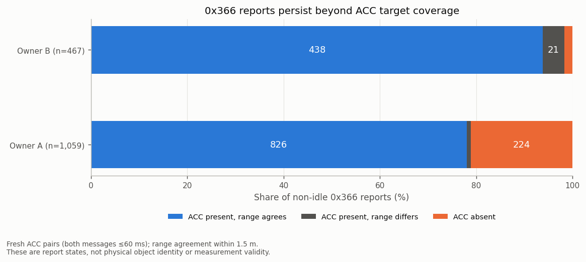
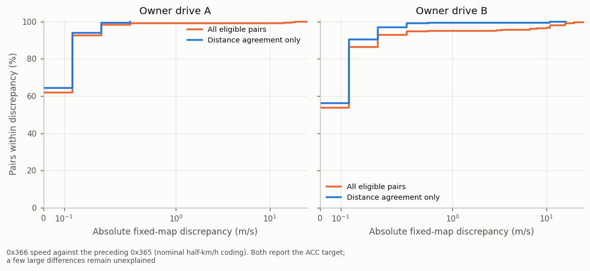
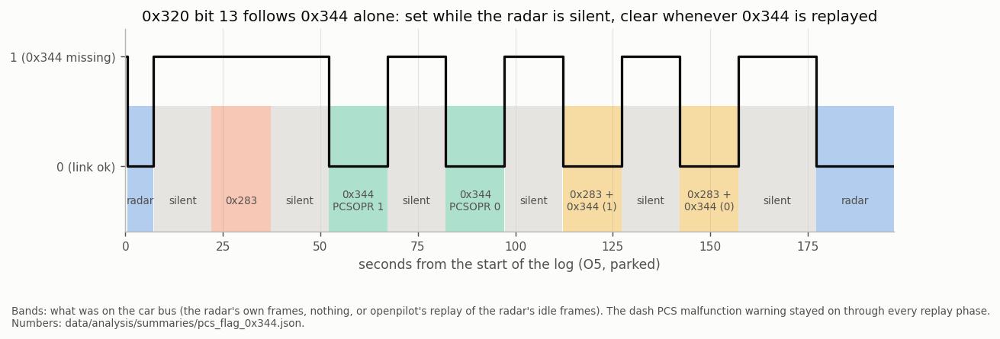

# 13. The radar's car-bus messages

On the RAV4 2022 / 2023 the ARS510 is also Toyota's driving-support ECU (`DS1` / "DSU" in the DBCs). It sends
nine messages on the **car bus (bus 0)**, the same ones a TSS-P DSU sends. They carry the ACC command, the
pre-collision (PCS / AEB) brake request and the PCS status on the dash. openpilot longitudinal either filters or switches off these
messages, which decides whether the car keeps its automatic emergency braking. The profiles (`acc`, `fused`, `raw`) read the
radar bus (bus 1) in every case; the car-bus messages below are independent of the profile. Numbers:
[`radar_car_bus_messages.json`](../data/analysis/summaries/radar_car_bus_messages.json) and
[`radar_disable_unfiltered.json`](../data/analysis/summaries/radar_disable_unfiltered.json).

## The nine messages

All nine stop when openpilot disables the radar ([01](01_radar_bus.md#openpilots-radar-disable)), so the radar sends them.

| addr | name (opendbc / Toyota) | rate, DLC | idle payload | content | |
|---|---|---|---|---|---|
| 0x343 | `ACC_CONTROL` / `ACC1S03` | 33 Hz, 8 | `00 00 43 00 00 00 00 91` at power-up | ACC acceleration request and ACC / HUD flags | ● |
| 0x344 | `PRE_COLLISION_2` / `ACC1F01` | 20 Hz, 8 | `00 00 01 00 00 00 00 50` | PCS / AEB deceleration request, pre-fill and alarm triggers; idle with only `PCSOPR` (bit 16) set; PCS alarm: `PCSALM` (bit 17) also set, `00 00 03 … 52` (U3) | ● idle and alarm, ◐ other fields |
| 0x283 | `PRE_COLLISION` / `DS11F01` | 33 Hz, 7 | `00 00 00 00 00 00 8C` | AEB brake force and state (`STATE` 3 = emergency braking); PCS alarm: byte 5 = 0x02 (bit 41, `PCSNOCHG`), force and state 0 (U3) | ● idle and alarm, ◐ braking fields |
| 0x33E | — | 5 Hz, 7 | `7F FF 00 80 00 xx 00` | target-gated fields, one rising with ego speed | ○ |
| 0x365 | `DSU_CRUISE` / `DS11D70` | 5 Hz, 7 | `00 00 00 00 FC 00 00` | **ACC lead distance (m) and relative speed (km/h)** | ● |
| 0x366 | `DS11D71` | 5 Hz, 7 | `50 00 7F FF 00 7A 00` | **target report**: the ACC target while one exists, plus other states: relative speed (0.5 km/h), distance (≈ 0.8 m), lateral offset (0.34 m per code) | ◐ |
| 0x411 | `PCS_HUD` / `DS12F02` | 1 Hz, 8 | `00 20 00 00 00 00 80 00` | PCS state, sensitivity, FCW and the blocked-radar / temperature / beam-alignment alerts; PCS alarm: `10 20 00 03 00 00 80 00` (FCW, byte 3 = 0x03; U3) | ● idle and FCW, ◐ alerts |
| 0x494 | — | 1 Hz, 8 | `82 00 00 00 00 00 00 00` | constant | ○ |
| 0x4FF | `FRD1N01` (front radar → gateway) | ~0.8 Hz, 8 | `3F 00 00 00 00 00 00 00` | front-radar node frame, `FRDNID` = 0x3F | ○ |

Toyota names come from the leaked `toyota_2017_ref_pt.dbc` in opendbc. 0x343, 0x344 and 0x283 end in the Toyota
checksum: (address high byte + low byte + DLC + data bytes) & 0xFF. In normal driving 0x283, 0x344, 0x411, 0x494 and 0x4FF hold their idle payloads
(4.1 h of owner drives and U1; 0x411 over 752 owner segments, where it reads `40 20 …`, `PCS_INDICATOR` 1, from about 0.2 s to 3 s
after each of 27 cold starts).
0x33E, 0x365 and 0x366 change with the lead.

### 0x365: lead distance and relative speed (●)

Byte 4 is the distance to the radar's ACC target in metres, and 0xFC marks an idle target. Byte 5 is the relative speed in km/h,
signed, negative when closing. The other bytes are zero. Both fields match the ACC target (0x235 / 0x237,
[05](05_acc_target_and_support.md#the-radars-acc-target-0x235--0x237), 0.125 m/s and 0.025 m per code) on two owner drives and on a second car up to 37 m/s:

| drive | distance: scale, r, MAD | speed: scale, r, MAD | frames |
|---|---|---|---|
| O2 (city, ≤ 22 m/s) | 0.992, 0.9995, 0.24 m | 0.999, 0.9997, 0.14 km/h | 830 |
| O3 (city, ≤ 18 m/s) | 0.997, 0.9992, 0.17 m | 1.001, 0.9995, 0.14 km/h | 474 |
| U1 (expressway, ≤ 37 m/s) | 0.997, 0.9992, 0.22 m | 0.995, 0.993, 0.27 km/h | 1,816 |

This is opendbc's `DSU_CRUISE.LEAD_DISTANCE`, plus the Toyota name `D_VRCC` for byte 5.

### 0x366: target report, the ACC target and other states (◐)

Fields count MSB-first from the first payload bit; `ars510.support.parse_0x366` returns them (`None` for the `7FFF` idle word).

| bits | field | coding |
|---|---|---|
| `16\|9` | relative speed | `(code − 155) × 0.5 km/h` for codes below 256; codes 442-506 (eight reports) fit `code − 512` and return `None` |
| `25\|7` | distance | ≈ 0.8 m per code (fit 0.79); 127 = idle target |
| `40\|5` | lateral offset | signed, −0.34 m per code (right positive, ±5 m); 15 = idle target, −16 = invalid (mostly a target beyond ±5 m) |

**While the radar has an ACC target, 0x366 reports that target.** Against the latest `0x235`/`0x237` on an owner drive
(820 frames) the residuals are 0.06 m/s, 0.26 m and 0.14 m, about the quantization of both frames, and 99 % agree in
distance within 1.5 m ([summary](../data/analysis/summaries/target_366_coding.json)).

**It also reports while the ACC frames say "idle"**: 224 of 1,059 reports on owner drive O2 and 8 of 467 on O3, with fresh
(fresh ACC frames, one span of 32 reports over 6.2 s). On O2 the car moves slowly during them (median ego 1.6 m/s, median relative speed −7 m/s); the 61 that match an
object-list track sit a median 4 m to the side, and their speeds correlate at 0.81; these reports are a candidate PCS target (○)
([coverage](../data/analysis/summaries/target_366_coverage.json)).

**High speed codes.** Eight reports have codes 442-506; five same-tail steps among them close at 20-28 m/s by their distances; subtracting 512 counts
fits them (mean difference 2.9 m/s). The parser returns a speed for codes below 256, the domain the ACC target confirms
([domain](../data/analysis/summaries/target_366_speed_domain.json)).

It arrives about 90 ms after 0x365. Byte 0 is 0x50 or 0x52, byte 4 bits 3-7 are raw speed / range-dependent flags, and
the low three bits of byte 5 are constant. The profiles read the same target from the 50 Hz ACC target frames.

### 0x343 from the radar (●)

With stock ACC (U1, 21 min) the radar's own command spans −0.52 to +0.20 m/s². It sends `ACC_TYPE` 1 and
`ALLOW_LONG_PRESS` 3 on every frame, `MINI_CAR` 1 while it has a lead (5,086 of 5,134 frames), `PERMIT_BRAKING` 1 on 4,971 frames, and `DISTANCE` pulses on button
presses. `RADAR_DIRTY`, `ACC_MALFUNCTION`, `ACC_CUT_IN` and `CANCEL_REQ` hold 0. openpilot's own `ACC_CONTROL` sends
`ALLOW_LONG_PRESS` 1.
On a second car with a board in the radar's car-bus line, stock ACC passes the radar's 0x343 through unchanged: `MINI_CAR`
equals ACC-target presence on 99.98 % of cruise-on cycles, and a closing car that becomes the ACC target at 94 m draws a command down to
−0.83 m/s² by 10 s later. Stopped behind a lead with cruise off, U1's command is −0.30 m/s² on 96 % of such cycles. How the command follows the ACC target is in
[10](10_research_directions.md#learn-from-toyotas-own-longitudinal-control)
([`stock_acc_law.json`](../data/analysis/summaries/stock_acc_law.json), [`radar_car_bus_messages.json`](../data/analysis/summaries/radar_car_bus_messages.json)).

## openpilot longitudinal: filter or disable

The radar's car-bus link runs to the gateway, which relays it onto the car bus. The comma harness sits at the camera,
so the radar's 0x343 reaches the powertrain on a path that bypasses the panda. With one 0x343 sender allowed on the
bus, openpilot longitudinal needs one of two setups:

| | radar CAN filter (smartDSU-style) | openpilot's radar disable (alpha long) |
|---|---|---|
| how | a board in the radar's line drops only the radar's 0x343 while openpilot sends its own; status message 0x2FF (~51 Hz) lets forks detect it | UDS `28 01 01` to 0x750 / 0x0F switches off the radar's car-bus transmit |
| radar's 0x343 | ends as openpilot's begins (3.487 s / 3.501 s after power-up, O4) | silent |
| PCS / AEB (0x283 / 0x344) | **passed to the car**: the radar's AEB stays in place | **silent**: the radar's PCS / AEB request is off with its car-bus output |
| 0x411 on the dash | the radar's: PCS on | openpilot's `40 20 00 00 10 01 00 00`: PCS off |
| car's reaction | normal (0x320 bit 13 clear) | **0x320 bit 13** set (0x344 stopped, below); dash "Pre-Collision System Malfunction" and PCS OFF lamp |
| bus 1 (decoder input) | running | running ([01](01_radar_bus.md#openpilots-radar-disable)) |
| follow-distance wheel button | **reported on 0x2FF** byte 0 bit 7 (below) | no frame carries it (◐) |

**The filter also reports the follow-distance button (●).** The filter's 0x2FF heartbeat (4 bytes, ~51 Hz) is opendbc's `SDSU` message:
byte 0 bit 7 is `FD_BUTTON`, "the follow distance button signal as forwarded by the sdsu". Byte 2 holds a state nibble (5 on 97 % of 12,388
sampled frames) and a 4-bit counter, and byte 3 equals byte 2 + 5 on all of them. Over 663 owner segments (661 carry 0x2FF) the bit rose seven
times, each a 90-210 ms pulse, and every one followed the same chain
([`filter_follow_distance_button.json`](../data/analysis/summaries/filter_follow_distance_button.json)):

| step | time |
|---|---|
| 0x2FF bit 7 rises / falls | = the `carState` `gapAdjustCruise` pressed / released event, within 3 ms |
| FrogPilot / StarPilot step the personality (`leadDistanceBars` 3 → 2 → 1 → 3) | 17-20 ms after release |
| openpilot's own 0x343 `DISTANCE` pulse | 20-177 ms after release |
| car's `PCM_FOLLOW_DISTANCE` (0x1D3) follows, `4 − leadDistanceBars` | 57-227 ms after release |

FrogPilot and StarPilot read the bit when the car reports a smartDSU (0x2FF seen; `SMART_DSU` flag) and not a radar filter announced by
0x2AA (`RADAR_CAN_FILTER`), and on release of the button (not a long press) they set `personality = (personality − 1) % 3`. The upstream
radar-ACC path ignores the wheel button, and sunnypilot's `SDSU` read (source snapshot) sits in a branch that TSS2 cars never reach. The press has no other path to openpilot while it sends 0x343:
with the radar on (second car, stock ACC) it is the radar's own 0x343 `DISTANCE` pulse (5 of 5 presses, the PCM follows 20-40 ms
later), and with the radar switched off over UDS no frame in 26 segments changed with a press (◐: no press is known on that drive).

**0x320 bit 13 = "0x344 stopped" (●).** 0x320 (`VSC1S07`) is the gateway's brake-system status to the
driving-support ECU. Its bit 13 (byte 1 bit 5; Toyota name `P2BRXMK`) sets about 0.15 s after the radar's 0x344
(`ACC1F01`) stops and clears on the next 0x320 frame (20 Hz) once 0x344 is back. The presence of 0x344 alone clears it (table below): bit 13 stays clear with 0x344 present whether its `PCSOPR` bit
(16, "PCS operational", 1 in the radar's idle frame) is 1 or 0, and idle 0x283 alone leaves it set.

The test was run on O5, the owner's car, parked in P. Toyota's interface disabled the radar with openpilot's UDS request,
then replayed the radar's idle frames from openpilot in 15 s phases:

| on the car bus (O5) | 0x320 frames with bit 13 clear / set |
|---|---|
| radar's own messages | 2,713 / 1 |
| radar silent, replay off | 0 / 1,906 |
| idle 0x283 only | 0 / 307 |
| idle 0x344 (`PCSOPR` 1) | 306 / 0 |
| idle 0x344 with `PCSOPR` 0 | 305 / 1 |
| 0x283 + 0x344, `PCSOPR` 1 / 0 | 305 / 1, 305 / 1 |

The single set frames are each the last frame of a phase, 0.15 s after 0x344 stopped. On U2 (unfiltered, alpha long)
the bit sets 0.17 s after the radar's last car-bus frame and stays set for the whole drive; on U1 and on filtered cars it is clear.

**The dash warning follows the radar's messages (●, O5); 0x411 is the leading candidate for its input (◐).** From about 7 s
after the radar fell silent, the dash showed "Pre-Collision System Malfunction – Visit Your Dealer" with the PCS OFF lamp.
It stayed on in every replay phase (bit 13 clear or set) and cleared by itself once the radar's messages
(including its 0x411) were back. Replaying idle 0x344 therefore satisfies the brake system's link check (bit 13 clear)
while the dash keeps showing that PCS is off, and the radar's PCS brake request stays off.

**The event pair keeps running while the radar is disabled (◐).** On U2 the bus-1 event pair 0x195 / 0x196
([05](05_acc_target_and_support.md#0x195--0x196-event-pair)) became active 6 times (0.1-1.3 s, 4-7 m/s, ACC-target
time to collision 3.6-7.5 s); the state lives on bus 1. On U1 (stock ACC) the 5 comparable short states
left 0x283 / 0x344 / 0x411 idle: the event pair is the radar's threat state, a level below PCS action on the car bus (◐); the PCS brake request
itself travels on the car bus.

## What panda allows openpilot to send

openpilot's Toyota longitudinal TX list (DSU-unplugged TSS-P support) already covers most of these messages:

| message | panda |
|---|---|
| 0x343 | allowed, `ACCEL_CMD` −3.5..+2.0 m/s² |
| 0x344, 0x33E, 0x365, 0x366, 0x411 | allowed |
| 0x283 | allowed with bytes 0-5 zero (the idle frame) |
| 0x494, 0x4FF | outside the TX list |

opendbc's `toyotacan.create_pcs_commands` builds 0x283 + 0x344.

## AEB on an unfiltered radar line

**Today:** stock AEB runs with stock ACC (openpilot lateral only, radar line unfiltered) and with openpilot longitudinal through a
radar CAN filter. With openpilot longitudinal on an unfiltered radar line, the radar is disabled and the car's PCS brake request is off; the dash
shows "Pre-Collision System Malfunction" and the PCS OFF lamp.

Why the disable takes AEB with it, the recorded stock PCS alarm (U3), how a relay of the radar's own decision would
work, what the dash should show and the recordings that settle the open stages are in [15: AEB and PCS](15_aeb_pcs.md).
