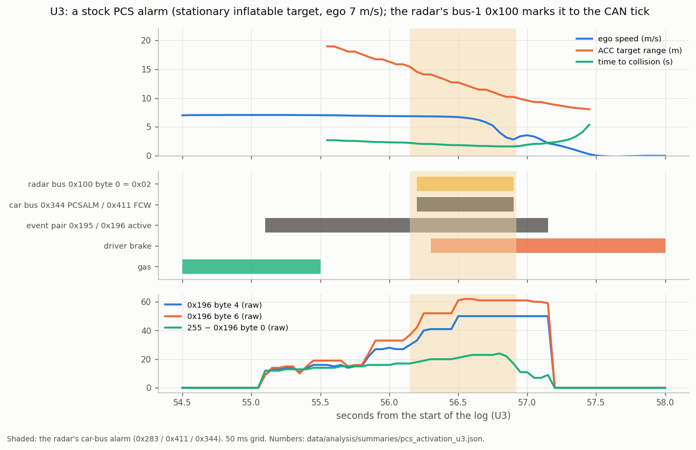

# 15. AEB and PCS

The radar is also Toyota's pre-collision (PCS / AEB) ECU. This page collects what is known about its PCS decision, why
openpilot's radar disable takes AEB with it, how a relay of the radar's own decision would work, the open questions, and
how to record PCS events. The car-bus messages themselves, the CAN filter against the radar disable and what panda
allows are in [13](13_car_bus_messages.md).

## AEB on an unfiltered radar line

**Today:** stock AEB runs with stock ACC (openpilot lateral only, radar line unfiltered) and with openpilot longitudinal through a
radar CAN filter. With openpilot longitudinal on an unfiltered radar line, the radar is disabled and the car's PCS brake request is off; the dash
shows "Pre-Collision System Malfunction" and the PCS OFF lamp.

**Why the disable takes AEB with it.** AEB is a live request: the radar sends non-idle 0x283 / 0x344 frames at the
moment it decides to brake, and the brake system acts on them. UDS communication control (`28 01 01`) stops all of the
radar's normal car-bus messages at once, 0x283 / 0x344 included: after the request on U2 (12.50 s) the 26 min log holds 0 frames of
0x283 and 0 of 0x344 ([`radar_car_bus_messages.json`](../data/analysis/summaries/radar_car_bus_messages.json)).

## A recorded stock PCS alarm (U3)

U3 is a deliberate test on the second car (stock ACC, radar enabled, radar line unfiltered), approached at 7 m/s: an inflatable
decoration stood in the lane, with a pickup parked a few metres behind it. **The radar tracked the pickup.** Its only
object and its ACC target (one ID throughout) read 8 m at the stop, while the inflatable was at the bumper; the
object list held the pickup alone. The radar's **PCS alarm stage** ran from 56.151 to 56.922 s. The driver
braked 0.12 s later and stopped with the inflatable at the bumper; the braking stages (0x283 `FORCE` / `STATE`, 0x344
`DSS1GDRV`) stayed at 0 ([`pcs_activation_u3.json`](../data/analysis/summaries/pcs_activation_u3.json)).

**The alarm was most likely for the pickup (◐).** At the alarm the pickup was at 14.5 m, a time to collision of 2.1 s.
- **The in-path object is a vehicle.** The pickup was the only tracked object (object-list object 2, in path,
  stationary, first seen at 29.1 m) and the ACC target.
- **The camera's logged frames held constant.** On bus 1 the camera's frames (0x101 / 0x102, 0x180, 0x197, 0x210, 0x24D,
  0x500 / 0x501) stayed constant, and 0x240-0x248 only stepped their phase counter with default daytime bodies. On the
  car side only steering messages moved: 0x191, 0x2E4 and 0x371 `LTA_RELATED`.
- **The target of the alarm** is a research question ([open questions](#open-questions),
  [recording](#recording-pcs--aeb-events)): the camera also reaches the radar over a link outside the logged buses
  ([03](03_slot_fields.md#camera-association)), and the object list shows the radar's filtered tracks, so a camera trigger on
  the inflatable and a weak radar detection of it are the two candidates.
- The 0x100 flag marks the alarm in every reading.

**Size range of radar objects.** The radar tracks pedestrians at 0.5 × 0.4 m, and its ACC target has followed stationary
objects as narrow as 23 cm while driving ([05](05_acc_target_and_support.md#class-width-and-timestamp-0x239--0x23b)). The
inflatable's empty object-list position is consistent with a weak reflection at 77 GHz (○).

| t (s) | radar bus (bus 1) | car bus (bus 0) |
|---|---|---|
| 55.09 | event pair 0x195 / 0x196 leaves idle | |
| 55.6 | ACC target appears: the parked pickup, 18.9 m, closing at 7.0 m/s | |
| **56.1506** | **0x100 byte 0 → 0x02** | **same CAN tick:** 0x283 → `… 02 8E`, 0x411 → FCW; 0x344 → `PCSALM` at its next slot (56.180) |
| 56.27 | | driver brake |
| 56.913-56.922 | 0x100 → 0 | 0x411, 0x283, 0x344 back to idle |
| 57.18 | event pair back to idle | |

**0x100 byte 0 = 0x02 is the radar's PCS alarm flag on bus 1 (◐, one event).** It starts and ends with the car-bus
alarm, and in every stored log (1,597 rlogs, 936,440 0x100 frames, three cars) it occurs in exactly these 9 frames. The
other non-zero 0x100 is the `FF FF` first frame after power-up. The event pair fires in many drives with the PCS
outputs idle: it is the radar's threat state, and 0x100 marks the decision to warn. Numbers:
[`pcs_activation_u3.json`](../data/analysis/summaries/pcs_activation_u3.json).

## Relaying the radar's decision (○ theoretical)

The disable silences the radar's car-bus side. On bus 1, which the comma reads, the radar keeps sending its object
list, ACC target and threat states at full rate ([01](01_radar_bus.md#openpilots-radar-disable)). On U2 its short
time-to-collision event pair (0x195 / 0x196, [05](05_acc_target_and_support.md#0x195--0x196-event-pair)) kept firing
while it was disabled. The radar's PCS logic appears to keep running with only its output to the car cut. A relay would
reconnect that output through openpilot, so Toyota's own tuned decision logic still decides when to brake.

How it would work:

1. **Listen on bus 1.** Each cycle openpilot reads the radar's PCS state from bus 1: alarm, pre-fill, brake assist,
   autonomous braking, and the requested deceleration. The alarm stage is there: 0x100 byte 0 = 0x02 matches the
   car-bus alarm to the CAN tick (U3, above). Pre-fill and braking need an activation that reaches them; the event pair
   is a threat state.
2. **Translate to the car bus.** openpilot sends the 0x283 / 0x344 / 0x411 frames the radar would have sent for that
   state. The mapping is learned from a car with a radar CAN filter, where both buses are visible at once during a stock
   activation: each bus-1 state lines up with the car-bus frames the radar sent at the same moment.
3. **Keep the streams running.**
   - **0x344 as a continuous stream** (20 Hz, idle `00 00 01 00 00 00 00 50`). The brake system checks for it: 0x320 bit 13
     sets 0.15 s after it stops ([13](13_car_bus_messages.md#openpilot-longitudinal-filter-or-disable)).
   - **0x283 idle** (33 Hz), so an activation only changes the content of a running stream.
   - The stages carry the reference names: alarm (`PCSALM`, `PCSWAR`, FCW in 0x411), brake pre-fill (`PREFILL`),
     brake assist, autonomous braking (0x283 `FORCE` and `STATE` 3, `PRECOLLISION_ACTIVE`; 0x344 `DSS1GDRV`
     deceleration).
4. **Fail safe.** If bus 1 goes stale, a record's CRC mismatches, or openpilot stops, the relay drops to idle frames, and
   the dash shows PCS off (below). The relay adds one openpilot cycle of delay (10-30 ms) to the radar's own timing.
5. **A panda safety mode that allows it.** Upstream panda passes 0x283 with bytes 0-5 zero. A fork would allow
   the radar's brake request with limits: force, duration, only while moving, and only while bus 1 is healthy.

## The dash: PCS shows what is true

The malfunction warning follows the radar's messages (O5, [13](13_car_bus_messages.md#openpilot-longitudinal-filter-or-disable)); the radar's own 0x411 (`PCS_HUD`) is the leading
candidate. The rule for any implementation:

| situation | dash | 0x411 |
|---|---|---|
| relay healthy (radar records arriving, openpilot running, panda in its AEB mode) | PCS on | as the radar's idle frame, `PCS_OFF` 0 |
| any part unhealthy, or the relay unvalidated | PCS off | `PCS_OFF` 1, as upstream openpilot sends today |
| openpilot stopped | malfunction | the car's own check reports it |

"PCS on" also carries the radar's real alerts. The radar's own 0x411 reports a blocked or dirty sensor
(`PCS_DUST2`) and faults (`PCS_INDICATOR` 2); a relay that sends the idle frame reports "all clear" whatever the radar's alerts say. The candidate bus-1
signals for blockage and faults are listed in [17](17_upstream.md#what-radard-gets-from-other-radars); a drive
with a covered or dirty radar shows which candidate reacts, and "PCS on" reports a blinded radar from that point.

## Where a relay stands (for developers)

| relay stage | radar bus (input) | car bus (output) | status |
|---|---|---|---|
| idle link | records arriving | idle 0x283 (33 Hz) and 0x344 (20 Hz), continuous | ● recorded (O5) |
| alarm / FCW | 0x100 byte 0 = 0x02 (radar enabled) | 0x283 `PCSNOCHG`, 0x344 `PCSALM`, 0x411 FCW | ◐ one event (U3); the 0x100 flag of a disabled radar is a recording to make |
| pre-fill, brake assist | to record | to record | ○ |
| autonomous braking | to record | 0x283 `FORCE` / `STATE` 3, 0x344 `DSS1GDRV`: values and sequence to record | ○ |

What this means for a build today:

- **A braking relay waits for recordings** of the frames that make the brake system act and of the radar-bus values
  that announce them. Any build sends recorded brake requests only.
- **A warning-only relay duplicates openpilot's warning.** openpilot already shows a forward-collision warning and sends
  FCW in 0x411 under alpha long; a relay would swap in Toyota's decision for openpilot's. The alarm-stage frames (0x344
  `PCSALM`, 0x283 `PCSNOCHG`) may also prime brake assist in the brake system, so their effect is the first thing to
  record.
- **A passive watcher is the safe first build.** Read 0x100 on bus 1 while the radar is disabled, log it, and raise
  openpilot's existing FCW alert when it fires. It stays read-only on the car bus and tests the signal on
  real drives.

## Open questions

*Can a relay bring the radar's AEB back under openpilot longitudinal?* On an unfiltered radar line, openpilot longitudinal
disables the radar and its AEB. The disabled radar keeps assessing threats on bus 1, and openpilot would pass its brake
decision to the car as 0x283 / 0x344, keep 0x344 running for the brake system's link check, and show PCS on the dash only
while the relay is healthy. How it would work, and what is needed first, are above
([relay](#relaying-the-radars-decision--theoretical), [stages](#where-a-relay-stands-for-developers)); the first item is one recorded stock AEB activation with bus 0 and
bus 1 logged ([recordings](#recordings-that-settle-the-open-stages)).

*What does the radar's PCS alarm react to, and from what size of object?* U3's alarm came with a parked pickup tracked at
14.5 m and an inflatable at the bumper that left the object list empty at its position
([above](#a-recorded-stock-pcs-alarm-u3)). The radar tracks pedestrians at 0.5 × 0.4 m, so the
camera's link and a weak 77 GHz reflection are the two candidates. *Data:* a recorded series of alarms on radar-reflective
soft targets of graded size with separately characterised target controls ([recording](#recording-pcs--aeb-events)).

## Recordings that settle the open stages

The professional / passive recording specification, target controls and required logs are [below](#recording-pcs--aeb-events).
These are facility-managed engineering tasks.

1. **The alarm with the radar disabled:** a facility-managed comparison with the radar's car-bus output disabled and
   bus 1 logged. A repeated 0x100 alarm association qualifies that signalling path.
2. **A stock activation that reaches braking**, with bus 0 and bus 1 logged, a validated soft target, independent
   actuator / driver-action labels, and the radar enabled. Bus 0 gives the braking sequence in 0x283 / 0x344; bus 1 shows
   which radar-bus values mark it, next to 0x100. The target is a radar-reflective soft target of the kind made for
   ADAS / NCAP testing (U3's inflatable left the object list empty at its position).
3. **Which object a warning is about:** separate characterised target controls with a clean background and independently
   measured motion distinguish U3's candidate targets.
4. **A parked 0x411 test:** with the radar disabled, send upstream's "PCS off" 0x411 and see whether the dash changes from
   "Malfunction" to "PCS off". This names the dash's input; it is the same kind of parked test as O5.
5. **A fork-level design** of the panda limits and the health check, reviewed before anything brakes the car on the
   road. A relay is a fork-only safety function.

Share recordings through a [research finding](https://github.com/ds-sebastian/ars510-radar/issues/new/choose).

## Recording PCS / AEB events

The radar's PCS output is decoded through an alarm-stage event
([above](#a-recorded-stock-pcs-alarm-u3)). Further evidence needs isolated target identity,
warning-versus-braking stages and the radar's behavior when its car-bus output is disabled. This section specifies
what to record at a professional test facility or during an incidental event in normal driving.
For ordinary routes and other controlled tests, use [16](16_routes_and_tests.md).

Toyota advises leaving PCS testing to professionals
([RAV4 quick-reference guide, PCS section](https://assets.sia.toyota.com/publications/en/om-s/OM19V1QRG/pdf/OM19V1QRG.pdf)).
Keep every approach speed, target design, abort condition and vehicle-control decision with the facility's validated
procedure, and keep driver braking at its normal timing. This section supplies the data requirements; the facility
supplies the safety setup.

### 1. Isolate and identify the target

U3 had an inflatable decoration and a pickup behind it. The object list tracked the pickup and held 0 entries for the inflatable, so either object may be the warning's intended target
([above](#a-recorded-stock-pcs-alarm-u3)). A new experiment controls the target separately.

- Use a facility-approved, radar-characterized ADAS soft target for a radar-target experiment, and as the only object on
  the approach path; keep people, real parked vehicles and homemade reflector assemblies off it.
- Keep the target's background free of other plausible reflectors; record the complete scene and surveyed positions.
- Measure the target's position and motion independently and demonstrate association before interpreting a PCS edge.
- Read a gap in the object list at the target as an association limit: a radar detection below threshold or a camera input outside the log can each be the source of the warning.

### 2. Record the complete event

Keep full rlogs on all available CAN buses, synchronized external video/reference and road-camera frame indices.
Retain at least 30 seconds before and after the event, adjacent segments, driver actions and the actual sensor/
controller configuration. Record the target alias, radar/filter state, longitudinal mode and any dashboard messages.

| Group | Fields to retain |
|---|---|
| threat and alarm | bus-1 0x100, 0x195/0x196; 0x80/0x85; selected targets 0x235/0x237/0x239/0x23B; car-bus 0x33E |
| PCS and brake stages | original car-bus 0x283/0x344/0x411, brake-pressure/force fields where logged, stockFcw/stockAeb |
| driver and motion | brake/gas, carState, pose/IMU, independently logged target/ego motion, controls and planner outputs |
| configuration/health | radar firmware, fork/profile/version, CAN filter or DSU, diagnostics/restriction where available, all messages before/after |

Verify that the original car-bus outputs reach the log, whatever filter or openpilot configuration is installed. Map
CAN receipt time, video SOF and reference acquisition time to one clock with a measured offset; wall-clock notes and
visual overlap give an approximate alignment.

### 3. Conditions to request from a facility

| Condition | Setup to document | Question |
|---|---|---|
| A: isolated radar-visible target | facility-approved target, radar enabled | whether the alarm and bus-1 0x100 association repeat on a uniquely identified target |
| B: target-visibility control | a separately characterized target, the only reflector in the scene | whether warning behavior differs with radar visibility; input source needs independent evidence |
| C: brake-stage capture | facility-managed warning, brake-assist, pre-fill and autonomous-braking conditions, labelled separately | which car-bus commands and radar-bus values mark each stage |
| D: disabled-output condition | facility-approved control/logging setup with the radar's car-bus output disabled | whether bus-1 threat/alarm signaling remains available; the car's warning or braking is recorded as observed |

Keep runs where warning and braking stay idle, labelled **unexercised**: each records the conditions tried. The facility separates driver braking, brake assist and autonomous action; the
actuator source comes from the brake-pressure/force fields and stage labels, since a pedal press or deceleration trace is
common to all three.

### 4. What the result can support

Repeated, stage-labelled events qualify an alarm or braking decision signal and its timing within the tested
configuration. A safe AEB relay, universal target detection and restoration of stock behavior are separate
questions that need their own fork-level design and safety review
([above](#where-a-relay-stands-for-developers)).
Short-TTC 0x195/0x196 activity with PCS idle is a useful control, with its own label.

Brake requests come from decoded, stage-labelled stock events; a warning-only signal stays a warning, and message
replication is described as replication.

### 5. Share privately, report anonymously

Open a [research finding](https://github.com/ds-sebastian/ars510-radar/issues/new?template=research_finding.yml)
with the condition table, firmware/configuration, relative event times, observed stages, reference uncertainty
and runs labelled unexercised. Offer rlogs and video privately; the maintainer arranges transfer.
Keep route/dongle IDs, VINs, GPS and identifying footage out of public posts. The public repo carries anonymous
signal summaries and reproduction instructions.

## Advanced: a radar setting that drops only 0x343 (○ candidate)

Another route to AEB under openpilot longitudinal is a Toyota-specific setting, if one exists, that mutes only the
radar's ACC command (0x343) while its PCS messages keep running. Standard communication control mutes every message.
Someone with Toyota's dealer tool (Techstream) or service information can check whether the radar offers such a setting.
Explore it **only on a spare radar on the bench**: a changed radar configuration can leave the radar faulted, AEB included.
Report what you find through a [research finding](https://github.com/ds-sebastian/ars510-radar/issues/new/choose).
